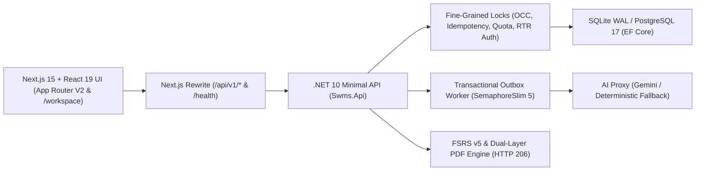

# SWMS (Studxy) — Sovereign Study Workspace & AI Course Platform

**SWMS (Studxy)** is a production-ready **Modular Monolith** full-stack learning platform engineered for high-concurrency multi-user workloads, deep PDF annotation, bidirectional Personal Knowledge Management (PKM), server-authoritative **FSRS v5** spaced repetition, and AI-assisted course/quiz generation.

Built with **.NET 10 Minimal API**, **EF Core**, **Next.js 15 (React 19 / TypeScript)**, **Zustand**, **PDF.js**, and **Playwright E2E**.

---

## Key Engineering Highlights

1. **Optimistic Concurrency Control (OCC) with Zero Data Loss (`HTTP 409 Keep-Both`)**
   - Serializes resource updates using fine-grained `ConcurrentDictionary<Guid, SemaphoreSlim>` locks (`NotebookOccLocks`, `NotebookAutoProvisionLocks`).
   - Under 20 concurrent auto-save updates (`baseVersion = 1`), exactly **1 writer** advances cleanly (`200 OK` to `v2`) while **19 concurrent writers** cleanly receive `409 CONFLICT_KEEP_BOTH` and fork preserved drafts into `notebook_conflict_drafts` (**`OCC p95 = 61.05ms`**, **`p99 = 62.14ms`** across 30 Virtual Users).

2. **Server-Authoritative FSRS v5 Engine & Idempotent Offline Replay**
   - Computes spaced-repetition memory states with server-authoritative clock-skew validation, chronological offline replay, single-step `Undo`, and `reviewEventId` idempotency (`FlashcardSyncLocks`).
   - Applies per-connection SQLite performance & durability PRAGMAs via `SqlitePragmaConnectionInterceptor` (`WAL`, `synchronous=NORMAL`, `temp_store=MEMORY`, `busy_timeout=5000`, `wal_autocheckpoint=20000`, `cache_size=-64000`) plus `SqliteFlashcardWriteLock`, maintaining **`p95 = 60.31ms` / `p99 = 62.30ms`** under 30-VU review burst load.

3. **Transactional Outbox Worker & Atomic AI Quota Ledger**
   - Decouples heavy AI essay rubric grading and curriculum generation using a **Transactional Outbox Background Worker** (`SemaphoreSlim(5)`).
   - Enforces a strict daily AI credit ceiling atomically via `AiQuotaLocks` before invoking the upstream LLM proxy — releasing credits on failure and immediately rejecting excess burst traffic with **`HTTP 429 Too Many Requests`** (`0` quota overspend; deterministic Vietnamese fallback when the local proxy is offline).

4. **Dual-Layer PDF.js Reader (`HTTP 206` Streaming) & 3-Tier Self-Healing Annotations**
   - Streams multi-hundred-page PDF textbooks (tested on 298-page PDFs) via **`HTTP 206 Partial Content`** range requests.
   - Provides synchronized 3-mode viewing (`Song song` / `Bản in PDF` Canvas / `Văn bản` extracted prose), unaccented Vietnamese hybrid search (`"bo nho ao"` matching `"Bộ nhớ ảo"`), 5-color highlights, Cloze card capture, and **3-Tier Self-Healing Annotation Reconciliation**.

5. **Multi-Tenant Data Isolation & Refresh Token Rotation (RTR)**
   - Enforces strict per-resource ownership checks (`IsOwnerOrDefaultSeededAccess`) across documents, range file streams, notebooks, Markdown exports, and practice quizzes (**`0` data leaks** across 60 cross-tenant IDOR probes).
   - Implements JWT + **Refresh Token Rotation (RTR)** with Grace Window replay-attack detection.

---

## System Architecture



### Multi-Surface Routing (Top-Down 4-Level Sitemap + Classic Workspace)
- **Public & Auth:** `/` (`LandingPageV2`), `/auth` (Registration, Login, Quick Multi-Tenant Demo Switcher)
- **V2 Top-Down Sitemap Shell:** `/app`, `/app/courses`, `/app/courses/new`, `/app/courses/[id]`, `/app/courses/[id]/learn`, `/app/courses/[id]/quiz`, `/app/documents`, `/app/notes`, `/app/library`, `/app/settings`
- **Classic PKM Workspace:** `/workspace` (Synced bidirectionally via Sidebar and `Ctrl+K` Command Palette)

---

## Verified Load Benchmark & Automated Test Results

All metrics below are from **two consecutive Double Clean Pass runs** of [`scripts/verify.ps1`](scripts/verify.ps1) against the compiled `.NET 10` Release binary (`30 Virtual Users`, `377 HTTP requests` in [`scripts/benchmark-multiuser.mjs`](scripts/benchmark-multiuser.mjs)):

- **Clean Pass 1 (`20261116-155213`, `285.95s`, Exit Code `0`):** `68/68` Backend xUnit, `6/6` Multi-User Benchmark Scenarios (`S4 p95 = 68.71ms`), `129/129` Playwright E2E across 11 suites.
- **Clean Pass 2 (`20261116-155713`, `301.18s`, Exit Code `0`):** `68/68` Backend xUnit, `6/6` Multi-User Benchmark Scenarios, `129/129` Playwright E2E across 11 suites.

### Multi-User Load Benchmark (Pass 2 — `30 VUs / 377 Requests`)

| Scenario | Requests | Throughput | `p50` | `p95` | `p99` | Verification Result |
| :--- | :---: | :---: | :---: | :---: | :---: | :--- |
| **S1: Concurrent Registration & Duplicate Email Race** | 60 | 83.16 req/s | 21.63ms | 383.24ms | 696.10ms | `30/30` registered; duplicate race: `1` (`200`) + `29` blocked (`409`) |
| **S2: Multi-Tenant Data Isolation (IDOR Audit)** | 64 | 39.02 req/s | 19.49ms | 978.49ms | 991.63ms | `0` cross-tenant leaks across IDOR probes (`50` x `403 Forbidden`) |
| **S3: Notebook Auto-Save Concurrency & OCC 409** | 40 | 238.27 req/s | 54.92ms | 74.69ms | 77.20ms | **OCC `p95 = 61.05ms`**, `1` (`200 v2`) + `19` Keep-Both forks (`409`) |
| **S4: FSRS v5 Burst Sync, Idempotency & Undo** | 62 | 233.53 req/s | 51.03ms | 60.31ms | 62.30ms | **FSRS `p95 = 60.31ms`** (`< 200ms` SLO), idempotent replay & `Undo` |
| **S5: PDF Range Streaming (`HTTP 206`) & Hybrid Search** | 90 | 38.42 req/s | 1391.61ms | 2303.03ms | 2337.06ms | `30/30` `HTTP 206 Partial Content`; `30/30` unaccented Vietnamese search |
| **S6: AI Daily Credit Quota Ceiling Guard** | 61 | 6.59 req/s | 3055.74ms | 3134.22ms | 3136.07ms | `50` (`200 OK`) + `10` burst throttled (`429`), `0` quota overspend |
| **Overall Workload** | **377** | **26.14 req/s** | **70.52ms** | **3103.39ms** | **3134.22ms** | `200: 239`, `206: 30`, `403: 50`, `409: 48`, `429: 10`, **`0` `5xx` errors** |

> For full architecture diagrams, lock tables, and verification breakdowns, see [ARCHITECTURE_EVALUATION.md](ARCHITECTURE_EVALUATION.md).

---

## Quick Start

### 1. Run Locally in Production Mode (Windows PowerShell)
```powershell
powershell -ExecutionPolicy Bypass -File scripts/start-prod.ps1 -OpenBrowser
```
Builds `.NET 10` Release + Next.js Production bundle, verifies `/health` on ports `5080` and `3000`, and opens `http://127.0.0.1:3000/app`.

### 2. Run Full Verification Suite (`68` xUnit + `30-VU` Benchmark + `129` E2E)
```powershell
powershell -ExecutionPolicy Bypass -File scripts/verify.ps1
```

### 3. Deploy with Docker Compose (`PostgreSQL 17` + `Backend` + `Frontend`)
Copy [`.env.example`](.env.example) to `.env`, configure secrets (`JWT_SECRET_KEY`, `POSTGRES_PASSWORD`, `CORS_ALLOWED_ORIGINS`), and follow [`DEPLOY.md`](DEPLOY.md):
```bash
docker compose -f docker-compose.prod.yml up -d --build
```

---

## Repository Structure

```text
Studxy (SWMS)/
├── backend/
│   ├── src/Swms.Api/               # .NET 10 Minimal API, EF Core, FSRS v5, Outbox Worker
│   ├── tests/Swms.Tests/           # 68 xUnit unit & multi-user concurrency tests
│   └── Dockerfile                  # Multi-stage ASP.NET Core 10 container build
├── frontend/
│   ├── src/app/                    # Next.js 15 App Router (/, /app/*, /workspace, /auth)
│   ├── src/components/             # PDF.js Dual-Layer Reader, FSRS UI, Command Palette
│   ├── e2e/                        # Playwright E2E test suites (11 suites / 129 tests)
│   └── Dockerfile                  # Standalone Next.js production container build
├── scripts/
│   ├── verify.ps1                  # Automated Release build, xUnit, 30-VU benchmark & E2E runner
│   ├── start-prod.ps1              # Windows production build, startup & health probe script
│   └── benchmark-multiuser.mjs     # 30-VU concurrent load & security isolation suite
├── docs/SITEMAP.md                 # Top-Down 4-Level V2 Navigation Specification
├── ARCHITECTURE_EVALUATION.md      # Full Double Clean Pass verification & performance report
├── DEPLOY.md                       # Production Docker Compose & environment guide
├── docker-compose.prod.yml         # PostgreSQL 17 + Backend + Frontend orchestration
└── PROJECT.md                      # Functional & non-functional design overview
```

---

## Current Scope & Notes
- Automated verification runs against isolated per-run SQLite WAL databases; Docker Compose + live PostgreSQL 17 container startup and live external LLM proxy calls (`127.0.0.1:8045`) are documented in [DEPLOY.md](DEPLOY.md) and [ARCHITECTURE_EVALUATION.md](ARCHITECTURE_EVALUATION.md) as unverified in the Windows local test runner.
- Multi-instance horizontal scaling on PostgreSQL requires pairing the in-process `SemaphoreSlim` guards with PostgreSQL `UNIQUE` constraints and row-level locking (`SELECT ... FOR UPDATE`).
