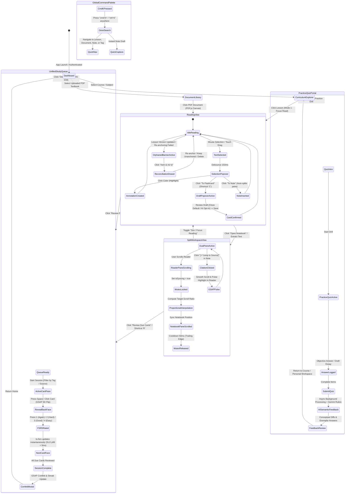

# SWMS: STUDY WORKSPACE MANAGEMENT SYSTEM
## MASTER ARCHITECTURAL & DEVELOPMENT SPECIFICATION PROMPT

> **Version**: 2.2.0 (Production-Grade Architecture Specification + Product Review Amendments)  
> **Target Release**: SWMS v1.0 Enterprise & Academic Edition  
> **Authoritative Baseline**: Synthesized from Architectural Research (R1, R2), Competitive Market Benchmarks (R3), UI/UX Specifications (R4), and Feature Gap Roadmap (R5).  
> **Status**: Accepted & Active Master Prompt

> [!IMPORTANT]
> **v2.2.0 Product Review Amendments (2026-10-31)** — Outcome of a product/business/UI grill-me review. Governing records: **ADR-019** (Hybrid Persona & Personal Workspace), **ADR-020** (Tag-Based Unified Review Queue, no Decks in v1.0), **ADR-021** (v1.0 Core-Loop Scope Cut & Deferral of Formal Exams), **ADR-022** (v1.0 "Resilient Online" Offline Model & Keep-Both Conflict Resolution). Sections amended: 1.4–1.5 (new), 3 (B, F, H), 4, 5.1, 5.3, 5.8, 5.9–5.12 (new), 8.2, 9, 10, 12, 13.2–13.4. Superseded v2.1.0 text is preserved in clearly labelled *Superseded* blocks for traceability.

---

## 1. ROLE & MISSION

### 1.1 Executive Role
You are the **Lead Software Architect & Principal Engineer** responsible for specifying, building, and maintaining **SWMS (Study Workspace Management System)**. Every implementation, code file, database migration, and interface must adhere strictly to the engineering rules, architectural contracts, and UX standards defined in this Master Prompt.

### 1.2 Core Mission: Eliminating Cognitive Friction in Learning
Current educational technology is fundamentally fragmented. Students and knowledge workers suffer from continuous cognitive friction by toggling between four disconnected software categories:
1. **Document Readers**: Adobe Acrobat, browser PDF viewers, Pocket (read without deep synthesis).
2. **Annotation Extractors**: Readwise, browser extensions (highlights trapped in silos).
3. **Note-Taking & PKM**: Notion, Obsidian, RemNote (notes severed from original source context).
4. **Spaced Repetition & Assessment**: Anki, Quizlet, LMS exam portals (manual flashcard creation overhead, high abandonment).

```
TRADITIONAL FRAGMENTED WORKFLOW (HIGH COGNITIVE LOAD & CONTEXT LOSS):
[PDF/Course Reader] --(manual copy-paste)--> [Notion/Obsidian] --(manual card typing)--> [Anki] --(separate login)--> [Exam Portal]

SWMS UNIFIED STUDY ECOSYSTEM (ZERO FRICTION & CONTINUOUS FLOW):
┌──────────────────────────────────────────────────────────────────────────────────────────────────┐
│                                    SWMS UNIFIED WORKSPACE                                        │
│  [Deep Reader Mode]  <=======>  [Split Workspace PKM]  <=======>  [Active Recall FSRS & Practice]│
│   • 68ch Ergonomics              • Sovereign Freeform Notebooks    • Unified Queue + Tag Filters │
│   • 5 Semantic Color Keys        • M:N Bidirectional Backlinks     • FSRS v5 3D Flip Card Engine │
│   • PDF & Lesson Dual Ingest     • Synchronized Scroll Mutex       • Formative AI Rubric Quiz    │
└──────────────────────────────────────────────────────────────────────────────────────────────────┘
```

**SWMS delivers a unified, zero-distraction educational operating environment**:
- **Unified Study Flow**: Ingest (PDF/Markdown) $\to$ Reading & Semantic Highlighting $\to$ Freeform Synthesis & Citations $\to$ FSRS Spaced Repetition (Unified Queue) $\to$ Formative Practice Quizzes.
- **Deep Contextual Anchoring**: Every note, flashcard, and quiz item maintains an immutable cryptographic and relational anchor (`ref_annotation_id`, `ref_block_id`, `source_quote`) linking directly back to the exact passage in the course curriculum or ingested PDF document.
- **High Performance & Sovereign Data**: Combining server-authoritative PostgreSQL 17 relational integrity with zero-latency client-side FSRS evaluation (`ts-fsrs`) and optimistic offline caching (IndexedDB).

### 1.3 Competitive Benchmark Matrix & Architectural Lessons (Requirement R3)

To ensure SWMS achieves industry-leading caliber, the platform synthesizes best-of-breed architectural paradigms from the six premier learning and PKM platforms: **Readwise Reader**, **RemNote**, **Obsidian**, **Notion**, **MarginNote 4**, and **Heptabase**.

#### 1.3.1 Comprehensive 6-Tool x 12-Dimension Benchmark Matrix

| # | Evaluation Dimension | Readwise Reader | RemNote | Obsidian | Notion | MarginNote 4 | Heptabase | **SWMS Architectural Standard** |
|---|---|---|---|---|---|---|---|---|
| **1** | **Core Positioning & Segment** | Read-it-later & Ingestion Hub (PDF, EPUB, Web, RSS) | All-in-one Learning: Outliner + Flashcard SRS | Second Brain PKM: Local-first Markdown Graph | All-in-one Workspace: Docs, Relational DB, Wiki | Academic Deep Reading & PDF/EPUB Mind Mapping | Visual PKM: Infinite Whiteboard + Atomic Cards | **Integrated Educational Workspace**: Deep Reader + Unified PKM + Native FSRS v5 + AI Rubric Assessment |
| **2** | **Ingestion & Document Processing** | Exceptional (HTML Readability, 1000p PDF, EPUB, YouTube transcripts) | Good (PDF reader split-view, web clippers) | Basic (Native PDF viewer is rudimentary; requires community plugins) | Poor (PDFs as static file attachments, no margin notes) | Outstanding (PDF/EPUB, OCR book scanning, rect crop) | Good (Split-screen PDF reader, text/rect card extraction) | **Production Ingestion Engine**: Native Lesson AST + PDF.js Split-Screen + Background OCR (.NET 10 Channel) + AI Summarizer |
| **3** | **Highlighting & Annotation Mechanism** | DOM text selector, range offsets, notes, tags | PDF page coordinate anchoring & text offset | Plugin-dependent (PDF++, Annotator), text offset strings | Block comments or inline background color styling | Spatial Bounding Box Rect + Text character offsets | Bounding Box Rect + Text anchor on PDF pages | **Hybrid W3C Selectors**: Exact/Prefix/Suffix quote strings + stable `block_id` + PDF Bounding Box coordinates |
| **4** | **Synthesis / Note-taking Paradigm** | Marginalia notes & lightweight document notebook | Hierarchical Outliner (Rems bullet tree) | Flat Markdown documents + Infinite Canvas | Block-based modular document tree | 2D Mind Map + Document Outline | Infinite Whiteboard Canvas + Atomic Cards | **Linear Rich Document (Tiptap ProseMirror JSON AST)** + Embedded Citation Cards + Contextual Graph |
| **5** | **Spaced Repetition (SRS) Integration** | Limited (Basic daily highlight review; delegates to Anki) | Deeply Native (Inline syntax `::`, `==`, FSRS & SM-2) | Community plugin dependent (Flashcards / SRS plugin) | Third-party only (Notion2Anki sync integrations) | Deeply Native (Mind map card to FSRS flashcard projection) | None (Pure visual sense-making focus) | **Native FSRS v5 Engine**: Local client `ts-fsrs` evaluation (target p99 < 5ms, see §13.5) + 3D flip card + C# server authoritative weight optimization |
| **6** | **Knowledge Linking & Graph** | Flat tags + 1-way sync to external PKMs | Bi-directional links, Rem reference, Portals | Bi-directional `[[wikilinks]]`, Block embed, 2D/3D Graph | Bi-directional `@page`, Synced Blocks (Transclusion) | Title Links (Auto keyword linking), Card link | Visual relation lines, nested whiteboards | **Bi-directional `[[wikilinks]]`** + Transclusion (`ref_block_id`) + Asynchronous Backlinks Indexer (`notebook_links`) |
| **7** | **Data Storage Architecture** | Cloud-first (PostgreSQL backend + PWA IndexedDB) | Hybrid Local-first (Desktop SQLite/PGlite, Web IndexedDB) | Pure Local-first (Plain text `.md` files on local drive) | Cloud-first (Sharded PostgreSQL by workspace) | Local-first (Native Apple CoreData / SQLite DB) | Local-first (Local SQLite on Electron desktop) | **Cloud-first with Optimistic Offline**: PostgreSQL 17 JSONB + pgvector HNSW + Client IndexedDB Mutation Queue |
| **8** | **Sync & Offline Model** | Background Sync API / REST highlight delta | Offline mutation queue -> WebSocket/REST sync | Obsidian Sync (E2E Encrypted chunk diff) or Git/iCloud | `saveTransactions` API batching + RecordCache | Apple CloudKit sync / WebDAV / Wi-Fi local sync | Custom WebSocket sync protocol via AWS servers | **Optimistic Debounced Save** + Versioning ETag + Client Mutation Queue (IndexedDB) + PWA Service Worker |
| **9** | **Conflict Resolution Strategy** | Last-Write-Wins (LWW) per highlight entity | Granular node-level tree merge on Rems | File merge / Git merge / `.sync-conflict` duplicates | Transaction version check + Block-level OT | CloudKit record merge (prone to branching on network jitter) | Last-Write-Wins on card metadata + Transaction merge | **Field-level Optimistic Concurrency Control (OCC)** (`version` column) + `navigator.locks` Single-Writer Protection |
| **10** | **AI Engine Integration** | Ghostreader: In-context explain, vocab, Q&A | AI Assistant: Auto flashcards from outliner notes | Third-party plugins (Smart Connections, Copilot) | Notion AI: Writing assistant, Q&A across docs | Basic AI (Text summary, translation via external API) | Hybrid semantic search (Turbopuffer vector index) | **Deep In-Context AI Pipeline**: Asynchronous Bounded Channel (`Channel<T>`), semantic rubric essay evaluation, FSRS weight tuning |
| **11** | **Data Sovereignty & Portability** | Open API, Webhooks, auto-export to Notion/Obsidian | Export to Markdown, Anki `.apkg`, JSON backup | Maximum sovereignty (100% open Markdown, no lock-in) | Export Markdown/CSV/PDF, rate-limited REST API | Export to Anki `.apkg`, PDF with notes, Mind Map image | Export Markdown, JSON, Whiteboard vector SVG | **Open Multi-Format Hub**: Export to Anki `.apkg` (full FSRS state), Markdown YAML Frontmatter, CSS Paged Print PDF |
| **12** | **Business Model & Pricing** | Fixed monthly subscription ($7.99 - $9.99/mo) | Freemium + Pro Subscription ($8 - $10/mo) | Free core; Paid Sync ($4/mo) & Publish ($8/mo) | Freemium tiered + AI Add-on ($8 - $10/user/mo) | Upfront perpetual license ($12 - $15) or v4 upgrade | Fixed subscription ($10 - $12/mo) | **Freemium Academic/Enterprise**: Free student core; tiered AI tokens & cloud storage quotas |

#### 1.3.2 Core Architectural Lessons Synthesized for SWMS

1. **From MarginNote 4: "Cards as the Axis" & Spatial Bounding Box Anchoring**
   - *Architectural Insight*: MarginNote 4 demonstrates that learners should never manually duplicate knowledge. An excerpt highlighted in a document (PDF or Lesson) is not merely passive text—it is a discrete knowledge atom projecting into three views: (1) an anchor in the original document, (2) a synthesis node in a notebook, and (3) an active recall flashcard in a study deck.
   - *SWMS Application*: SWMS adopts this triad. Highlights store both W3C TextQuoteSelectors (`exact_quote`, `prefix_quote`, `suffix_quote`) and spatial coordinates (page number and bounding-box rect for PDFs). Flashcards reference `annotation_id` via `ON DELETE SET NULL`, ensuring the card permanently survives even if the underlying highlight is removed.

2. **From RemNote: Zero-Friction Outliner-to-SRS Transformation**
   - *Architectural Insight*: Requiring learners to leave their note-taking canvas and launch a separate flashcard app (like Anki) introduces severe friction, resulting in an ~80% abandonment rate. RemNote solved this through dual-purpose concept blocks and inline syntax (`::` for two-sided cards, `==` for cloze deletion).
   - *SWMS Application*: SWMS integrates native Tiptap node extensions (`flashcardBlock`, `clozeMark`) and slash command `/flashcard`, allowing instant conversion of lecture notes and highlights into active recall items without leaving the flow state.

3. **From Readwise Reader: High-Speed Ingestion Triage & Context-Bound Ghostreader**
   - *Architectural Insight*: General-purpose chatbot sidebars (floating ChatGPT widgets) create cognitive distraction because they lack precise context. Readwise's Ghostreader succeeds because it attaches directly to highlighted text selections with single-key action shortcuts.
   - *SWMS Application*: SWMS implements an in-situ selection toolbar with 5 semantic colors and dedicated one-click AI action popovers ("Explain Concept", "Generate Flashcard", "Find Counter-Example", "Translate"). Long document ingestion runs in background .NET channels to prevent client freezing.

4. **From Heptabase: Visual Sense-Making & Atomic Knowledge Cards**
   - *Architectural Insight*: Hierarchical folders and flat lists fail for complex conceptual synthesis. Human memory thrives on spatial relationships (spatial sense-making) where atomic cards are manipulated across a 2D canvas.
   - *SWMS Application*: SWMS standardizes notes on atomic Tiptap ProseMirror documents (`notebooks.content_ast`) with embedded citation cards, preparing the architectural data layer for Phase 4 visual whiteboard expansion.

5. **From Obsidian: Bi-directional Links (`[[wikilinks]]`), Transclusion, and Data Sovereignty**
   - *Architectural Insight*: Knowledge is an interconnected graph, not a tree of isolated silos. Bi-directional links (`[[page]]`) and block transclusion (`![[note#^block]]`) allow dynamic knowledge traversal. Furthermore, learners demand open data formats to prevent vendor lock-in.
   - *SWMS Application*: SWMS implements `[[wikilinks]]` autocomplete in Tiptap, an asynchronous backlinks indexer (`notebook_links`), and full-fidelity export to standard Markdown with YAML frontmatter and Anki `.apkg` packages.

6. **From Notion: Universal Block Schema while Rejecting Normalized Relational Storage**
   - *Architectural Insight*: While Notion's universal block UX is beloved, its underlying database architecture—normalizing every block into a separate database row—causes crippling write amplification, transaction lock contention, and high latency on documents with thousands of blocks.
   - *SWMS Application*: SWMS preserves Notion's intuitive slash-command block experience on the frontend, but fundamentally departs at the storage layer: persisting entire notebook pages as a single, compressed JSONB document (`content_ast`), eliminating per-block row locking and write amplification. Auto-save latency is governed by the measurable SLO in §13.5 (p95 < 50ms, p99 < 150ms) rather than unverified claims.

### 1.4 Product Positioning, Target Personas & Language Strategy (Decisions 1, 7)

#### 1.4.1 The Hybrid Learning Workspace Model
Traditional educational platforms enforce a rigid duality: they are either pure personal note-taking tools without institutional structure (Obsidian, Notion) or rigid Learning Management Systems (LMS) where learners have no sovereign autonomy outside instructor-assigned courses (Canvas, Blackboard, Moodle).

SWMS resolves this dichotomy through the **Hybrid Learning Workspace Model**:
1. **Personal Workspace by Default (Sovereign Core)**:
   - Every learner account initializes with a sovereign Personal Workspace.
   - Learners can immediately ingest arbitrary external materials—PDF textbooks, research papers, Markdown notes, lecture slides—without creating, joining, or paying for an academic course.
   - All highlights, freeform notebooks, tags, and FSRS spaced repetition flashcards authored in the Personal Workspace remain the permanent intellectual property of the learner.
2. **Instructor-Led Courses as Structured Extensions**:
   - Academic institutions and instructors author formal courses containing structured chapters, lessons, versions, and formative practice quizzes.
   - When an enrolled student studies a course lesson, their personal annotations, highlights, and flashcards remain private and sandboxed. Course enrollment simply acts as an additional structured source of truth within the learner's broader knowledge base.

```
┌──────────────────────────────────────────────────────────────────────────────────┐
│                         SWMS HYBRID WORKSPACE ARCHITECTURE                       │
├────────────────────────────────────────┬─────────────────────────────────────────┤
│    SOVEREIGN PERSONAL WORKSPACE        │     INSTRUCTOR COURSE EXTENSIONS        │
│    (Default for All Learners)          │     (Optional Cohort / Academic Layer)  │
├────────────────────────────────────────┼─────────────────────────────────────────┤
│ • Uploaded PDF Textbooks & Papers      │ • Instructor-Authored Curricula         │
│ • Freeform Synthesis Notebooks         │ • Structured Chapters & Lessons         │
│ • Tag-Based Unified FSRS Review Queue  │ • Multi-Version Lesson Releases         │
│ • Private 5-Color Semantic Highlights  │ • Cohort Practice Quizzes               │
│ • Personal Study Heatmap & Analytics   │ • Curated Course Resource Packs         │
└────────────────────────────────────────┴─────────────────────────────────────────┘
```

#### 1.4.2 Target Personas
SWMS is engineered for two primary archetypes:
1. **Primary Persona — Autonomous Self-Learner / Technical Professional ("Người Tự Học Chuyên Sâu")**:
   - *Profile*: Software engineers, medical students, graduate researchers, and lifelong learners studying complex, high-density domains.
   - *Core Pain Point*: High friction when converting dense reading materials into active recall flashcards; tools lose the bidirectional link between Anki cards and original PDF pages.
   - *Primary SWMS Flow*: Ingest PDF/Markdown $\to$ Highlight with 5 semantic keys $\to$ Auto-create Cloze flashcards via Draft Popover $\to$ Synthesize in Freeform Notebook $\to$ Daily FSRS review via Tag filters.
2. **Secondary Persona — Academic Cohort Student ("Sinh Viên Theo Khóa Học")**:
   - *Profile*: University or college students enrolled in structured semester courses.
   - *Core Pain Point*: Fragmented lecture slides, LMS announcements, scattered notes, and cramming before midterms without retention.
   - *Primary SWMS Flow*: Access instructor lessons $\to$ In-situ highlighting with scroll-synchronized split note $\to$ Formative practice quizzes with AI rubric feedback $\to$ Long-term exam retention.

#### 1.4.3 Vietnamese Primary & Internationalization Strategy (i18n)
1. **Primary Audience & Language Priority**:
   - The primary target market for SWMS v1.0 is Vietnamese students, educators, and knowledge workers.
   - **Bilingual Interface**: The web application defaults to Vietnamese (`vi-VN`) with comprehensive English (`en-US`) support via `next-intl`. All UI labels, tooltips, error messages, and onboarding guides must maintain complete Vietnamese localization.
2. **Vietnamese Text Processing & Full-Text Search Architecture**:
   - Standard PostgreSQL full-text search (`tsvector`) does not provide a native Vietnamese dictionary, leading to recall collapse on accented words.
   - SWMS implements a multi-tier search pipeline:
     - **Unaccent Normalization**: The PostgreSQL `unaccent` extension strips diacritical marks during indexing and query compilation, ensuring unaccented search queries (e.g., `bo nho ao`) match accented source text (`bộ nhớ ảo`).
     - **Trigram Similarity (`pg_trgm`)**: Composite indexes on `(f_unaccent(title) gin_trgm_ops)` provide high-speed typo-tolerant fuzzy matching across Vietnamese phrases.
     - **Hybrid Semantic Search**: Combines pgvector HNSW embeddings (multilingual 768-dim models) with trigram lexical search via Reciprocal Rank Fusion (RRF), guaranteeing high precision across mixed Vietnamese-English technical terminology.
3. **Language-Adaptive AI Copilot & Rubric Evaluation**:
   - The background AI assistant (Gemini/LLM) dynamically detects the primary language of the source document and learner query.
   - Responses default to Vietnamese for Vietnamese materials, and English for English research papers, with explicit support for Vietnamese explanations of English technical concepts.
4. **Text-to-Speech (TTS) Localization**:
   - Web Speech API synthesizes Vietnamese speech utilizing native browser neural voices (`vi-VN`). When unavailable, the client gracefully falls back to available operating system voices without blocking playback.

---

### 1.5 Product Metrics, Onboarding Flow & Activation Funnel (Decision 10)

#### 1.5.1 North Star Metric & Core Retention KPIs
- **North Star Metric**: **Weekly Active Retained Learners (WARL)** — Defined as unique users who complete $\ge 1$ FSRS active recall review session and synthesize $\ge 50$ words of notes per week.
- **Activation Metric (The "Aha!" Moment)**:
  $$\text{Activation} \iff \text{User completes } \ge 1 \text{ FSRS card review within } 48 \text{ hours of account registration.}$$
  *Rationale*: Completing an active recall review closes the cognitive loop (Reading $\to$ Extraction $\to$ Testing), proving value and establishing the spaced repetition habit.
- **Core Lifecycle Retention Benchmarks**:
  - **Day 1 Retention (D1)**: Target $\ge 40\%$ (User returns within 24h to read or capture notes).
  - **Day 7 Retention (D7)**: Target $\ge 25\%$ (User completes $\ge 3$ FSRS review sessions in week 1).
  - **Day 30 Retention (D30)**: Target $\ge 15\%$ (User maintains active review streak into month 2).
  - **Review Compliance Rate**: Target $\ge 80\%$ of cards reviewed within $\pm 24\text{h}$ of scheduled `due_at`.

#### 1.5.2 3-Step Guided Onboarding Flow
To eliminate blank-slate paralysis and guarantee 48-hour activation, new accounts follow an automated, interactive zero-to-one onboarding sequence:

```
┌─────────────────────────────────────────────────────────────────────────────────┐
│                     SWMS 3-STEP ZERO-TO-ONE ONBOARDING FUNNEL                   │
├─────────────────────────────────────────────────────────────────────────────────┤
│                                                                                 │
│   [ STEP 1: PRELOADED SOURCE ]        [ STEP 2: GUIDED DISCOVERY ]              │
│   • Auto-provision sample source:      • Interactive checklist on Dashboard     │
│     "Hệ điều hành: Kiến trúc           • Highlight sentence with 🟡 Core Key    │
│      Bộ nhớ ảo & Phân trang"           • Click "⚡ To Flashcard" -> Draft Popover│
│   • Instant Reading Mode access       • Confirm instant Cloze card              │
│                                                                                 │
│                                         [ STEP 3: ACTIVATION REVEAL ]           │
│                                         • Auto-route to Review Mode             │
│                                         • Flip card (Space) & Rate "Good" (3)   │
│                                         • 🎉 GSAP Celebration Confetti          │
│                                         • Unlock custom PDF/Doc uploader        │
└─────────────────────────────────────────────────────────────────────────────────┘
```

1. **Step 1 — Zero-Friction Content Provisioning**:
   - New accounts automatically receive a pre-loaded, high-yield Vietnamese sample source in their Personal Workspace: *"Hệ điều hành: Kiến trúc Bộ nhớ ảo & Phân trang"* (accompanied by diagrams and structured headings).
2. **Step 2 — In-Situ Extraction Checklist**:
   - A non-intrusive floating checklist guides the learner through 3 micro-actions:
     1. *Highlight*: Select any text passage and apply the Yellow (`🟡 Khái niệm cốt lõi`) semantic highlight.
     2. *Extract*: Click the `⚡ To Flashcard` button on the selection toolbar, review the auto-generated Cloze draft popover, and click `Save Card`.
     3. *Synthesize*: Open Split Mode (`Ctrl + \`) and type a 1-sentence note linking to the citation.
3. **Step 3 — Activation Milestone & Celebration**:
   - The user is prompted: *"Bạn đã sẵn sàng ôn tập thẻ đầu tiên?"*
   - Clicking `Bắt đầu ôn tập` opens Review Mode, where the learner flips the card and selects rating `Good`.
   - The system logs the **Activation Event** in `ai_usage_ledger` / analytics, fires the GSAP celebratory confetti effect, initializes the 1-day streak badge, and unlocks full PDF file upload capabilities.

---

## 2. TECHNOLOGY STACK MATRIX

| Layer | Technology | Version / Specification | Architectural Rationale & Standards |
|---|---|---|---|
| **Frontend Framework** | **Next.js** | `v15.2+` (App Router) | React Server Components (RSC), Turbopack bundler, edge-ready middleware, streaming SSR. |
| **UI Library & Runtime** | **React** | `v19.0+` | Native `useActionState`, `useOptimistic`, server actions, enhanced ref prop lifecycle. |
| **Styling & Design Tokens** | **TailwindCSS** | `v4.0+` | Native CSS directive `@theme`, zero-config build, CSS variable design tokens, modern subgrid. |
| **Component Primitives** | **Shadcn/ui & Radix UI** | Latest Primitives | Unstyled, fully accessible (WAI-ARIA compliant), keyboard-navigable UI components. |
| **Rich Text Editor Engine** | **Tiptap / ProseMirror** | `v2.10+` (ProseMirror Core) | Structured JSON AST, schema-driven leaf-node inline marks, custom node extensions, collaborative-ready. |
| **Motion & Micro-interactions**| **GSAP & @gsap/react** | `v3.12+` | Hardware-accelerated transitions, 3D card physics, `useGSAP` hook with automated garbage collection. |
| **Backend Runtime** | **.NET** | `10.0 LTS` | C# 13, Native AOT ready, high-throughput Kestrel server, non-blocking I/O runtime. |
| **Backend Architecture** | **Vertical Slice Architecture** | Wolverine / MediatR | Feature-folder isolation (`Features/{FeatureName}/`), CQRS command/query separation, minimal dependencies. |
| **API Endpoints** | **FastEndpoints & Minimal APIs**| Latest FastEndpoints | High-performance REPR (Request-Endpoint-Response) pattern, zero reflection overhead. |
| **Object-Relational Mapping** | **Entity Framework Core** | `10.0` | Strongly typed LINQ, compiled queries, native PostgreSQL JSONB mapping (`EF.Functions.JsonContains`). |
| **Concurrency & Queues** | **System.Threading.Channels** | `Channel<T>` | Bounded memory channels (`FullMode.Wait`) for resilient backpressure and producer-consumer AI pipelines. |
| **Primary Database** | **PostgreSQL** | `17.2+` | ACID transactional compliance, TOAST JSONB compression, declarative foreign key cascading. |
| **Vector Indexing Engine** | **pgvector** | `v0.8+` (HNSW) | Hierarchical Navigable Small World index (`m = 16`, `ef_construction = 128`), safe on empty tables. |
| **Spaced Repetition Engine** | **FSRS v5** | `ts-fsrs` & Custom C# | Free Spaced Repetition Scheduler v5 based on DSR model (Difficulty, Stability, Retrievability). |
| **Real-time Transport** | **SignalR / SSE** | HTTP/2 Streaming | Server-Sent Events for job progress; SignalR Hubs for multi-device sync and real-time alerts. |

---

## 3. CORE ARCHITECTURAL DECISIONS

### Decision A: Standardization of ProseMirror JSON AST and Leaf-Node Inline Marks (Bottleneck R1.1)
- **Problem**: Legacy offset-based annotation tables (`start_offset`, `end_offset` on raw plain text) create an impedance mismatch with ProseMirror/Tiptap's flat inline sequence model. Document editing causes immediate position drift and renders DOM slicing impossible.
- **Resolution**:
  1. Lessons and Notebooks store content natively as Tiptap ProseMirror JSON AST.
  2. **Multi-Tenant Content Separation**: For shared curriculum lessons, learner highlights are **NEVER** baked into `lessons.content_ast`. They are persisted in `annotations` and rendered dynamically in client memory using ProseMirror **`DecorationSet`**. For personal notebooks, inline marks or citation blocks are authored directly within the learner's private `notebooks.content_ast`.
  3. External relational indexing (`annotations` table) persists the **W3C Web Annotation Data Model (TextQuoteSelector)**: `exact_quote`, `prefix_quote`, `suffix_quote`, `block_id`, and character offsets measured strictly in **JavaScript UTF-16 Code Units** (matching DOM and ProseMirror positioning). An immutable `original_exact_quote` snapshot is preserved separately from any fuzzy-healed text.

### Decision B: Single JSONB Document Storage with Asynchronous Link Extraction for Notebooks (Bottlenecks R1.2 & R2.1)
- **Problem**: Storing notebook notes as normalized rows (`notebook_blocks`) with `sort_order` causes catastrophic write amplification and row-exclusive deadlocks (`40P01`) when users insert blocks or reorder content. Fractional indexing (float/lexorank) suffers from IEEE 754 precision underflow.
- **Resolution & Concurrency Mitigations**:
  1. The entire content of a notebook page is stored as a single JSONB document in `notebooks.content_ast`.
  2. **Optimistic Concurrency Control (OCC) & Mutation Contract**: Saving a notebook requires a structured mutation envelope:
     ```json
     {
       "mutation_id": "uuid-v4",
       "entity_id": "notebook-uuid",
       "base_version": 4,
       "device_id": "client-device-id",
       "client_timestamp": "2026-10-31T05:00:00Z",
       "content_ast": { ... }
     }
     ```
      Updates execute atomically: `UPDATE notebooks SET content_ast = @ast, version = version + 1, updated_at = NOW() WHERE id = @id AND version = @expected_version;`. On version conflict (`409 Conflict`), the server automatically preserves the incoming payload by creating a conflict copy fork (`Bản sao xung đột - YYYY-MM-DD HH24:MI`) and logging a record into `notebook_conflict_drafts` with `resolution_status = 'kept_both'` per ADR-022. Three-way visual diff reconciliation is formally deferred to the v1.x Backlog.
   3. **Multi-Tab Coordination**: Tabs on the same origin coordinate via the `Web Locks API` (`navigator.locks.request('notebook_' + id, ...)`) combined with a `BroadcastChannel('swms_notebook_sync')`, ensuring only the active tab performs debounced saves while peer tabs listen for remote change events.
   4. **Defensive AST Rendering for Deleted Annotations**: When an annotation referenced in `content_ast` (`annotationRef`) is deleted, client-side rendering gracefully displays an `[Archived / Removed Source]` badge indicator instead of throwing unhandled 404/TypeError exceptions.
   5. Relational integrity and graph backlinks are maintained via an asynchronous background extractor that parses top-level custom attributes (`ref_annotation_id`, `ref_lesson_id`) and populates the auxiliary `notebook_links` table.

### Decision C: BFF Cookie-Based Session Architecture with Encrypted Refresh Token Rotation (Bottleneck R1.3)
- **Problem**: Stateless JWTs cannot be revoked upon logout. Storing refresh tokens in JavaScript memory or LocalStorage exposes them to XSS theft and prevents multi-tab session synchronization. Furthermore, storing only a SHA-256 hash of a refresh token in PostgreSQL makes it mathematically impossible for the server to return the plaintext replacement token during an idempotent grace window.
- **Resolution & Security Architecture**:
  1. **Backend-For-Frontend (BFF) Cookie Security**: Refresh tokens are issued exclusively inside an `HttpOnly`, `Secure`, `SameSite=Strict` cookie scoped to `/api/v1/auth/refresh`. Short-lived Access Tokens (15 minutes) reside in client memory closures.
  2. **Encrypted Replacement Persistence for Idempotent Grace (15–30 Seconds)**:
     - Refresh tokens are grouped by a cryptographically secure `family_id` (UUID). The DB record stores `token_hash = SHA256(raw_token)` alongside an `encrypted_replacement_token` encrypted with the server's AES-256-GCM master key.
     - When concurrent requests arrive during mobile packet drops or multi-tab reloads within the 15–30s leeway window, the server decrypts and returns the existing replacement token idempotently.
  3. **Breach Alarm (Replay Detection)**: If a revoked token is received outside the 30s grace window (or without a valid replacement link), the server triggers an active breach alert, revokes ALL tokens within that `family_id`, and increments `users.token_version`.
  4. **Cache Invalidation & Token Revocation**: Middleware verifies `token_version` against Redis with automated DB revalidation fallback (5-minute cache TTL) to guarantee access revocation even if Redis Pub/Sub experiences temporary network blips.

### Decision D: Foreign Key Cascading Strategy, Knowledge Preservation, and Soft Deletion (Bottleneck R1.4)
- **Problem**: Unregulated cascading deletes orphan data or irreversibly destroys learner intellectual property. Specifically, setting `ON DELETE CASCADE` on `flashcard_reviews(flashcard_id)` destroys months of spaced repetition history if a student deletes a card, wiping out the training dataset required for FSRS weight calibration.
- **Resolution & Data Safety Mitigations**:
  1. **Strict Compositional Cascade (`ON DELETE CASCADE`)**: Applied down curriculum containers: `courses -> chapters -> lessons`.
  2. **Review Ledger Protection (`ON DELETE RESTRICT`)**: `flashcard_reviews.flashcard_id` MUST use `ON DELETE RESTRICT`. Any attempt to hard-delete a flashcard that has review logs is rejected by the database.
  3. **Flashcard Soft-Delete Pattern (`is_archived`)**: Deleting a flashcard in the UI toggles `is_archived = true`, removing it from active review queues while preserving historical rows in `flashcard_reviews` for FSRS weight calibration.
  4. **Source Decoupling (`ON DELETE SET NULL`)**: `flashcards.annotation_id` and `notebooks.lesson_id` MUST use `ON DELETE SET NULL`. If an instructor removes a lesson or a student deletes a highlight, the flashcard retains its questions, answers, stability, difficulty, and review logs permanently.
  5. **Denormalized Snapshotting**: Flashcards store snapshot strings (`source_title_snapshot`, `source_quote_snapshot`) so curriculum context remains readable even if source entities are deleted.
  6. **GDPR Account Erasure (Anonymization)**: When a student requests account deletion, personal identifiers are purged, and historical review logs are anonymized (`user_id = NULL`) to preserve model training sets without violating privacy regulations.

### Decision E: Migration to HNSW Indexing with Iterative Filtering Scan (Bottleneck R1.5)
- **Problem**: IVFFlat requires an initial $k$-means training phase and degenerates on empty tables. Meanwhile, naive HNSW global graph search collapses to 0.0% recall when combined with highly selective post-filtering (e.g., `WHERE lesson_id = @id` selecting 0.1% of all chunks), because global candidates are pruned before evaluating filter predicates.
- **Resolution & Retrieval Mitigations**:
  1. Complete migration to **HNSW (Hierarchical Navigable Small World)** vector indexing: `USING hnsw (embedding vector_cosine_ops) WITH (m = 16, ef_construction = 128)`.
  2. **pgvector Iterative Index Scan**: Leverage pgvector 0.7.0+/0.8+ iterative index scan (`SET hnsw.iterative_scan = 'relaxed_order';`), allowing HNSW to iteratively traverse additional graph layers until $k$ filtered matches are satisfied, eliminating recall collapse.
  3. **Composite B-Tree & Query Planner Fallback**: A composite index `(lesson_id)` is maintained on `lesson_embeddings`. For single-lesson queries (`WHERE lesson_id = @lesson_id`), the query planner selects an exact vector scan (`ORDER BY embedding <=> @q LIMIT 5`), reserving HNSW for multi-lesson, chapter, or global curriculum searches, targeting $\ge 95\%$ recall across all query profiles.

### Decision F: Formative Practice Quizzes with AI Semantic Rubric Evaluation (Amended per ADR-021; Supersedes Legacy Exam Attempts)
- **Problem**: Formal high-stakes summative examinations with numerical passing scores, instructor proctoring, and letter grades are misaligned with self-directed study, introduce complex institutional dependencies, and risk launch delays for a focused 1–2 developer team.
- **Resolution (ADR-021)**:
  1. Replace formal summative exams with formative **Practice Quizzes** (`practice_quizzes`, `practice_quiz_items`) designed for low-stakes self-testing at the end of lessons or ingested documents.
  2. Track practice lifecycle via `status` (`in_progress`, `completed`, `abandoned`).
  3. Support objective items (`multiple_choice`, `cloze`, `short_answer`) with instant client validation and essay items evaluated via Gemini AI against semantic rubrics (highlighting key conceptual strengths, missing arguments, and concept diffs without assigning high-stakes numerical grades).
  4. Formal proctored examination engines, GPA calculators, and question bank management are formally deferred to the **v1.x Backlog**.

### Decision G: Fluid Resizable Split-Workspace Architecture (Bottleneck R1.7 & R4)
- **Problem**: Hardcoded pixel constraints (`580px - 650px`) waste 410px of dead space on standard 1920x1080 displays and overflow on smaller screens.
- **Resolution & Layout Mitigations**:
  1. Adopt `react-resizable-panels` with responsive Tailwind CSS v4 clamps.
  2. Standard 1080p Baseline: 15% Sidebar (288px) / 45% Reader (864px) / 40% Notebook (768px). Total available width accounts for resize handles via `calc(100vw - 8px)` to prevent horizontal scrollbar overflows on exact 1920px viewports.
  3. Supports double-click handle reset, `localStorage` persistence, and synchronized scrolling via relative anchor mapping.
  4. **Scroll-Sync Mutex with Trailing-Edge Dispatch & Proportional Fallback**: Mutual exclusion flag (`isSyncing`) with a 50ms cooldown, structured event tracking `{ sourcePane, anchorId, sequence }`, and proportional interpolation fallback prevents recursive ping-pong loops while guaranteeing smooth continuous scrolling across passages without highlights.
  5. **State Preservation Across Modes**: Practice quiz inputs and notebook editor drafts are isolated in persistent global state (Zustand persist / LocalStorage) to prevent data loss during mode switching.

### Decision H: Server-Side 3-Tier Self-Healing Fuzzy Matching with Pristine AST Preservation & Client DecorationSet (Design Question R2.2)
- **Problem**: When instructors edit lesson content, learner annotation offsets drift. Reconciling on client load causes UI freeze, non-deterministic rendering, and write storms. Crucially, attempting to re-inject individual student marks directly into the stored master `lessons.content_ast` creates a **catastrophic multi-tenancy defect**: Student B would see Student A's private highlights, and popular lessons would suffer from exponential payload bloat. Furthermore, naive SQL matching via `position(exact_quote in plain_text)` blindly anchors to the first occurrence if a quote appears multiple times.
- **Resolution & Multi-Tenant Isolation**:
  1. **Pristine Master Document**: The shared `lessons.content_ast` stored in PostgreSQL is an **immutable, pristine master document authored exclusively by the instructor**. Student-specific marks are **NEVER** baked into `lessons.content_ast`.
  2. **Disambiguated 3-Tier Self-Healing Algorithm**:
     - *Offset Standard*: Measured strictly in **JavaScript UTF-16 Code Units** matching Tiptap ProseMirror document coordinates.
     - *Tier 1 (Block-Scoped Exact Match)*: Evaluates `prefix_quote + exact_quote + suffix_quote` within the originating `block_id`. If unique, updates coordinates immediately.
     - *Tier 2 (Coordinate Shift via Myers Diff)*: Projects the coordinate shift vector $\Delta x$ within $\pm 250\text{ch}$.
     - *Tier 3 (Local Fuzzy Alignment via Smith-Waterman)*: If similarity $\ge 0.85$, updates coordinates and synchronizes `annotations.exact_quote`, `prefix_quote`, and `suffix_quote` in PostgreSQL to match the corrected text (e.g., fixed typos).
     - *Ambiguity & Orphan Detection*: If a quote appears multiple times and surrounding context cannot disambiguate with $\ge 90\%$ confidence, the system flags `status = 'needs_review'`. If the text was completely deleted, it flags `status = 'orphaned'`. An immutable `original_exact_quote` snapshot is preserved separately.
  3. **Client-Side ProseMirror DecorationSet Rendering**:
     - When a student opens a lesson, the client fetches the pristine `lessons.content_ast` and the student's personal annotations (`GET /api/v1/lessons/{id}/annotations`).
     - Tiptap dynamically applies the annotations as an in-memory **ProseMirror DecorationSet** (`Decoration.inline(start, end, { class: 'swms-highlight', 'data-annotation-id': id })`).
     - Guarantees 100% strict tenant privacy isolation, zero payload bloat, and efficient virtualized rendering.

### Decision I: Transactional DB-Backed Queue with In-Memory .NET 10 Channel Dispatch (Design Question R2.3)
- **Problem**: Relying solely on in-memory .NET `Channel<T>` means any server restart or pod crash permanently destroys all pending AI parsing and grading jobs. Furthermore, setting `FullMode.Wait` blocks HTTP request threads when the channel fills, violating SLA commitments.
- **Resolution & Durable Queue Architecture**:
  1. **PostgreSQL as Source of Truth**: Endpoints transactionally persist the job into `background_jobs` with status `queued` and an `idempotency_key` BEFORE returning `202 Accepted` with a `job_id`.
  2. **Local Dispatch Optimization**: The background service uses .NET 10 `Channel<T>` (`FullMode.DropWrite` or bounded buffer) strictly as a high-speed local wake-up notification mechanism to signal workers.
  3. **Durable Worker Leasing**: Background workers claim jobs using transactional row locking:
     ```sql
     SELECT id, payload FROM background_jobs 
     WHERE status = 'queued' AND (scheduled_at IS NULL OR scheduled_at <= NOW())
     ORDER BY priority DESC, created_at ASC 
     FOR UPDATE SKIP LOCKED LIMIT 1;
     ```
     Jobs are marked `leased` with a 5-minute lease timeout. If a worker process crashes, stalled leased jobs are automatically reclaimed by surviving workers upon lease expiration.
  4. **Backpressure & Quota Protection**: When the active queue exceeds system concurrency thresholds (e.g., 500 active jobs), endpoints return HTTP `429 Too Many Requests` or `503 Service Unavailable` with `Retry-After: 60`, protecting Kestrel thread pools.

### Decision J: Hybrid Client-Side FSRS v5 Evaluation with Idempotent Event Ledger (Design Question R2.4)
- **Problem**: Waiting for an HTTP round-trip on every card flip introduces 200–500ms latency, destroying study rhythm. However, accepting unvalidated client timestamps without event deduplication causes split-brain state divergence, duplicated review logs on mobile retry, and clock-skew stability inflation.
- **Resolution & Reconciliation Mitigations**:
  1. **Pinned Algorithm Specification**: The system pins **FSRS v5 (19 parameters)**. Parity between client-side TypeScript (`ts-fsrs`) and server-side C# is verified against a shared suite of 1,000 golden test vectors.
  2. **Idempotent Review Event Ledger**: Client generates a client-side `review_event_id (UUID)` for each review:
     ```json
     {
       "review_event_id": "uuid-v4",
       "flashcard_id": "card-uuid",
       "rating": 3,
       "client_timestamp": "2026-10-31T05:00:00Z",
       "review_duration_ms": 3200
     }
     ```
     The server enforces `UNIQUE(review_event_id)`. Retried HTTP requests due to flaky mobile connections are acknowledged idempotently without logging duplicate reviews.
  3. **Asymmetric Server-Authoritative Clock Validation**:
     - **Upper Bound**: `client_timestamp <= server_now + 10 minutes` (clamps future-dated reviews to `server_now` to prevent artificial exponential stability inflation).
     - **Lower Bound**: `client_timestamp >= server_now - 30 days` (preserves legitimate offline study up to 30 days while rejecting stale out-of-bounds logs).
  4. **Out-of-Order Replay Protocol**: When an offline sync batch arrives containing reviews dated earlier than the card's current `last_review_at`, the server replays the full event log chronologically through the canonical FSRS v5 engine, recalculating true stability and difficulty.

---

## 4. CONTENT HIERARCHY & DOMAIN MODEL

The SWMS domain model follows a decoupled, multi-source architecture designed for personal sovereignty while supporting structured academic extensions:

```
========================================================================================================================
                                             SWMS v1.0 DOMAIN MODEL TOPOLOGY
========================================================================================================================

   [User / Learner]
      │
      ├── [Personal Workspace] (Default Sovereign Environment)
      │      │
      │      ├── [Documents] (Uploaded PDF textbooks, research papers, Markdown files)
      │      │      └── [Annotations] (PDF page bounding boxes + W3C TextQuoteSelectors)
      │      │
      │      ├── [Notebooks] (Freeform synthesis docs in Tiptap JSON AST, versioned)
      │      │      └── [NotebookLinks] (M:N relational references to Annotations, Lessons, Docs)
      │      │
      │      ├── [Tags] (User-defined taxonomy: #OS, #Exam2026, #Definitions)
      │      │      └── [FlashcardTags] (M:N tagging for card filtering)
      │      │
      │      ├── [Flashcard Review Queue] (Unified queue for all user cards — NO DECKS in v1.0)
      │      │      ├── [Flashcards] (FSRS v5 memory items, front_ast, back_ast, S/D/R parameters)
      │      │      └── [FlashcardReviews] (Immutable chronological ledger with review_event_id)
      │      │
      │      └── [Practice Quizzes] (Formative self-assessment sessions: MCQ, Cloze, Essay AI feedback)
      │             └── [PracticeQuizItems] (Per-question answers, rubric evaluation, model answers)
      │
      └── [Course Enrollments] (Optional Academic Cohort Layer)
             └── [Courses] (Curriculum container authored by instructors)
                    └── [Chapters] (Sequential milestones, sort_order)
                           └── [Lessons] (Structured web curriculum, pristine content_ast JSONB)
                                  ├── [LessonVersions] (Immutable version snapshots, diff summaries)
                                  └── [Annotations] (Learner highlights rendered dynamically via DecorationSet)
========================================================================================================================
```

### 4.1 Key Architectural Domain Principles

1. **Elimination of the Deck Entity in v1.0 (Decision 4)**:
   - In traditional spaced repetition software (Anki), users create dozens of fragmented decks, leading to cognitive fatigue, neglected decks, and review abandonment.
   - **SWMS v1.0 eliminates the `decks` table entirely**. All flashcards created by a user live in a single **Unified Review Queue** scheduled by FSRS v5.
   - Categorization and focused study sessions are accomplished dynamically via **Tags** (`tags`, `flashcard_tags`) and source filters (filtering by Course, Chapter, Lesson, or Document). Learners can drill all due cards globally or filter on `#OS-Memory` with zero deck-management overhead.

2. **Freeform Sovereign Notebooks with M:N Source Linking (Decision 3)**:
   - Notebooks are **NOT** child entities of lessons. A notebook is an independent, sovereign synthesis document (`notebooks.content_ast`) residing in the user's Personal Workspace.
   - A single notebook can synthesize knowledge across multiple lessons, external PDF documents, and web articles via the auxiliary `notebook_links` table.
   - To support 1-to-1 study workflows, a notebook maintains optional foreign keys `primary_source_lesson_id` and `primary_source_document_id`.

3. **Split Mode Auto-Provisioning Behavior**:
   - When a learner switches to Split Workspace Mode (`Mode 2`) while reading a Lesson or PDF Document:
     1. The system queries for an existing notebook where `primary_source_lesson_id = @id` (or `primary_source_document_id = @id`).
     2. If found, opens that notebook immediately in Pane 3.
     3. If no matching notebook exists, the client automatically instantiates a new draft notebook titled `Ghi chú: [Tiêu đề Nguồn]`, links it to the active source, and commits it to PostgreSQL upon the user's first keystroke.
     4. The learner can switch the right pane to any other existing notebook at any time via a dropdown selector.

4. **Polymorphic Annotation Provenance**:
   - An `Annotation` anchors to exactly one source target via mutually exclusive foreign keys:
     - `lesson_id` + `block_id` (Tiptap UTF-16 offset marks within a curriculum lesson).
     - `document_id` + `page_number` + `bounding_boxes` (Spatial rects within a PDF document).
   - Annotations persist semantic `color_key` enums and transition through status `anchored` $\to$ `needs_review` $\to$ `orphaned` $\to$ `archived`.

5. **Formative Practice Quizzes over High-Stakes Exams in v1.0 (Decision 6)**:
   - Formal summative examinations (with grade weighting, proctoring, and official GPA impacts) are deferred to post-v1.0.
   - v1.0 implements **Practice Quizzes** (`practice_quizzes`, `practice_quiz_items`) strictly for formative self-assessment.
   - Essay questions submit to the asynchronous .NET 10 background queue and return qualitative Gemini rubric feedback (strengths, omissions, conceptual accuracy, model answers) without computing punitive numerical grades.

---

## 5. WORKSPACE UI/UX LAYOUT SPECIFICATION (1920x1080 BASELINE)

```
========================================================================================================================
SWMS GLOBAL HEADER (h-14, sticky top-0, z-50, backdrop-blur-md)
[Logo SWMS] | Course: Advanced OS > Ch 3: Memory > Lesson 3.2: Paging   [cmd+k Search]   [Mode Selector]   [Streak: 7d] (User)
========================================================================================================================
```

### 5.1 Mode 1: Reading Mode (Ergonomic Focus)
- **Viewport Layout**: Single centered reading column maximizing typography ergonomics.
- **TOC Sidebar (Left)**: $300\text{px}$ width ($15.6\%$), collapsible to $48\text{px}$ icon rail with `Ctrl + \`. Displays H1–H3 active scroll spy indicator (`border-l-2 border-indigo-600 dark:border-indigo-400`).
- **Reading Column (Center)**: Constrained to **68–75 characters per line** ($720\text{px}$ / `max-w-3xl`). Flanked by symmetrical gutters of $\approx 426\text{px}$ to prevent optical saccade fatigue.
- **Typography Standards**: Font size $18\text{px}$ (`text-[1.125rem]`), line height $1.8$ (`leading-[1.8]`), serif/sans-serif switchable.
- **Floating Action Rail (Right)**: $48\text{px}$ floating rail (`fixed right-8 top-1/2 -translate-y-1/2`): Zen mode toggle, TTS audio player, highlight filter.
- **Selection Toolbar (Pop-up)**: Debounced ($150\text{ms}$) glassmorphic toolbar with 5 semantic color keys (Decision 13):
  - 🟡 **Yellow (`color_key = 'yellow'`)**: Default label *"Khái niệm cốt lõi"* (Core Definitions).
  - 🟢 **Green (`color_key = 'green'`)**: Default label *"Ví dụ & Dẫn chứng"* (Empirical Examples & Code).
  - 🔵 **Blue (`color_key = 'blue'`)**: Default label *"Câu hỏi & Nghi vấn"* (Questions & Open Investigation).
  - 🟣 **Purple (`color_key = 'purple'`)**: Default label *"Ý tưởng tổng hợp"* (Synthesis & Interdisciplinary Links).
  - 🔴 **Rose (`color_key = 'rose'`)**: Default label *"Lưu ý quan trọng"* (Warnings, Edge Cases & Misconceptions).
  - *Accessibility & WCAG 1.4.1 Compliance*: Each color chip renders a distinctive semantic micro-icon (💡 for Yellow, 💻 for Green, ❓ for Blue, 🔗 for Purple, ⚠️ for Rose) alongside tooltip labels, ensuring color-blind learners can navigate without ambiguity. Labels are fully customizable in user workspace settings.
  - Action buttons: `[📝 Thêm ghi chú]`, `[⚡ Tạo thẻ ghi nhớ]` (triggers Draft Popover), `[🤖 Giải thích AI]`, `[📋 Sao chép trích dẫn]`.

#### Reading Mode ASCII Wireframe (1920x1080 Baseline with Quota & Orphan Banner):
```
+----------------------------------------------------------------------------------------------------------------------------------------------------+
| SWMS | Khóa học: Hệ điều hành > Chương 3: Bộ nhớ > Bài 3.2: Bộ nhớ ảo     [cmd+k Tìm kiếm] [Mode: Đọc v] [🤖 AI: 14/50 | 💾 18MB] [🔥 7d] (Avatar) |
+----------------------------------------------------------------------------------------------------------------------------------------------------+
| <!-- NON-BLOCKING ORPHANED HIGHLIGHT BANNER (Hiển thị khi bài học cập nhật phiên bản) -->                                                          |
| [ ⚠️ 2 highlight bị lệch vị trí do bài học vừa cập nhật phiên bản mới ]                   [ Xem & Xử lý (2) ]  [ Tạm ẩn banner X ]                 |
+----------------------------------------------------------------------------------------------------------------------------------------------------+
| <MỤC LỤC BÀI HỌC> (300px) |                       <CỘT ĐỌC CÔNG THÁI HỌC CHÍNH> (720px / 68ch)                             | <ACTION RAIL> (48px) |
|                           |                                                                                                |                      |
| 1. Quản lý bộ nhớ         |                                3.2 BỘ NHỚ ẢO VÀ PHÂN TRANG (VIRTUAL MEMORY)                    | [ Zen Mode ]         |
|    1.1 Bộ nhớ vật lý      |                                                                                                | [ Phông: Serif ]     |
|  > 1.2 Phần cứng phân trang|  Phân trang (Paging) là cơ chế quản lý bộ nhớ cho phép không gian địa chỉ vật lý của tiến trình | [ Cỡ chữ: 18px ]     |
|    1.3 Bảng trang đa cấp  |  không cần liên tục. Không gian địa chỉ được chia thành các khối cố định gọi là trang (page).   | [ 🔊 Đọc TTS ]       |
| 2. Xử lý lỗi trang        |                                                                                                | [ Highlight: 5 ]     |
|    2.1 TLB Miss           |  +----------------------------------------------------------------------------------------+   |                      |
|    2.2 Thuật toán LRU     |  | [💡 Vàng] [💻 Xanh lá] [❓ Xanh dương] [🔗 Tím] [⚠️ Đỏ] | [📝 Ghi chú] [⚡ Tạo thẻ] [🤖 AI] |   |                      |
| 3. Bảng trang nghịch đảo  |  +----------------------------------------------------------------------------------------+   |                      |
|                           |  Phần cứng phân trang dựa trên bộ đệm Translation Lookaside Buffer (TLB), một bộ nhớ cache     |                      |
| [================ 65% ]   |  liên kết tốc độ cao cho phép chuyển đổi địa chỉ ảo sang địa chỉ vật lý trong O(1) chu kỳ.     |                      |
| Còn 5 phút đọc            |                                                                                                |                      |
+----------------------------------------------------------------------------------------------------------------------------------------------------+
```

### 5.2 Mode 2: Split Workspace Mode (Parallel Synthesis)
- **Layout Architecture**: 3-pane responsive grid via `react-resizable-panels`:
  - **Pane 1 (Navigation & Assets)**: Default $15\%$ ($288\text{px}$), min $10\%$, max $25\%$. Collapses to 48px rail at xl (1536px) and hides to drawer at lg (1280px) (Decision 8).
  - **Pane 2 (Article Reader)**: Default $45\%$ ($864\text{px}$), min $30\%$, max $60\%$.
  - **Pane 3 (Notebook Editor)**: Default $40\%$ ($768\text{px}$), min $25\%$, max $55\%$.
- **Split Mode Freeform Auto-Provisioning (Decision 3)**:
  - When entering Split Mode on a Lesson or Document, the system auto-attaches an existing linked notebook (`primary_source_lesson_id` or `primary_source_document_id`). If none exists, it auto-provisions a new freeform notebook titled `Ghi chú: [Tiêu đề Nguồn]`.
- **Splitter Handle & Boundary Calculation**:
  - Available width for panels is calculated as `calc(100vw - 8px)` to account for the two 4px splitter handles (`w-1 bg-border/60 hover:w-2 hover:bg-indigo-500/80 transition-all`), strictly preventing 8px horizontal overflow on 1920x1080 screens.
  - Centered grip dots, cursor `cursor-col-resize`, double-click reset to $15/45/40$, and `localStorage` ratio persistence.
- **Synchronized Scrolling Engine with Mutex Lock & Trailing-Edge Dispatch**:
  - Binds `annotation.id` in Reader to `ref_annotation_id` in Notebook via Anchor Mapping.
  - **Scroll-Sync Mutex Mechanism**: To prevent infinite ping-pong scroll events while ensuring fast scroll gestures never drop the final resting anchor position, scrolling handlers enforce mutual exclusion with trailing-edge dispatch via `pendingAnchorId`:
    ```typescript
    // hooks/useSynchronizedScroll.ts
    let isSyncing = false;
    let syncTimeout: NodeJS.Timeout | null = null;
    let pendingAnchorId: string | null = null;

    export function handleReaderScroll(targetAnchorId: string) {
      pendingAnchorId = targetAnchorId;
      if (isSyncing) return;
      isSyncing = true;
      requestAnimationFrame(() => {
        if (pendingAnchorId) {
          syncNotebookToReaderAnchor(pendingAnchorId);
          pendingAnchorId = null;
        }
        if (syncTimeout) clearTimeout(syncTimeout);
        syncTimeout = setTimeout(() => {
          isSyncing = false;
          // Trailing edge dispatch: if a new anchor arrived during cooldown, sync it now
          if (pendingAnchorId) {
            handleReaderScroll(pendingAnchorId);
          }
        }, 50);
      });
    }

    export function handleNotebookScroll(sourceAnchorId: string) {
      pendingAnchorId = sourceAnchorId;
      if (isSyncing) return;
      isSyncing = true;
      requestAnimationFrame(() => {
        if (pendingAnchorId) {
          syncReaderToNotebookAnchor(pendingAnchorId);
          pendingAnchorId = null;
        }
        if (syncTimeout) clearTimeout(syncTimeout);
        syncTimeout = setTimeout(() => {
          isSyncing = false;
          // Trailing edge dispatch: if a new anchor arrived during cooldown, sync it now
          if (pendingAnchorId) {
            handleNotebookScroll(pendingAnchorId);
          }
        }, 50);
      });
    }

    // Proportional Interpolation Fallback for unanchored passages:
    // When scrolling between two distant anchors A and B (or when no anchors exist):
    // TargetScrollRatio = Anchor_A + ((CurrentPos - Pos_A) / (Pos_B - Pos_A)) * (Anchor_B - Anchor_A)
    // If no anchors exist in the active viewport, smoothly falls back to linear percentage-height synchronization,
    // completely eliminating sudden visual jump discontinuities (nearest-neighbor clamping jumps).
    ```
- **Bidirectional Indicators**:
  - Reader displays margin badges `[📝 N]` and `[⚡ M]`.
  - Notebook displays glassmorphic Citation Cards with `[↗ Jump to Source]` triggers that scroll and pulse the reader text.

#### Split Workspace ASCII Wireframe (1920x1080 Baseline):
```
+----------------------------------------------------------------------------------------------------------------------------------------------------+
| SWMS | OS > Ch 3: Memory > Lesson 3.2: Paging    [cmd+k]    [Split Mode v] [🔗 Sync Scroll: ON] [Layout: 15/45/40]           [🔥 7d Streak] (Avatar) |
+----------------------------------------------------------------------------------------------------------------------------------------------------+
| CURRICULUM TREE (288px) |!| ARTICLE READER PANE (864px)                       |!| NOTEBOOK EDITOR PANE (768px)                                     |
|                         |!|                                                   |!|                                                                  |
| v 3. Memory Management  |!| ## 1.2 Paging Hardware & Address Translation      |!| # Synthesis Note: Virtual Memory & Hardware Acceleration         |
|   3.1 Physical Memory   |!|                                                   |!|                                                                  |
| > 3.2 Paging Hardware   |!| The CPU generates logical addresses partitioned   |!| > [📖 Lesson 3.2 - Paragraph 2] [↗ Jump to Source]               |
|     * TOC Headings      |!| into a page number (p) and page offset (d).       |!| > "The TLB is an associative, high-speed hardware cache..."      |
|     * Flashcards (6)    |!|                                                   |!|                                                                  |
|     * Notes (4)         |!| ==The TLB is an associative, high-speed           |!| 💡 Critical Architectural Takeaway:                              |
|   3.3 Multi-level Tables|!| hardware cache storing recent page entries.== [📝1]|!| TLB miss penalty is 10-100x slower than TLB hit. Multi-level     |
|   3.4 Page Replacement  |!|                                            [⚡ 1] |!| tables reduce memory footprint but increase traversal depth.     |
|                         |!| When a TLB miss occurs, the MMU walks the page    |!|                                                                  |
| [ Collapse Sidebar ]    |!| table hierarchy, incurring high latency.          |!| [[Compare with Inverted Page Tables]]                            |
|                         |!|                                                   |!| [⚡ Linked Flashcards: 2] [+ Create New Card]                    |
+----------------------------------------------------------------------------------------------------------------------------------------------------+
```

### 5.3 Mode 3: Review & Practice Mode (FSRS Active Recall & Assessment)
- **Flashcard Canvas**: Centered $800\text{px} \times 520\text{px}$ card with 3D perspective (`perspective: 1200px`).
- **3D Card Flip**: Spacebar or click flips card $180^\circ$ (`rotateY(180deg)`) using GSAP spring easing (`back.out(1.4)`).
- **FSRS Dynamic Rating Controls (4 Buttons)**:
  - `[1] Again` (`< 10m`): Red tint, resets learning step.
  - `[2] Hard` (`1.2d`): Amber tint, modest interval increase.
  - `[3] Good` (`3.5d`): Emerald tint, standard memory consolidation.
  - `[4] Easy` (`8.2d`): Sky blue tint, leap forward on forgetting curve.
- **State Preservation Across Modes**:
  - Active practice quiz progress (selected answers, essay drafts) and notebook editor changes are isolated in global Zustand state with persistence (`usePracticeQuizStore`, `useNotebookStore`), guaranteeing zero data loss if a learner switches between modes during an active study session.
- **Assessment Engine**:
  - Multiple Choice with keyboard accelerators (`A`, `B`, `C`, `D`).
  - Interactive Cloze Deletion with drag-and-drop or typed inputs.
  - Formative AI Essay Feedback (Decision 6): Displays qualitative feedback, conceptual diffs, and exemplar answers without punitive grading.

#### Review & Practice Mode ASCII Wireframe (1920x1080 Baseline — Unified Queue & Tags):
```
+----------------------------------------------------------------------------------------------------------------------------------------------------+
| SWMS | Hàng đợi ôn tập: Tất cả thẻ  [Bộ lọc Thẻ: #OS-Paging v] [Nguồn: Bài 3.2 v]   [Tiến độ: 24/48 Thẻ] (O) 50%    [⏱ 14:20]   [🔥 7d] (Avatar)    |
+----------------------------------------------------------------------------------------------------------------------------------------------------+
|                                                                                                                                                    |
|                                         +-----------------------------------------------------------------------+                                  |
|                                         | ÔN TẬP CHỦ ĐỘNG: TRANSLATION LOOKASIDE BUFFER (TLB) [Độ khó: 3.8]     |                                  |
|                                         | Thẻ #18 / Nguồn: Bài 3.2 - Đoạn 2                   [Thẻ: #OS #Memory]|                                  |
|                                         +-----------------------------------------------------------------------+                                  |
|                                         |                                                                       |                                  |
|                                         |  CÂU HỎI (MẶT TRƯỚC):                                                 |                                  |
|                                         |  Cơ chế phần cứng nào đóng vai trò cache tốc độ cao giúp giảm thiểu   |                                  |
|                                         |  chi phí duyệt bảng trang đa cấp trong MMU hiện đại?                  |                                  |
|                                         |                                                                       |                                  |
|                                         |  -------------------------------------------------------------------  |                                  |
|                                         |  CÂU TRẢ LỜI (MẶT SAU):                                               |                                  |
|                                         |  TRANSLATION LOOKASIDE BUFFER (TLB) — bộ nhớ cache liên kết lưu trữ   |                                  |
|                                         |  các ánh xạ địa chỉ ảo sang địa chỉ vật lý gần đây.                   |                                  |
|                                         |                                                                       |                                  |
|                                         |  💡 Điểm mấu chốt: TLB Hit mất ~1 chu kỳ; TLB Miss tốn 10-100 chu kỳ  |                                  |
|                                         |  để duyệt cây bảng trang trong RAM.                                   |                                  |
|                                         |                                                                       |                                  |
|                                         |  [📖 Nhảy đến dẫn chứng trong Bài 3.2]                                |                                  |
|                                         +-----------------------------------------------------------------------+                                  |
|                                                                                                                                                    |
|                                       +-------------------+ +-------------------+ +-------------------+ +-------------------+                      |
|                                       |   [1] HỌC LẠI     | |     [2] KHÓ       | |     [3] TỐT       | |     [4] DỄ        |                      |
|                                       |       < 10m       | |       1.2d        | |       3.5d        | |       8.2d        |                      |
|                                       +-------------------+ +-------------------+ +-------------------+ +-------------------+                      |
|                                         (Phím tắt: 1)         (Phím tắt: 2)         (Phím tắt: 3)         (Phím tắt: 4)                            |
|                                                                                                                                                    |
|                         [Phím tắt: Phím cách (Lật thẻ) | Z (Hoàn tác) | E (Sửa thẻ) | H (Gợi ý) | M (Bật/Tắt âm thanh)]                            |
+----------------------------------------------------------------------------------------------------------------------------------------------------+
```

### 5.4 Responsive Breakpoints & OS Display Scaling Matrix (Decision 8)

> [!CRITICAL]
> **Desktop 1080p Display Scaling Mandate (Decision 8)**: Standard 15.6" and 14" laptops running Windows 11 with native 1920x1080 screens default to **125% DPI scale** (producing a **$1536\text{px}$** CSS viewport width) or **150% DPI scale** (producing a **$1280\text{px}$** CSS viewport width).
> A rigid 3-pane layout (15/45/40) crushes the reading column below legible thresholds at $\le 1536\text{px}$. Therefore, SWMS enforces fluid adaptive collapsing, and **Playwright/Cypress E2E test suites MUST validate layouts at 1920px, 1536px, and 1280px viewports**.

| Breakpoint | CSS Viewport | Hardware Scenario | Reading Mode Layout | Split Workspace Layout | Review Mode Layout | Automated Test Requirement |
|---|---|---|---|---|---|:---:|
| **2xl** | $\ge 1920\text{px}$ | 1080p Desktop at 100% scale, 1440p / 4K displays | 720px centered reading column, 300px TOC sidebar, 426px gutters. | Full 3 Panes: 15% Sidebar (288px) / 45% Reader (864px) / 40% Notebook (768px). Two 4px handles (`calc(100vw - 8px)`). | 800x520px card canvas, lateral stats panel. | **Mandatory E2E** (1920x1080) |
| **xl** | $1440\text{px} - 1919\text{px}$ | **1080p Laptop at 125% scale (~1536px)** | 680px centered column, 240px sidebar or 48px rail. | **Rail Mode**: Sidebar collapses to 48px icon rail. Reader expands to 52% (~770px), Notebook to 48% (~710px). | 740x480px card canvas, bottom stats bar. | **Mandatory E2E** (1536x864) |
| **lg** | $1024\text{px} - 1439\text{px}$ | **1080p Laptop at 150% scale (~1280px)**, 1366x768 screens | 640px centered column, TOC moves to slide-over drawer. | **2-Pane Mode**: Sidebar hidden into drawer (toggled via `Ctrl+\`). Reader takes 55% (~700px), Notebook takes 45% (~570px). | 660x440px card canvas, touch swipe enabled. | **Mandatory E2E** (1280x720) |
| **md** | $768\text{px} - 1023\text{px}$ | iPad / Tablets, half-screen snap | Full width with 24px padding, sheet TOC navigation. | **Tabbed Single Pane**: Quick tab switcher toggles between `[📖 Bài đọc]` and `[📝 Ghi chú]`. | Full width card, vertical rating button stack. | Regression Test (768x1024) |
| **sm** | $< 768\text{px}$ | Mobile devices | Full width reading, sticky bottom navigation bar. | Single column; bottom slide-up sheet for rapid note capture. | Mobile gesture: Swipe Left = Again, Swipe Right = Good, Tap = Flip. | Mobile Viewport Test (390x844) |

### 5.5 Micro-Interactions & Motion Design (GSAP `@gsap/react`)
All micro-interactions are coordinated via GSAP with `@gsap/react` (`useGSAP`), ensuring hardware-accelerated transforms and zero memory leaks:
```typescript
// utils/animations.ts
import gsap from 'gsap';
import { ScrollToPlugin } from 'gsap/ScrollToPlugin';
gsap.registerPlugin(ScrollToPlugin);

// 1. Workspace Mode Transition
export function animateWorkspaceTransition(container: HTMLElement) {
  const tl = gsap.timeline({ defaults: { ease: 'power3.inOut' } });
  tl.to(container, { opacity: 0.4, scale: 0.985, duration: 0.18, y: 6 })
    .to(container, { opacity: 1, scale: 1, duration: 0.32, y: 0, clearProps: 'transform,opacity' });
}

// 2. Highlight Navigation Pulse
export function scrollToAndPulseHighlight(targetElementId: string, containerSelector: string) {
  const targetEl = document.getElementById(targetElementId);
  const container = document.querySelector(containerSelector);
  if (!targetEl || !container) return;

  gsap.to(container, {
    duration: 0.6,
    scrollTo: { y: targetEl, offsetY: 120 },
    ease: 'power2.out',
    onComplete: () => {
      gsap.timeline()
        .fromTo(targetEl, 
          { backgroundColor: 'rgba(99, 102, 241, 0.45)', boxShadow: '0 0 0 6px rgba(99, 102, 241, 0.35)', scale: 1.025, borderRadius: '4px' },
          { backgroundColor: 'rgba(254, 240, 138, 0.6)', boxShadow: '0 0 0 0px rgba(99, 102, 241, 0)', scale: 1, duration: 1.2, ease: 'power1.out', clearProps: 'scale,boxShadow' }
        );
    }
  });
}

// 3. FSRS Session Completion Confetti
export function triggerCompletionCelebration(containerId: string) {
  const container = document.getElementById(containerId);
  if (!container) return;
  const colors = ['#6366F1', '#10B981', '#F59E0B', '#EC4899', '#3B82F6'];
  for (let i = 0; i < 60; i++) {
    const particle = document.createElement('div');
    particle.className = 'absolute rounded-sm pointer-events-none z-50';
    const size = gsap.utils.random(6, 12);
    particle.style.width = `${size}px`;
    particle.style.height = `${size * 0.6}px`;
    particle.style.backgroundColor = gsap.utils.random(colors);
    particle.style.left = '50%';
    particle.style.top = '50%';
    container.appendChild(particle);

    const angle = Math.random() * Math.PI * 2;
    const velocity = gsap.utils.random(150, 420);
    gsap.to(particle, {
      x: Math.cos(angle) * velocity,
      y: Math.sin(angle) * velocity + gsap.utils.random(80, 200),
      rotationX: gsap.utils.random(0, 720),
      rotationY: gsap.utils.random(0, 720),
      opacity: 0,
      duration: gsap.utils.random(1.2, 2.2),
      ease: 'power3.out',
      onComplete: () => particle.remove(),
    });
  }
}
```

### 5.6 TailwindCSS v4 `@theme` Design Tokens Configuration Block
TailwindCSS v4 replaces `tailwind.config.js` with native CSS directives. The following `@theme` block establishes SWMS design tokens in `app/globals.css`:

```css
@import "tailwindcss";

@theme {
  /* ==================== PHÔNG CHỮ & TYPOGRAPHY ==================== */
  --font-sans: "Plus Jakarta Sans", "Inter", -apple-system, BlinkMacSystemFont, "Segoe UI", Roboto, sans-serif;
  --font-serif: "Source Serif 4", "Merriweather", "Charter", Georgia, serif;
  --font-mono: "JetBrains Mono", "Fira Code", monospace;

  /* Cột đọc công thái học (65-75 characters) */
  --max-w-reading-prose: 72ch;
  --leading-reading: 1.8;

  /* ==================== BẢNG MÀU GIAO DIỆN CHÍNH ==================== */
  --color-brand-50: #EEF2FF;
  --color-brand-100: #E0E7FF;
  --color-brand-500: #6366F1; /* Primary Indigo */
  --color-brand-600: #4F46E5;
  --color-brand-700: #4338CA;

  /* ==================== BẢNG MÀU NGỮ NGHĨA HIGHLIGHT (DECISION 13) ==================== */
  /* Lưu trữ trong DB dưới dạng color_key enum: 'yellow', 'green', 'blue', 'purple', 'rose' */
  --color-highlight-yellow: var(--highlight-yellow-bg);
  --color-highlight-green: var(--highlight-green-bg);
  --color-highlight-blue: var(--highlight-blue-bg);
  --color-highlight-purple: var(--highlight-purple-bg);
  --color-highlight-rose: var(--highlight-rose-bg);

  /* ==================== BẢNG MÀU FSRS STATUS (4 NÚT ĐÁNH GIÁ) ==================== */
  --color-fsrs-again: #F43F5E; /* Rose 500 - Again */
  --color-fsrs-hard: #F59E0B;  /* Amber 500 - Hard */
  --color-fsrs-good: #10B981;  /* Emerald 500 - Good */
  --color-fsrs-easy: #0EA5E9;  /* Sky 500 - Easy */

  /* ==================== ĐỘ SÂU & BÓNG ĐỔ THẺ 3D ==================== */
  --shadow-card-front: 0 10px 25px -5px rgba(0, 0, 0, 0.08), 0 8px 10px -6px rgba(0, 0, 0, 0.04);
  --shadow-card-hover: 0 20px 35px -5px rgba(99, 102, 241, 0.15), 0 10px 15px -5px rgba(0, 0, 0, 0.06);
  --shadow-floating-bar: 0 12px 30px -4px rgba(15, 23, 42, 0.18);

  /* ==================== BÁN KÍNH BO GÓC ==================== */
  --radius-sm: 0.375rem;
  --radius-md: 0.5rem;
  --radius-lg: 0.75rem;
  --radius-xl: 1rem;
  --radius-2xl: 1.5rem;
}

/* Biến màu theo CSS HSL cho Light / Dark Mode tương thích Shadcn/ui */
:root {
  --background: 210 40% 98%;
  --foreground: 222.2 84% 4.9%;
  --card: 0 0% 100%;
  --card-foreground: 222.2 84% 4.9%;
  --popover: 0 0% 100%;
  --popover-foreground: 222.2 84% 4.9%;
  --primary: 238.7 83.5% 66.7%;
  --primary-foreground: 210 40% 98%;
  --muted: 210 40% 96.1%;
  --muted-foreground: 215.4 16.3% 46.9%;
  --accent: 210 40% 96.1%;
  --accent-foreground: 222.2 47.4% 11.2%;
  --border: 214.3 31.8% 91.4%;
  --input: 214.3 31.8% 91.4%;
  --ring: 238.7 83.5% 66.7%;

  /* Semantic Highlight Color Tokens (Light Mode - WCAG AA) */
  --highlight-yellow-bg: rgba(254, 240, 138, 0.7); /* Core Definitions */
  --highlight-yellow-border: #FACC15;
  --highlight-green-bg: rgba(187, 247, 208, 0.7);  /* Examples & Code */
  --highlight-green-border: #4ADE80;
  --highlight-blue-bg: rgba(186, 230, 253, 0.7);   /* Questions & Open */
  --highlight-blue-border: #38BDF8;
  --highlight-purple-bg: rgba(233, 213, 255, 0.7); /* Synthesis */
  --highlight-purple-border: #C084FC;
  --highlight-rose-bg: rgba(254, 205, 211, 0.7);   /* Warnings */
  --highlight-rose-border: #FB7185;
}

.dark {
  --background: 222.2 84% 4.9%;
  --foreground: 210 40% 98%;
  --card: 222.2 84% 6.5%;
  --card-foreground: 210 40% 98%;
  --popover: 222.2 84% 6.5%;
  --popover-foreground: 210 40% 98%;
  --primary: 238.7 83.5% 66.7%;
  --primary-foreground: 222.2 47.4% 11.2%;
  --muted: 217.2 32.6% 17.5%;
  --muted-foreground: 215 20.2% 65.1%;
  --border: 217.2 32.6% 17.5%;
  --ring: 238.7 83.5% 66.7%;

  /* Semantic Highlight Color Tokens (Dark Mode - Desaturated Anti-Glare) */
  --highlight-yellow-bg: rgba(161, 98, 7, 0.35);
  --highlight-yellow-border: #EAB308;
  --highlight-green-bg: rgba(21, 128, 61, 0.35);
  --highlight-green-border: #22C55E;
  --highlight-blue-bg: rgba(3, 105, 161, 0.35);
  --highlight-blue-border: #0EA5E9;
  --highlight-purple-bg: rgba(126, 34, 206, 0.35);
  --highlight-purple-border: #A855F7;
  --highlight-rose-bg: rgba(190, 18, 60, 0.35);
  --highlight-rose-border: #F43F5E;
}
```

### 5.7 Shadcn/ui & Radix Component Hierarchy Tree
```
+-------------------------------------------------------------------------------------------------------------------+
|                                          SWMS COMPONENT HIERARCHY TREE                                            |
+-------------------------------------------------------------------------------------------------------------------+
| WorkspaceShell (Root Provider, ThemeProvider, HotkeyManager)                                                      |
|  |-- TopNavHeader (NavigationMenu, Breadcrumb, StudyStreakBadge, ModeToggleGroup, UserAvatarDropdown)             |
|  |                                                                                                                |
|  |-- [MODE 1: READING]                                                                                            |
|  |    |-- ReadingLayoutContainer                                                                                  |
|  |         |-- TableOfContentsSidebar (ScrollArea, Accordion, ActiveHeadingIndicator)                             |
|  |         |-- CenteredReadingColumn (TiptapProseRenderer, HighlightMarkDecorator)                                |
|  |         |    |-- FloatingHighlightBar (PopoverAnchor, ToggleGroup, TooltipProvider)                            |
|  |         |    |-- InlineNotePopover (PopoverContent, Textarea, ButtonGroup)                                     |
|  |         |-- FloatingActionRail (Tooltip, Button, Slider[Zoom], DropdownMenu[Theme])                           |
|  |                                                                                                                |
|  |-- [MODE 2: SPLIT WORKSPACE]                                                                                    |
|  |    |-- ResizablePanelGroup (direction="horizontal", autoSaveId="swms-split-layout")                            |
|  |         |-- ResizablePanel (id="sidebar", defaultSize=15, minSize=10, maxSize=25, collapsible)                 |
|  |         |    |-- CourseResourceTree (TreeItem, Badge, FileIcon)                                                |
|  |         |-- ResizableHandle (withHandle, onDoubleClick=resetLayout)                                            |
|  |         |-- ResizablePanel (id="reader", defaultSize=45, minSize=30, maxSize=60)                               |
|  |         |    |-- LessonReaderPane (ScrollSyncTarget, MarginAnnotationBadges, TextHighlighter)                  |
|  |         |-- ResizableHandle (withHandle, onDoubleClick=resetLayout)                                            |
|  |         |-- ResizablePanel (id="notebook", defaultSize=40, minSize=25, maxSize=55)                             |
|  |              |-- TiptapNotebookEditor (BlockToolbar, SlashCommandMenu, CitationEmbedCard, BacklinksDrawer)     |
|  |                                                                                                                |
|  |-- [MODE 3: REVIEW & PRACTICE]                                                                                  |
|  |    |-- ReviewDeckContainer                                                                                     |
|  |         |-- SessionProgressBar (Progress, BadgeGroup[New/Learn/Review], TimerDisplay)                         |
|  |         |-- FlipCard3D (CardFrontFace, CardBackFace, ClozeTokenBlank, SourceQuoteAnchor)                      |
|  |         |-- FSRSRatingBar (Button[Again], Button[Hard], Button[Good], Button[Easy], HotkeyBadge)              |
|  |         |-- SemanticGradingPanel (RubricRadarChart, ScoreProgressBar, DiffViewer, ModelAnswerAccordion)       |
|  |                                                                                                                |
|  |-- GlobalOverlays                                                                                               |
|       |-- CommandPaletteModal (CommandDialog, CommandInput, CommandList, CommandGroup, CommandItem)               |
|       |-- QuickCaptureDrawer (Sheet, SheetContent, SheetHeader, NoteForm)                                         |
|       |-- SessionCelebrationModal (DialogContent, ConfettiCanvas, StreakIncrementCard)                            |
|       |-- ToastNotificationProvider (SonnerToaster, richColors, closeButton)                                      |
+-------------------------------------------------------------------------------------------------------------------+
```

### 5.8 User Navigation Flow, View Interlinking & State Topology

SWMS rejects fragmented multi-page page transitions and modal traps, unifying the entire learning lifecycle into a cohesive, fluid state machine:



#### Detailed View Linking & Ergonomics Rules:
1. **In-Situ Interaction Over Modal Traps**: Highlighting and Draft Flashcard creation occur in lightweight, glassmorphic popovers positioned directly adjacent to the active selection. They NEVER open blocking modals that obscure source context.
2. **Context-Preserving Bidirectional Traversal**: Clicking `[↗ Jump to Source]` in a Notebook citation card uses `scrollToAndPulseHighlight` to navigate the reader to the exact text block without resetting the user's active cursor or selection in the notebook editor.
3. **Dual-Pane Scroll Harmony**: The scroll-sync engine uses `useSynchronizedScroll` with proportional interpolation fallback, guaranteeing smooth scrolling across unhighlighted passages without visual jump discontinuities.
4. **Resilient State Isolation**: Mode transitions (`Reading` $\leftrightarrow$ `Split` $\leftrightarrow$ `Review`) synchronize route query parameters (`?mode=split&annotationId=...`) while persisting active editor keystrokes and practice quiz answers in persistent Zustand stores, preventing data loss on accidental navigation.

---

### 5.9 "To Flashcard" Draft Confirmation Popover Specification & Wireframe (Decision 5)

#### 5.9.1 Architectural Rationale & UX Workflow
Unchecked, one-click automated card generation creates cognitive clutter and pollutes the FSRS database with unverified, hallucinated, or poorly formulated flashcards. SWMS enforces a **Draft Confirmation Popover** pattern:
1. When a user highlights text and clicks `⚡ Tạo thẻ ghi nhớ` (or hits shortcut `C`), the system opens a lightweight, non-modal popover anchored directly to the selection.
2. **Zero-Latency Instant Cloze (Default)**: By default, the system converts the highlighted text into a Cloze deletion (`{{c1::highlighted phrase}}`) surrounded by the immediate sentence context. **No AI API call is triggered**, resulting in instantaneous 0ms display and zero token cost.
3. **Optional AI Q&A Generation**: The user can toggle `[🤖 Tạo Q&A bằng AI]`. This triggers a background streaming request that generates a concise Front Question and Back Answer based on the excerpt.
4. **Interactive Review**: The learner can edit the front text, back text, assign tags (`#OS`, `#Memory`), and confirm. Clicking `Lưu thẻ (Enter)` commits the card to the database with `annotation_id` provenance. Pressing `Esc` discards the draft without saving.

#### 5.9.2 Draft Confirmation Popover ASCII Wireframe:
```
+---------------------------------------------------------------------------------------+
|  TẠO THẺ GHI NHỚ MỚI (FLASHCARD DRAFT)                             [Esc Đóng]         |
+---------------------------------------------------------------------------------------+
|  Loại thẻ:  (*) [ Cloze Tức thì (Mặc định) ]    ( ) [ 🤖 Sinh Q&A bằng AI ]          |
|                                                                                       |
|  Mặt trước (Câu hỏi / Ngữ cảnh chứa Cloze):                                           |
|  +---------------------------------------------------------------------------------+  |
|  | Phần cứng phân trang dựa trên {{c1::Translation Lookaside Buffer (TLB)}}, một   |  |
|  | bộ nhớ cache liên kết tốc độ cao trong MMU.                                     |  |
|  +---------------------------------------------------------------------------------+  |
|                                                                                       |
|  Mặt sau (Gợi ý / Giải thích chi tiết):                                               |
|  +---------------------------------------------------------------------------------+  |
|  | O(1) page-to-frame translation. Giảm thiểu chi phí duyệt bảng trang trong RAM.   |  |
|  +---------------------------------------------------------------------------------+  |
|                                                                                       |
|  Thẻ phân loại:  [ + Thêm thẻ: #OS-Memory x ] [ #Paging x ] [ Gợi ý: #Hardware ]      |
|  Nguồn gốc:      📖 Bài 3.2: Bộ nhớ ảo (Đoạn 2)                                       |
|                                                                                       |
|  [ Hủy bỏ (Esc) ]                                   [ Lưu vào Hàng đợi Ôn tập (↵) ]  |
+---------------------------------------------------------------------------------------+
```

---

### 5.10 Orphaned Highlight Non-Blocking Banner & 3-Action Panel Specification (Decision 14)

#### 5.10.1 Problem & UX Resolution
When an instructor edits a lesson version or a document is re-uploaded, text blocks may be removed or drastically altered. If the 3-tier self-healing algorithm detects ambiguity (confidence $< 90\%$), it flags `status = 'needs_review'`; if the text block was deleted or no match can be established, it sets `status = 'orphaned'`.
- **Intrusive Modals Rejected**: Forcing the student to reconcile lost highlights via a blocking modal destroys reading flow.
- **Silent Deletion Rejected**: Deleting annotations destroys user notes and breaks citation links.
- **Resolution**:
  1. The Reader displays a **gentle, non-blocking glassmorphic top banner**:
     `[ ⚠️ 2 highlight bị lệch vị trí do bài học vừa cập nhật ] [ Xem & Xử lý (2) ] [ Tạm ẩn X ]`
  2. Clicking `[ Xem & Xử lý ]` opens a right-side slide-over reconciliation drawer.
  3. For each orphaned highlight, the drawer displays the original exact quote snapshot, date created, and number of linked flashcards/notes, providing **3 explicit actions**:
     - **Hành động 1 — Gắn lại vị trí mới (Re-anchor)**: Prompts learner to highlight the corresponding updated passage in the active text; updates offsets and restores `status = 'anchored'`.
     - **Hành động 2 — Giữ lại không cần neo (Keep Unanchored)**: Retains the highlight and all connected flashcards/notes as an unanchored historical quote (`status = 'orphaned'`). Dismisses the banner alert.
     - **Hành động 3 — Xóa highlight (Delete)**: Archives (`status = 'archived'`) or deletes the highlight. Linked flashcards permanently retain their `source_quote_snapshot` via `ON DELETE SET NULL`.

#### 5.10.2 Orphaned Highlight Reconciliation Panel ASCII Wireframe:
```
+---------------------------------------------------------------------------------------+
|  XỬ LÝ HIGHLIGHT MẤT VỊ TRÍ NEO (ORPHANED ANNOTATIONS)                      [X Đóng]  |
+---------------------------------------------------------------------------------------+
|  Phiên bản 2.1 của bài học đã thay đổi nội dung. Có 2 trích dẫn không thể tự động neo.|
|                                                                                       |
|  -----------------------------------------------------------------------------------  |
|  HIGHLIGHT #1 (Tạo ngày: 24/10/2026)                               [🟡 Khái niệm]     |
|  Trích dẫn gốc:                                                                       |
|  "Cơ chế phân trang hai cấp giải quyết triệt để vấn đề phân mảnh ngoài..."            |
|                                                                                       |
|  Liên kết đang có: ⚡ 2 Thẻ ghi nhớ  |  📝 1 Đoạn trong Ghi chú tổng hợp               |
|                                                                                       |
|  Lựa chọn xử lý:                                                                      |
|  [ 🎯 Gắn lại vào bài ]  [ 📌 Giữ dạng trích dẫn tự do ]  [ 🗑️ Xóa highlight ]        |
|  -----------------------------------------------------------------------------------  |
|                                                                                       |
|  HIGHLIGHT #2 (Tạo ngày: 26/10/2026)                               [🔴 Lưu ý]         |
|  Trích dẫn gốc:                                                                       |
|  "TLB Miss buộc phần cứng phải thực hiện 4 lần truy cập bộ nhớ liên tiếp..."          |
|                                                                                       |
|  Liên kết đang có: ⚡ 1 Thẻ ghi nhớ  |  📝 Chưa liên kết ghi chú                      |
|                                                                                       |
|  Lựa chọn xử lý:                                                                      |
|  [ 🎯 Gắn lại vào bài ]  [ 📌 Giữ dạng trích dẫn tự do ]  [ 🗑️ Xóa highlight ]        |
|                                                                                       |
|  [ Xử lý tất cả: Giữ toàn bộ dạng trích dẫn tự do ]                 [ Hoàn tất ]     |
+---------------------------------------------------------------------------------------+
```

---

### 5.11 Daily AI & Storage Quota Indicator Specification & Wireframe (Decision 9)

#### 5.11.1 Quota Structure & Ledger Architecture
To maintain fiscal sustainability while offering a generous free learning tier without requiring upfront credit card billing:
- **Daily AI Quota**: Free accounts receive **50 AI Credits/day** (resetting at 00:00 UTC).
  - Instant Cloze flashcard creation: **0 credits** (Unlimited).
  - In-situ AI concept explanation: **1 credit**.
  - AI-assisted Q&A flashcard generation: **1 credit**.
  - Practice Quiz essay AI rubric evaluation: **2 credits**.
- **Storage Quota**: Free accounts receive **50 MB** of cloud storage for PDF textbooks and research papers.
- **UI Quota Indicator**:
  - Embedded directly in the Global Header: `[ 🤖 AI: 14/50 | 💾 18.4/50 MB ]`.
  - Color-coded ring: Emerald (<70%), Amber (70–90%), Crimson (>90%).
  - Hovering displays a detailed consumption breakdown popover.
  - When AI quota reaches 100%, AI-assisted buttons gracefully disable with informative tooltips, while instant Cloze and manual note creation remain 100% operational.

#### 5.11.2 Quota Breakdown Popover ASCII Wireframe:
```
+---------------------------------------------------------------------------------------+
|  HẠN MỨC SỬ DỤNG TÀI NGUYÊN (FREE LEARNER TIER)                                       |
+---------------------------------------------------------------------------------------+
|  🤖 AI CREDITS HÔM NAY:                                                               |
|  [████████████████░░░░░░░░░░░░░░░░░░░░] 14 / 50 lượt đã dùng (Còn 36 lượt)           |
|                                                                                       |
|  • Sinh thẻ Q&A bằng AI:          8 lượt (8 credits)                                  |
|  • Giải thích thuật ngữ bằng AI:   4 lượt (4 credits)                                  |
|  • Chấm điểm bài luận Practice:    1 lượt (2 credits)                                  |
|  • Tạo thẻ Cloze tức thì:         24 thẻ   (Miễn phí vĩnh viễn)                       |
|                                                                                       |
|  ⏱ Hạn mức AI sẽ tự động làm mới sau: 08 giờ 24 phút (lúc 00:00 UTC)                 |
|  -----------------------------------------------------------------------------------  |
|  💾 DUNG LƯỢNG LƯU TRỮ TÀI LIỆU (PDF & SÁCH):                                         |
|  [█████████████░░░░░░░░░░░░░░░░░░░░░░░] 18.4 MB / 50.0 MB (Còn 31.6 MB)              |
|  • Đã tải lên 3 tài liệu PDF (Tổng cộng 428 trang sách)                              |
|                                                                                       |
|  [ ⚡ Nâng cấp Tài khoản Pro (Sắp ra mắt) ]              [ Quản lý tài liệu ]         |
+---------------------------------------------------------------------------------------+
```

---

### 5.12 Personal Workspace Dashboard & 3-Step Onboarding Wireframe (Decision 10)

#### 5.12.1 Default Landing Experience
When an authenticated user accesses the platform, the root route (`/workspace`) renders the **Personal Workspace Dashboard**:
1. Displays quick access to uploaded documents, freeform synthesis notebooks, and active tags.
2. Prominently features the **Spaced Repetition Review Station** showing total due cards scheduled for today.
3. For accounts registered within 7 days, renders the **3-Step Onboarding Checklist** widget directly below the welcome header.

#### 5.12.2 Dashboard & Onboarding Checklist ASCII Wireframe (1920x1080 Baseline):
```
+----------------------------------------------------------------------------------------------------------------------------------------------------+
| SWMS | Không gian cá nhân (Personal Workspace)     [cmd+k Tìm kiếm nhanh]     [🤖 AI: 14/50 | 💾 18MB]    [🔥 1 Ngày Streak]    (Avatar Sơn Trần)    |
+----------------------------------------------------------------------------------------------------------------------------------------------------+
|                                                                                                                                                    |
|  CHÀO MỪNG TRỞ LẠI, SƠN TRẦN! 👋                                                    [ + Tải lên PDF ]  [ + Tạo Ghi chú mới ]  [ ⚙️ Cài đặt ]        |
|  "Mục tiêu ghi nhớ dài hạn: Ôn tập ngắt quãng đều đặn mỗi ngày để duy trì độ nhớ trên 90%."                                                        |
|                                                                                                                                                    |
|  +-----------------------------------------------------------------------------------------------------------------------------------------------+ |
|  | 🚀 BẮT ĐẦU NHANH TRONG 3 BƯỚC (HOÀN THÀNH ĐỂ KÍCH HOẠT TÀI KHOẢN & NHẬN HUY HIỆU NGÀY 1)                                       [Tiến độ: 2/3] | |
|  |                                                                                                                                               | |
|  |  [✓] Bước 1: Khám phá bài đọc mẫu "Hệ điều hành: Kiến trúc Bộ nhớ ảo & Phân trang" (Đã hoàn thành)                                             | |
|  |  [✓] Bước 2: Tạo thẻ ghi nhớ đầu tiên bằng công cụ "⚡ To Flashcard" từ bài đọc mẫu (Đã hoàn thành)                                             | |
|  |  [ ] Bước 3: Hoàn thành 1 lượt ôn tập FSRS trong Hàng đợi để kích hoạt trí nhớ dài hạn!            [ 👉 BẮT ĐẦU ÔN TẬP THẺ NÀY NGAY (1 PHÚT) ]  | |
|  +-----------------------------------------------------------------------------------------------------------------------------------------------+ |
|                                                                                                                                                    |
|  +--------------------------------------------------------+  +----------------------------------------------------------------------------------+  |
|  | 🧠 TRẠM ÔN TẬP CHỦ ĐỘNG FSRS HÔM NAY                    |  | 📚 TÀI LIỆU & GHI CHÚ GẦN ĐÂY                          [ Xem tất cả (12) ]        |  |
|  |                                                        |  |                                                                                  |  |
|  |  [ 12 ] THẺ ĐẾN HẠN CẦN ÔN TẬP                         |  |  📄 [PDF] Operating Systems: Three Easy Pieces (Trang 142/480)       • 2 giờ trước   |  |
|  |  • 4 Thẻ mới (New)                                     |  |  📝 [Ghi chú] Tổng hợp Kiến trúc Bộ nhớ Ảo & MMU                      • Hôm qua       |  |
|  |  • 3 Thẻ đang học (Learning)                           |  |  📄 [Bài đọc] 3.2 Bộ nhớ ảo và Bảng trang đa cấp                      • 3 ngày trước  |  |
|  |  • 5 Thẻ ôn tập định kỳ (Review)                       |  |  📝 [Ghi chú] Phân tích So sánh Thuật toán Thay thế Trang (LRU/Clock) • 4 ngày trước  |  |
|  |                                                        |  |                                                                                  |  |
|  |  Thời gian dự kiến: ~6 phút                            |  |  🏷️ THẺ PHÂN LOẠI PHỔ BIẾN:                                                         |  |
|  |  [ ⚡ BẮT ĐẦU PHIÊN ÔN TẬP TOÀN BỘ (12 THẺ) ]          |  |  [ #OperatingSystems (18) ]  [ #Paging (8) ]  [ #TLB (5) ]  [ #Algorithms (12) ]    |  |
|  +--------------------------------------------------------+  +----------------------------------------------------------------------------------+  |
|                                                                                                                                                    |
|  +-----------------------------------------------------------------------------------------------------------------------------------------------+ |
|  | 🔥 BIỂU ĐỒ HOẠT ĐỘNG & CHUỖI ÔN TẬP (STUDY STREAK: 1 NGÀY LIÊN TỤC)                                                                             | |
|  |  Ít học  [ ░ ] [ ▒ ] [ ▓ ] [ █ ]  Học nhiều                       [Tháng 8]               [Tháng 9]               [Tháng 10]                  | |
|  |  T2: ░ ░ ░ ░ ░ ░ ░ ░ ░ ░ ░ ░ ░ ░ ░ ░ ░ ░ ░ ░ ░ ░ ░ ░ ░ ░ ░ ░ ░ ░ ░ ░ ░ ░ ░ ░ ░ ░ ░ ░ ░ ░ ░ ░ ░ ░ ░ ░ ░ ░ ░ ░ ░ ░ ░ ░ ░ ░ ░ ░ ░ ░ ░ ░ ░ ░ ░ ░ ░ ░ ░ █  | |
|  |  T4: ░ ░ ░ ░ ░ ░ ░ ░ ░ ░ ░ ░ ░ ░ ░ ░ ░ ░ ░ ░ ░ ░ ░ ░ ░ ░ ░ ░ ░ ░ ░ ░ ░ ░ ░ ░ ░ ░ ░ ░ ░ ░ ░ ░ ░ ░ ░ ░ ░ ░ ░ ░ ░ ░ ░ ░ ░ ░ ░ ░ ░ ░ ░ ░ ░ ░ ░ ░ ░ ░ ░ ░  | |
|  |  T6: ░ ░ ░ ░ ░ ░ ░ ░ ░ ░ ░ ░ ░ ░ ░ ░ ░ ░ ░ ░ ░ ░ ░ ░ ░ ░ ░ ░ ░ ░ ░ ░ ░ ░ ░ ░ ░ ░ ░ ░ ░ ░ ░ ░ ░ ░ ░ ░ ░ ░ ░ ░ ░ ░ ░ ░ ░ ░ ░ ░ ░ ░ ░ ░ ░ ░ ░ ░ ░ ░ ░ ░  | |
|  |  CN: ░ ░ ░ ░ ░ ░ ░ ░ ░ ░ ░ ░ ░ ░ ░ ░ ░ ░ ░ ░ ░ ░ ░ ░ ░ ░ ░ ░ ░ ░ ░ ░ ░ ░ ░ ░ ░ ░ ░ ░ ░ ░ ░ ░ ░ ░ ░ ░ ░ ░ ░ ░ ░ ░ ░ ░ ░ ░ ░ ░ ░ ░ ░ ░ ░ ░ ░ ░ ░ ░ ░ ░  | |
|  +-----------------------------------------------------------------------------------------------------------------------------------------------+ |
+----------------------------------------------------------------------------------------------------------------------------------------------------+
```

---

## 6. AUTHENTICATION & SECURITY ARCHITECTURE

### 6.1 Threat Model & RFC Compliance
SWMS implements **RFC 6749**, **RFC 6819**, and **OWASP JWT Best Practices**:
- **Short-Lived Access Tokens (AT)**: 15-minute lifetime, stored exclusively in client memory (or secure closures). Contains `sub` (UserId), `email`, `role`, and `ver` (`token_version`).
- **Refresh Token Rotation (RTR)**: Long-lived tokens (14 days) are single-use. Every refresh request revokes the presented token and creates an atomic replacement.
- **Cryptographic Storage**: Raw tokens are 256-bit high-entropy strings; PostgreSQL stores only `token_hash = SHA256(raw_token)`.

### 6.2 Token Family, Idempotent Grace Window, and Automatic Reuse Detection
```
                          CLIENT SENDS (AT_expired, RT_1)
                                        │
                                        ▼
                  ┌───────────────────────────────────────────┐
                  │ Lookup RT_1 by SHA-256 Hash in Database   │
                  └─────────────────────┬─────────────────────┘
                                        │
                         Found & Valid? │
                    ┌───────────────────┴───────────────────┐
                    │ YES                                   │ NO / Already Revoked?
                    ▼                                       ▼
    ┌───────────────────────────────┐     ┌──────────────────────────────────────────────────┐
    │ 1. Mark RT_1 is_revoked = true│     │ Is revoked_at within 15–30s Grace Window         │
    │ 2. Generate new RT_2          │     │ AND replaced_by_token_id IS NOT NULL?            │
    │ 3. Link RT_1.replaced_by = RT2│     └───────────────────┬──────────────────────────────┘
    │ 4. Issue (AT_new, RT_2)       │                         │
    └───────────────────────────────┘            ┌────────────┴────────────┐
                                                 │ YES (Mobile Retry /     │ NO (Active Replay)
                                                 │ Concurrent Tab Race)    │
                                                 ▼                         ▼
                                 ┌───────────────────────────────┐ ┌──────────────────────────────────┐
                                 │ IDEMPOTENT RECOVERY:          │ │ 🚨 REUSE DETECTION BREACH ALARM  │
                                 │ Return existing replacement   │ │ 1. Revoke ALL tokens in family   │
                                 │ token pair (AT_new, RT_2)     │ │ 2. Increment User.token_version  │
                                 │ without error or alarm.       │ │ 3. Terminate all active sessions │
                                 └───────────────────────────────┘ └──────────────────────────────────┘
```

#### Concurrency Protection via Pessimistic Row Locking (`SELECT ... FOR UPDATE`)
To eliminate concurrency race conditions when multiple tabs or rapid network retry bursts arrive at the database simultaneously before client single-flight locks engage, the verification query acquires an exclusive row-level lock in PostgreSQL:
```sql
-- Executed inside an explicit transaction in RefreshTokenEndpoint
SELECT id, user_id, family_id, token_hash, is_revoked, revoked_at, replaced_by_token_id, expires_at
FROM refresh_tokens
WHERE token_hash = @token_hash
FOR UPDATE;
```
This guarantees strict serialization: the first concurrent request acquires the row lock, rotates the token (`is_revoked = true`, `replaced_by_token_id = @new_id`), and commits. Sibling requests wait for the lock release, read the updated `is_revoked = true` and `replaced_by_token_id` state, and immediately route into the 15–30s idempotent grace recovery branch without causing race-condition family forks or spurious security alarms.

#### Client-Side Single-Flight Refresh Concurrency
To completely eliminate refresh collisions between multiple browser tabs, client web apps use the Web Locks API or BroadcastChannel:
```typescript
// services/authClient.ts
export async function refreshAccessTokenSingleFlight(): Promise<string> {
  return await navigator.locks.request('auth_token_refresh', async () => {
    // Check if another tab just refreshed the token while we waited
    const cachedToken = getStoredAccessToken();
    if (cachedToken && !isTokenExpired(cachedToken)) {
      return cachedToken;
    }
    const response = await fetch('/api/v1/auth/refresh', { credentials: 'include', method: 'POST' });
    const data = await response.json();
    storeAccessToken(data.accessToken);
    return data.accessToken;
  });
}
```

### 6.3 Global Token Invalidation via `token_version` and Redis Pub/Sub
When a user clicks "Logout from all devices" or a security breach is detected:
```sql
UPDATE users SET token_version = token_version + 1, updated_at = NOW() WHERE id = @user_id;
```
The .NET 10 JWT Bearer middleware verifies `ver == user.TokenVersion` against a distributed Redis cache. When `token_version` is incremented, the server publishes a cache invalidation event via **Redis Pub/Sub** to all running Kestrel nodes, instantly invalidating cached credentials across distributed clusters within <5ms.

---

## 7. BACKEND ARCHITECTURE (.NET 10 VERTICAL SLICES)

### 7.1 Solution Organization
```
Backend/
├── src/
│   ├── Infrastructure/
│   │   ├── Database/ (SwmsDbContext, Migrations, Npgsql configuration)
│   │   ├── Security/ (JwtTokenService, PasswordHasher, TokenRotationHandler)
│   │   └── Background/ (AiTaskQueue, AiJobProcessorService)
│   └── Features/
│       ├── Auth/ (Register, Login, RefreshToken, RevokeSession)
│       ├── Lessons/ (GetLesson, PublishLessonVersion, SelfHealAnnotations)
│       ├── Annotations/ (CreateAnnotation, DeleteAnnotation, ListByLesson)
│       ├── Notebooks/ (GetNotebook, SaveNotebookContent, ExtractLinks)
│       ├── Flashcards/ (GetDueCards, BatchSyncReviews, OptimizeFsrsWeights)
│       ├── PracticeQuizzes/ (StartPracticeQuiz, SubmitQuizItem, GradeEssayWithAi)
│       └── Documents/ (UploadPdf, EnqueuePdfParseJob, StreamJobProgress)
```

### 7.2 Bounded Channel Producer-Consumer Pipeline
To handle long-running operations (PDF parsing, multi-page OCR, AI semantic grading) without thread pool starvation or HTTP gateway timeouts, SWMS uses .NET 10 `System.Threading.Channels`:

```csharp
// Infrastructure/Background/AiTaskQueue.cs
public class AiTaskQueue : IAiTaskQueue
{
    private readonly Channel<AiJobMessage> _channel;

    public AiTaskQueue(int maxCapacity = 200)
    {
        var options = new BoundedChannelOptions(maxCapacity)
        {
            FullMode = BoundedChannelFullMode.Wait, // Non-blocking backpressure
            SingleReader = false,
            SingleWriter = false
        };
        _channel = Channel.CreateBounded<AiJobMessage>(options);
    }

    public async ValueTask EnqueueAsync(AiJobMessage job, CancellationToken ct) 
        => await _channel.Writer.WriteAsync(job, ct);

    public IAsyncEnumerable<AiJobMessage> DequeueAllAsync(CancellationToken ct) 
        => _channel.Reader.ReadAllAsync(ct);
}
```

Workers consume jobs under a `SemaphoreSlim(5)` throttling ceiling to protect upstream LLM rate limits (RPM/TPM), saving incremental progress to `background_jobs` and dispatching progress updates (0% to 100%) to clients via SignalR / SSE.

---

## 8. FRONTEND ARCHITECTURE (NEXT.JS 15+ / REACT 19 / TIPTAP)

### 8.1 State Management, Offline Strategy & Concurrency Guard
- **Transient UI State**: Zustand stores (`useWorkspaceStore` for pane sizes, current mode, active annotation; `usePracticeQuizStore` and `useNotebookStore` for persistent drafts).
- **Single-Writer Tab Concurrency**: Before dispatching debounced auto-saves, the client acquires a non-blocking lock via `navigator.locks.request('notebook_autosave_' + id, { ifAvailable: true }, ...)`. If another tab holds the lock, the local tab defers saving until it gains active focus, preventing multi-tab write collisions.
- **Server Cache & Invalidation**: TanStack Query (React Query) v5 with optimistic updates and window focus revalidation.
- **Offline Persistence**: IndexedDB (`idb-keyval`) maintains a local mirror of user notebooks and a pending `MutationQueue`. When the client detects network restoration (`window.addEventListener('online')`), it replays pending notebook updates and FSRS review events in strict chronological order.

### 8.2 Custom Tiptap Extensions & Defensive Rendering
1. **`annotationMark`**: Inline mark decorating text with `annotation_id`, `color`, and `block_id`. During lesson revision self-healing, the backend re-injects this mark into the new ProseMirror AST so highlights remain visually rendered.
2. **`annotationRef` (Defensive Citation Card)**: Block-level embedded card quoting a highlight from a lesson, complete with live deep-linking attributes.
   - *Defensive Orphan Rendering*: If the referenced annotation is subsequently deleted (`ON DELETE SET NULL` sets relational reference to null), `annotationRef` lazy-renders an `[Archived / Unlinked Source]` badge displaying its cached `source_quote_snapshot` rather than crashing the editor with unhandled null references.
3. **`flashcardBlock`**: Inline flashcard component embedded in notes with cloze deletion support.
4. **`wikilink`**: Inline token triggered by typing `[[`, auto-completing to internal lessons, notebooks, or concepts.

---

## 9. COMPLETE DATABASE SCHEMA (POSTGRESQL 17 + PGVECTOR)

```sql
-- ============================================================================
-- SWMS DATABASE DEFINITION DDL (POSTGRESQL 17 + PGVECTOR)
-- AUTHORITATIVE PRODUCTION SCHEMA WITH STRICT INTEGRITY CONSTRAINTS
-- AMENDED PER ADR-019, ADR-020, ADR-021, ADR-022
-- ============================================================================

CREATE EXTENSION IF NOT EXISTS "uuid-ossp";
CREATE EXTENSION IF NOT EXISTS "vector";
CREATE EXTENSION IF NOT EXISTS "unaccent";
CREATE EXTENSION IF NOT EXISTS "pg_trgm";

-- ----------------------------------------------------------------------------
-- IMMUTABLE UNACCENT WRAPPER FOR VIETNAMESE TRIGRAM INDEXING
-- In PostgreSQL, unaccent() is STABLE. An IMMUTABLE wrapper is required to build
-- functional GIN trigram indexes for fast Vietnamese search & autocomplete.
-- ----------------------------------------------------------------------------
CREATE OR REPLACE FUNCTION f_unaccent(text)
  RETURNS text AS $$
  SELECT public.unaccent('public.unaccent', $1)
$$ LANGUAGE sql IMMUTABLE PARALLEL SAFE STRICT;

-- ----------------------------------------------------------------------------
-- 1. USERS & AUTHENTICATION (JWT REFRESH TOKEN ROTATION & REVOCATION)
-- ----------------------------------------------------------------------------
CREATE TABLE IF NOT EXISTS users (
    id UUID PRIMARY KEY DEFAULT gen_random_uuid(),
    email VARCHAR(255) NOT NULL UNIQUE,
    password_hash VARCHAR(255) NOT NULL,
    full_name VARCHAR(150) NOT NULL,
    role VARCHAR(50) NOT NULL DEFAULT 'student' CHECK (role IN ('student', 'instructor', 'admin')),
    token_version INT NOT NULL DEFAULT 1,
    created_at TIMESTAMPTZ NOT NULL DEFAULT NOW(),
    updated_at TIMESTAMPTZ NOT NULL DEFAULT NOW()
);

CREATE TABLE IF NOT EXISTS refresh_tokens (
    id UUID PRIMARY KEY DEFAULT gen_random_uuid(),
    user_id UUID NOT NULL REFERENCES users(id) ON DELETE CASCADE,
    token_hash VARCHAR(64) NOT NULL UNIQUE,
    family_id UUID NOT NULL,
    is_revoked BOOLEAN NOT NULL DEFAULT FALSE,
    replaced_by_token_id UUID REFERENCES refresh_tokens(id) ON DELETE SET NULL,
    device_info TEXT,
    ip_address VARCHAR(45),
    expires_at TIMESTAMPTZ NOT NULL,
    created_at TIMESTAMPTZ NOT NULL DEFAULT NOW(),
    revoked_at TIMESTAMPTZ
);

CREATE INDEX IF NOT EXISTS idx_refresh_tokens_hash ON refresh_tokens(token_hash);
CREATE INDEX IF NOT EXISTS idx_refresh_tokens_user ON refresh_tokens(user_id);
CREATE INDEX IF NOT EXISTS idx_refresh_tokens_family ON refresh_tokens(family_id);

-- ----------------------------------------------------------------------------
-- 1.1 LEARNER-SPECIFIC FSRS v5 19-PARAMETER WEIGHTS & PREFERENCES
-- ----------------------------------------------------------------------------
CREATE TABLE IF NOT EXISTS user_fsrs_parameters (
    user_id UUID PRIMARY KEY REFERENCES users(id) ON DELETE CASCADE,
    weights FLOAT[] NOT NULL DEFAULT '{0.4072, 1.1829, 3.1262, 15.4722, 7.2102, 0.5316, 1.0651, 0.0234, 1.616, 0.1544, 1.0824, 1.9813, 0.0953, 0.2975, 2.2042, 0.2407, 2.9466, 0.5034, 0.6567}',
    desired_retention FLOAT NOT NULL DEFAULT 0.90 CHECK (desired_retention BETWEEN 0.70 AND 0.99),
    maximum_interval_days INT NOT NULL DEFAULT 36500 CHECK (maximum_interval_days > 0),
    optimized_at TIMESTAMPTZ,
    created_at TIMESTAMPTZ NOT NULL DEFAULT NOW(),
    updated_at TIMESTAMPTZ NOT NULL DEFAULT NOW()
);

-- ----------------------------------------------------------------------------
-- 1.2 AI COST MANAGEMENT & USAGE QUOTAS (FREEMIUM SAFEGUARDS)
-- ----------------------------------------------------------------------------
CREATE TABLE IF NOT EXISTS user_quotas (
    user_id UUID PRIMARY KEY REFERENCES users(id) ON DELETE CASCADE,
    tier VARCHAR(30) NOT NULL DEFAULT 'free' CHECK (tier IN ('free', 'pro', 'institution')),
    daily_ai_token_limit INT NOT NULL DEFAULT 50000 CHECK (daily_ai_token_limit >= 0),
    storage_limit_bytes BIGINT NOT NULL DEFAULT 524288000 CHECK (storage_limit_bytes >= 0), -- 500 MB default
    current_storage_bytes BIGINT NOT NULL DEFAULT 0 CHECK (current_storage_bytes >= 0),
    created_at TIMESTAMPTZ NOT NULL DEFAULT NOW(),
    updated_at TIMESTAMPTZ NOT NULL DEFAULT NOW()
);

CREATE TABLE IF NOT EXISTS ai_usage_ledger (
    id UUID PRIMARY KEY DEFAULT gen_random_uuid(),
    user_id UUID NOT NULL REFERENCES users(id) ON DELETE CASCADE,
    feature VARCHAR(50) NOT NULL CHECK (feature IN ('cloze_generation', 'qa_generation', 'explain_concept', 'essay_feedback', 'practice_quiz_gen', 'semantic_search', 'ocr_parsing')),
    model VARCHAR(100) NOT NULL,
    prompt_tokens INT NOT NULL DEFAULT 0 CHECK (prompt_tokens >= 0),
    completion_tokens INT NOT NULL DEFAULT 0 CHECK (completion_tokens >= 0),
    total_tokens INT NOT NULL DEFAULT 0 CHECK (total_tokens >= 0),
    cost_usd NUMERIC(10, 6) NOT NULL DEFAULT 0.000000,
    context_ref JSONB,
    created_at TIMESTAMPTZ NOT NULL DEFAULT NOW()
);

CREATE INDEX IF NOT EXISTS idx_ai_usage_ledger_user_date ON ai_usage_ledger(user_id, created_at);
CREATE INDEX IF NOT EXISTS idx_ai_usage_ledger_feature ON ai_usage_ledger(feature);

-- ----------------------------------------------------------------------------
-- 2. COURSE HIERARCHY, PERSONAL WORKSPACE & VERSIONING
-- ----------------------------------------------------------------------------
CREATE TABLE IF NOT EXISTS courses (
    id UUID PRIMARY KEY DEFAULT gen_random_uuid(),
    instructor_id UUID NOT NULL REFERENCES users(id) ON DELETE CASCADE,
    title VARCHAR(255) NOT NULL,
    slug VARCHAR(255) NOT NULL UNIQUE,
    description TEXT,
    visibility VARCHAR(30) NOT NULL DEFAULT 'personal' CHECK (visibility IN ('personal', 'private', 'public')),
    is_published BOOLEAN NOT NULL DEFAULT FALSE,
    created_at TIMESTAMPTZ NOT NULL DEFAULT NOW(),
    updated_at TIMESTAMPTZ NOT NULL DEFAULT NOW()
);

CREATE INDEX IF NOT EXISTS idx_courses_instructor ON courses(instructor_id);
CREATE INDEX IF NOT EXISTS idx_courses_visibility ON courses(visibility);
CREATE INDEX IF NOT EXISTS idx_courses_title_trgm ON courses USING gin (f_unaccent(title) gin_trgm_ops);

CREATE TABLE IF NOT EXISTS course_enrollments (
    id UUID PRIMARY KEY DEFAULT gen_random_uuid(),
    user_id UUID NOT NULL REFERENCES users(id) ON DELETE CASCADE,
    course_id UUID NOT NULL REFERENCES courses(id) ON DELETE CASCADE,
    role VARCHAR(50) NOT NULL DEFAULT 'student' CHECK (role IN ('student', 'teaching_assistant', 'auditor')),
    enrolled_at TIMESTAMPTZ NOT NULL DEFAULT NOW(),
    UNIQUE(user_id, course_id)
);

CREATE INDEX IF NOT EXISTS idx_course_enrollments_user ON course_enrollments(user_id);
CREATE INDEX IF NOT EXISTS idx_course_enrollments_course ON course_enrollments(course_id);

CREATE TABLE IF NOT EXISTS chapters (
    id UUID PRIMARY KEY DEFAULT gen_random_uuid(),
    course_id UUID NOT NULL REFERENCES courses(id) ON DELETE CASCADE,
    title VARCHAR(255) NOT NULL,
    sort_order INT NOT NULL DEFAULT 0,
    created_at TIMESTAMPTZ NOT NULL DEFAULT NOW(),
    updated_at TIMESTAMPTZ NOT NULL DEFAULT NOW()
);

CREATE INDEX IF NOT EXISTS idx_chapters_course ON chapters(course_id, sort_order);

CREATE TABLE IF NOT EXISTS lessons (
    id UUID PRIMARY KEY DEFAULT gen_random_uuid(),
    chapter_id UUID NOT NULL REFERENCES chapters(id) ON DELETE CASCADE,
    title VARCHAR(255) NOT NULL,
    slug VARCHAR(255) NOT NULL,
    sort_order INT NOT NULL DEFAULT 0,
    current_version INT NOT NULL DEFAULT 1,
    content_ast JSONB NOT NULL,
    plain_text TEXT NOT NULL,
    is_published BOOLEAN NOT NULL DEFAULT FALSE,
    created_at TIMESTAMPTZ NOT NULL DEFAULT NOW(),
    updated_at TIMESTAMPTZ NOT NULL DEFAULT NOW(),
    UNIQUE(chapter_id, slug)
);

CREATE INDEX IF NOT EXISTS idx_lessons_chapter ON lessons(chapter_id, sort_order);
CREATE INDEX IF NOT EXISTS idx_lessons_title_trgm ON lessons USING gin (f_unaccent(title) gin_trgm_ops);

CREATE TABLE IF NOT EXISTS lesson_versions (
    id UUID PRIMARY KEY DEFAULT gen_random_uuid(),
    lesson_id UUID NOT NULL REFERENCES lessons(id) ON DELETE CASCADE,
    version_number INT NOT NULL,
    content_ast JSONB NOT NULL,
    plain_text TEXT NOT NULL,
    published_by UUID NOT NULL REFERENCES users(id) ON DELETE RESTRICT,
    published_at TIMESTAMPTZ NOT NULL DEFAULT NOW(),
    change_summary TEXT,
    UNIQUE(lesson_id, version_number)
);

CREATE INDEX IF NOT EXISTS idx_lesson_versions_lesson ON lesson_versions(lesson_id, version_number);

-- ----------------------------------------------------------------------------
-- 2.1 DOCUMENTS & PDF TEXTBOOK MANAGEMENT
-- ----------------------------------------------------------------------------
CREATE TABLE IF NOT EXISTS documents (
    id UUID PRIMARY KEY DEFAULT gen_random_uuid(),
    course_id UUID NOT NULL REFERENCES courses(id) ON DELETE CASCADE,
    uploader_id UUID NOT NULL REFERENCES users(id) ON DELETE CASCADE,
    title VARCHAR(255) NOT NULL,
    file_url TEXT NOT NULL,
    file_size_bytes BIGINT NOT NULL CHECK (file_size_bytes > 0),
    total_pages INT NOT NULL DEFAULT 1 CHECK (total_pages > 0),
    mime_type VARCHAR(100) NOT NULL DEFAULT 'application/pdf',
    ocr_status VARCHAR(30) NOT NULL DEFAULT 'pending' CHECK (ocr_status IN ('pending', 'processing', 'completed', 'failed')),
    created_at TIMESTAMPTZ NOT NULL DEFAULT NOW(),
    updated_at TIMESTAMPTZ NOT NULL DEFAULT NOW()
);

CREATE INDEX IF NOT EXISTS idx_documents_course ON documents(course_id);
CREATE INDEX IF NOT EXISTS idx_documents_uploader ON documents(uploader_id);
CREATE INDEX IF NOT EXISTS idx_documents_title_trgm ON documents USING gin (f_unaccent(title) gin_trgm_ops);

-- ----------------------------------------------------------------------------
-- 3. ANNOTATIONS (POLYMORPHIC & STRICTLY EXCLUSIVE TARGETING)
-- ----------------------------------------------------------------------------
CREATE TABLE IF NOT EXISTS annotations (
    id UUID PRIMARY KEY DEFAULT gen_random_uuid(),
    user_id UUID NOT NULL REFERENCES users(id) ON DELETE CASCADE,
    -- Strictly exclusive polymorphic parent target: Lesson Text Block XOR Document PDF Page
    lesson_id UUID REFERENCES lessons(id) ON DELETE CASCADE,
    block_id UUID,
    document_id UUID REFERENCES documents(id) ON DELETE CASCADE,
    page_number INT CHECK (page_number IS NULL OR page_number > 0),
    bounding_boxes JSONB, -- Array of spatial rects: [{"x": 0.1, "y": 0.2, "width": 0.5, "height": 0.05}]
    
    exact_quote TEXT NOT NULL,
    original_exact_quote TEXT NOT NULL,
    prefix_quote VARCHAR(100),
    suffix_quote VARCHAR(100),
    start_offset INT NOT NULL DEFAULT 0,
    end_offset INT NOT NULL DEFAULT 0,
    color_key VARCHAR(20) NOT NULL DEFAULT 'yellow' CHECK (color_key IN ('yellow', 'green', 'blue', 'purple', 'rose', 'red')),
    note_comment TEXT,
    status VARCHAR(30) NOT NULL DEFAULT 'anchored' CHECK (status IN ('anchored', 'needs_review', 'orphaned', 'archived')),
    created_at TIMESTAMPTZ NOT NULL DEFAULT NOW(),
    updated_at TIMESTAMPTZ NOT NULL DEFAULT NOW(),

    CONSTRAINT chk_annotation_target_exclusive CHECK (
        (lesson_id IS NOT NULL AND block_id IS NOT NULL AND document_id IS NULL AND page_number IS NULL) OR 
        (document_id IS NOT NULL AND page_number IS NOT NULL AND lesson_id IS NULL AND block_id IS NULL)
    ),
    CONSTRAINT chk_annotation_offsets CHECK (end_offset >= start_offset)
);

CREATE INDEX IF NOT EXISTS idx_annotations_lesson_user ON annotations(lesson_id, user_id);
CREATE INDEX IF NOT EXISTS idx_annotations_document_user ON annotations(document_id, user_id, page_number);
CREATE INDEX IF NOT EXISTS idx_annotations_block ON annotations(block_id);
CREATE INDEX IF NOT EXISTS idx_annotations_status ON annotations(user_id, status);

-- ----------------------------------------------------------------------------
-- 4. NOTEBOOKS (SINGLE JSONB) & M:N NOTEBOOK LINKS
-- ----------------------------------------------------------------------------
CREATE TABLE IF NOT EXISTS notebooks (
    id UUID PRIMARY KEY DEFAULT gen_random_uuid(),
    user_id UUID NOT NULL REFERENCES users(id) ON DELETE CASCADE,
    title VARCHAR(255) NOT NULL DEFAULT 'Untitled Notebook',
    primary_source_lesson_id UUID REFERENCES lessons(id) ON DELETE SET NULL,
    primary_source_document_id UUID REFERENCES documents(id) ON DELETE SET NULL,
    content_ast JSONB NOT NULL DEFAULT '{"type":"doc","content":[]}'::jsonb,
    version INT NOT NULL DEFAULT 1,
    created_at TIMESTAMPTZ NOT NULL DEFAULT NOW(),
    updated_at TIMESTAMPTZ NOT NULL DEFAULT NOW(),
    
    CONSTRAINT chk_notebook_primary_source CHECK (
        (primary_source_lesson_id IS NULL OR primary_source_document_id IS NULL)
    )
);

CREATE INDEX IF NOT EXISTS idx_notebooks_user ON notebooks(user_id);
CREATE INDEX IF NOT EXISTS idx_notebooks_primary_lesson ON notebooks(primary_source_lesson_id) WHERE primary_source_lesson_id IS NOT NULL;
CREATE INDEX IF NOT EXISTS idx_notebooks_primary_document ON notebooks(primary_source_document_id) WHERE primary_source_document_id IS NOT NULL;
CREATE INDEX IF NOT EXISTS idx_notebooks_title_trgm ON notebooks USING gin (f_unaccent(title) gin_trgm_ops);

CREATE TABLE IF NOT EXISTS notebook_links (
    id UUID PRIMARY KEY DEFAULT gen_random_uuid(),
    notebook_id UUID NOT NULL REFERENCES notebooks(id) ON DELETE CASCADE,
    source_block_id UUID NOT NULL,
    target_type VARCHAR(30) NOT NULL CHECK (target_type IN ('annotation', 'lesson', 'document')),
    ref_annotation_id UUID REFERENCES annotations(id) ON DELETE CASCADE,
    ref_lesson_id UUID REFERENCES lessons(id) ON DELETE CASCADE,
    ref_document_id UUID REFERENCES documents(id) ON DELETE CASCADE,
    created_at TIMESTAMPTZ NOT NULL DEFAULT NOW(),
    
    CONSTRAINT chk_notebook_links_target CHECK (
        (target_type = 'annotation' AND ref_annotation_id IS NOT NULL) OR
        (target_type = 'lesson' AND ref_lesson_id IS NOT NULL) OR
        (target_type = 'document' AND ref_document_id IS NOT NULL)
    )
);

CREATE INDEX IF NOT EXISTS idx_notebook_links_notebook ON notebook_links(notebook_id);
CREATE INDEX IF NOT EXISTS idx_notebook_links_ref_ann ON notebook_links(ref_annotation_id) WHERE ref_annotation_id IS NOT NULL;
CREATE INDEX IF NOT EXISTS idx_notebook_links_ref_les ON notebook_links(ref_lesson_id) WHERE ref_lesson_id IS NOT NULL;
CREATE INDEX IF NOT EXISTS idx_notebook_links_ref_doc ON notebook_links(ref_document_id) WHERE ref_document_id IS NOT NULL;

-- ----------------------------------------------------------------------------
-- 4.1 OFFLINE CONFLICT DRAFTS (KEEP-BOTH RECONCILIATION PER ADR-022)
-- ----------------------------------------------------------------------------
CREATE TABLE IF NOT EXISTS notebook_conflict_drafts (
    id UUID PRIMARY KEY DEFAULT gen_random_uuid(),
    notebook_id UUID NOT NULL REFERENCES notebooks(id) ON DELETE CASCADE,
    user_id UUID NOT NULL REFERENCES users(id) ON DELETE CASCADE,
    device_id VARCHAR(100),
    base_version INT NOT NULL,
    server_version INT NOT NULL,
    client_content_ast JSONB NOT NULL,
    resolution_status VARCHAR(30) NOT NULL DEFAULT 'pending' CHECK (resolution_status IN ('pending', 'kept_both', 'resolved_local', 'resolved_server')),
    created_at TIMESTAMPTZ NOT NULL DEFAULT NOW(),
    resolved_at TIMESTAMPTZ
);

CREATE INDEX IF NOT EXISTS idx_notebook_conflicts_user ON notebook_conflict_drafts(user_id, resolution_status);

-- ----------------------------------------------------------------------------
-- 5. SPACED REPETITION (TAG-BASED UNIFIED QUEUE & FSRS v5)
-- ----------------------------------------------------------------------------
CREATE TABLE IF NOT EXISTS tags (
    id UUID PRIMARY KEY DEFAULT gen_random_uuid(),
    user_id UUID NOT NULL REFERENCES users(id) ON DELETE CASCADE,
    name VARCHAR(50) NOT NULL,
    color_key VARCHAR(20) NOT NULL DEFAULT 'blue' CHECK (color_key IN ('yellow', 'green', 'blue', 'purple', 'rose', 'red', 'gray')),
    created_at TIMESTAMPTZ NOT NULL DEFAULT NOW(),
    UNIQUE(user_id, name)
);

CREATE INDEX IF NOT EXISTS idx_tags_user ON tags(user_id);
CREATE INDEX IF NOT EXISTS idx_tags_name_trgm ON tags USING gin (f_unaccent(name) gin_trgm_ops);

CREATE TABLE IF NOT EXISTS flashcards (
    id UUID PRIMARY KEY DEFAULT gen_random_uuid(),
    user_id UUID NOT NULL REFERENCES users(id) ON DELETE CASCADE,
    lesson_id UUID REFERENCES lessons(id) ON DELETE SET NULL,
    document_id UUID REFERENCES documents(id) ON DELETE SET NULL,
    annotation_id UUID REFERENCES annotations(id) ON DELETE SET NULL,
    card_type VARCHAR(30) NOT NULL DEFAULT 'standard' CHECK (card_type IN ('standard', 'cloze', 'ai_generated')),
    source_title_snapshot TEXT,
    source_quote_snapshot TEXT,
    front_ast JSONB NOT NULL,
    back_ast JSONB NOT NULL,
    stability FLOAT NOT NULL DEFAULT 0.0,
    difficulty FLOAT NOT NULL DEFAULT 0.0,
    reps INT NOT NULL DEFAULT 0,
    lapses INT NOT NULL DEFAULT 0,
    state INT NOT NULL DEFAULT 0 CHECK (state BETWEEN 0 AND 3), -- 0=New, 1=Learning, 2=Review, 3=Relearning
    is_archived BOOLEAN NOT NULL DEFAULT FALSE,
    last_review_at TIMESTAMPTZ,
    due_at TIMESTAMPTZ NOT NULL DEFAULT NOW(),
    created_at TIMESTAMPTZ NOT NULL DEFAULT NOW(),
    updated_at TIMESTAMPTZ NOT NULL DEFAULT NOW(),
    UNIQUE(id, user_id)
);

CREATE INDEX IF NOT EXISTS idx_flashcards_user_due ON flashcards(user_id, due_at) WHERE is_archived = FALSE;
CREATE INDEX IF NOT EXISTS idx_flashcards_lesson ON flashcards(lesson_id);
CREATE INDEX IF NOT EXISTS idx_flashcards_document ON flashcards(document_id);
CREATE INDEX IF NOT EXISTS idx_flashcards_annotation ON flashcards(annotation_id);
CREATE INDEX IF NOT EXISTS idx_flashcards_archived ON flashcards(user_id, is_archived);

CREATE TABLE IF NOT EXISTS flashcard_tags (
    flashcard_id UUID NOT NULL REFERENCES flashcards(id) ON DELETE CASCADE,
    tag_id UUID NOT NULL REFERENCES tags(id) ON DELETE CASCADE,
    created_at TIMESTAMPTZ NOT NULL DEFAULT NOW(),
    PRIMARY KEY (flashcard_id, tag_id)
);

CREATE INDEX IF NOT EXISTS idx_flashcard_tags_tag ON flashcard_tags(tag_id);

CREATE TABLE IF NOT EXISTS flashcard_reviews (
    id UUID PRIMARY KEY DEFAULT gen_random_uuid(),
    review_event_id UUID UNIQUE NOT NULL,
    flashcard_id UUID NOT NULL,
    user_id UUID NOT NULL,
    rating INT NOT NULL CHECK (rating BETWEEN 1 AND 4),
    review_duration_ms INT CHECK (review_duration_ms IS NULL OR review_duration_ms >= 0),
    scheduled_days FLOAT NOT NULL,
    elapsed_days FLOAT NOT NULL,
    last_stability FLOAT NOT NULL,
    new_stability FLOAT NOT NULL,
    last_difficulty FLOAT NOT NULL,
    new_difficulty FLOAT NOT NULL,
    reviewed_at TIMESTAMPTZ NOT NULL DEFAULT NOW(),
    CONSTRAINT fk_flashcard_reviews_owner FOREIGN KEY (flashcard_id, user_id) 
        REFERENCES flashcards(id, user_id) ON DELETE RESTRICT
);

CREATE INDEX IF NOT EXISTS idx_flashcard_reviews_card ON flashcard_reviews(flashcard_id, reviewed_at);
CREATE INDEX IF NOT EXISTS idx_flashcard_reviews_user ON flashcard_reviews(user_id, reviewed_at);
CREATE INDEX IF NOT EXISTS idx_flashcard_reviews_event ON flashcard_reviews(review_event_id);

-- ----------------------------------------------------------------------------
-- 6. FORMATIVE PRACTICE QUIZZES (SELF-STUDY WITH AI RUBRIC FEEDBACK)
-- ----------------------------------------------------------------------------
CREATE TABLE IF NOT EXISTS practice_quizzes (
    id UUID PRIMARY KEY DEFAULT gen_random_uuid(),
    user_id UUID NOT NULL REFERENCES users(id) ON DELETE CASCADE,
    title VARCHAR(255) NOT NULL DEFAULT 'Practice Quiz',
    lesson_id UUID REFERENCES lessons(id) ON DELETE SET NULL,
    document_id UUID REFERENCES documents(id) ON DELETE SET NULL,
    total_items INT NOT NULL DEFAULT 0 CHECK (total_items >= 0),
    correct_items INT NOT NULL DEFAULT 0 CHECK (correct_items >= 0),
    status VARCHAR(30) NOT NULL DEFAULT 'in_progress' CHECK (status IN ('in_progress', 'completed', 'abandoned')),
    started_at TIMESTAMPTZ NOT NULL DEFAULT NOW(),
    completed_at TIMESTAMPTZ,
    ai_summary_feedback TEXT
);

CREATE INDEX IF NOT EXISTS idx_practice_quizzes_user ON practice_quizzes(user_id, started_at DESC);
CREATE INDEX IF NOT EXISTS idx_practice_quizzes_lesson ON practice_quizzes(lesson_id);
CREATE INDEX IF NOT EXISTS idx_practice_quizzes_document ON practice_quizzes(document_id);

CREATE TABLE IF NOT EXISTS practice_quiz_items (
    id UUID PRIMARY KEY DEFAULT gen_random_uuid(),
    quiz_id UUID NOT NULL REFERENCES practice_quizzes(id) ON DELETE CASCADE,
    item_type VARCHAR(30) NOT NULL CHECK (item_type IN ('multiple_choice', 'cloze', 'short_answer', 'essay')),
    prompt_ast JSONB NOT NULL,
    choices JSONB,
    cloze_solution TEXT,
    user_answer JSONB,
    is_correct BOOLEAN,
    ai_rubric_feedback JSONB,
    evaluated_at TIMESTAMPTZ,
    created_at TIMESTAMPTZ NOT NULL DEFAULT NOW()
);

CREATE INDEX IF NOT EXISTS idx_practice_quiz_items_quiz ON practice_quiz_items(quiz_id);

-- ----------------------------------------------------------------------------
-- 7. TRANSACTIONAL DURABLE BACKGROUND JOBS (POSTGRESQL LEASE QUEUE)
-- ----------------------------------------------------------------------------
CREATE TABLE IF NOT EXISTS background_jobs (
    id UUID PRIMARY KEY DEFAULT gen_random_uuid(),
    idempotency_key UUID UNIQUE NOT NULL,
    user_id UUID NOT NULL REFERENCES users(id) ON DELETE CASCADE,
    job_type VARCHAR(50) NOT NULL,
    status VARCHAR(30) NOT NULL DEFAULT 'queued' CHECK (status IN ('queued', 'leased', 'running', 'completed', 'failed', 'cancelled')),
    priority INT NOT NULL DEFAULT 0,
    retry_count INT NOT NULL DEFAULT 0,
    max_retries INT NOT NULL DEFAULT 3,
    lease_expires_at TIMESTAMPTZ,
    leased_by_worker_id VARCHAR(100),
    progress_percent INT NOT NULL DEFAULT 0 CHECK (progress_percent BETWEEN 0 AND 100),
    payload JSONB NOT NULL,
    result JSONB,
    error_message TEXT,
    created_at TIMESTAMPTZ NOT NULL DEFAULT NOW(),
    started_at TIMESTAMPTZ,
    completed_at TIMESTAMPTZ
);

CREATE INDEX IF NOT EXISTS idx_background_jobs_queue ON background_jobs(status, priority DESC, created_at ASC);
CREATE INDEX IF NOT EXISTS idx_background_jobs_user_status ON background_jobs(user_id, status);
CREATE INDEX IF NOT EXISTS idx_background_jobs_idempotency ON background_jobs(idempotency_key);

-- ----------------------------------------------------------------------------
-- 8. PGVECTOR HNSW EMBEDDINGS (M = 16, EF_CONSTRUCTION = 128)
-- ----------------------------------------------------------------------------
CREATE TABLE IF NOT EXISTS lesson_embeddings (
    id UUID PRIMARY KEY DEFAULT gen_random_uuid(),
    lesson_id UUID NOT NULL REFERENCES lessons(id) ON DELETE CASCADE,
    chunk_index INT NOT NULL,
    content_chunk TEXT NOT NULL,
    embedding vector(768) NOT NULL,
    created_at TIMESTAMPTZ NOT NULL DEFAULT NOW()
);

CREATE INDEX IF NOT EXISTS idx_lesson_embeddings_hnsw 
ON lesson_embeddings 
USING hnsw (embedding vector_cosine_ops) 
WITH (m = 16, ef_construction = 128);

CREATE INDEX IF NOT EXISTS idx_lesson_embeddings_lesson_id 
ON lesson_embeddings(lesson_id);

CREATE TABLE IF NOT EXISTS document_embeddings (
    id UUID PRIMARY KEY DEFAULT gen_random_uuid(),
    document_id UUID NOT NULL REFERENCES documents(id) ON DELETE CASCADE,
    page_number INT NOT NULL CHECK (page_number > 0),
    chunk_index INT NOT NULL,
    content_chunk TEXT NOT NULL,
    embedding vector(768) NOT NULL,
    created_at TIMESTAMPTZ NOT NULL DEFAULT NOW()
);

CREATE INDEX IF NOT EXISTS idx_document_embeddings_hnsw 
ON document_embeddings 
USING hnsw (embedding vector_cosine_ops) 
WITH (m = 16, ef_construction = 128);

CREATE INDEX IF NOT EXISTS idx_document_embeddings_doc 
ON document_embeddings(document_id, page_number);

CREATE TABLE IF NOT EXISTS notebook_embeddings (
    id UUID PRIMARY KEY DEFAULT gen_random_uuid(),
    user_id UUID NOT NULL REFERENCES users(id) ON DELETE CASCADE,
    notebook_id UUID NOT NULL REFERENCES notebooks(id) ON DELETE CASCADE,
    block_id UUID NOT NULL,
    content_chunk TEXT NOT NULL,
    embedding vector(768) NOT NULL,
    created_at TIMESTAMPTZ NOT NULL DEFAULT NOW()
);

CREATE INDEX IF NOT EXISTS idx_notebook_embeddings_user_notebook 
ON notebook_embeddings(user_id, notebook_id);

CREATE INDEX IF NOT EXISTS idx_notebook_embeddings_hnsw 
ON notebook_embeddings 
USING hnsw (embedding vector_cosine_ops) 
WITH (m = 16, ef_construction = 128);
```

---

## 10. FEATURE GAP ANALYSIS & EXTENDED FEATURE CATALOG

### 10.1 Comprehensive 8-Group Feature Gap Analysis Matrix (Amended per ADR-021)
To benchmark SWMS against industry standards and allocate engineering velocity effectively for a focused 1–2 developer team, features are evaluated across eight functional domains against **Readwise Reader**, **RemNote**, **Obsidian**, and **Notion**:

| # | Feature Group | Readwise Reader | RemNote | Obsidian | Notion | Current SWMS Status | Proposed SWMS Enhancement | Priority | Complexity | Target Phase / Sprint |
|---|---|---|---|---|---|---|---|---|---|---|
| **1** | **Ingestion & Processing** | High-throughput PDF, EPUB, Web articles | PDF reader split-view, web clippers | Static local Markdown, basic PDF viewer | File attachments, no margin notes | Ingestion previously deferred to Sprint 12 | PDF text-layer extraction (PDF.js) + Markdown ingestion pipeline in Phase 1; OCR background queue in Phase 3 | **P0 (Critical)** | Medium | Phase 1 (Sprint 2) |
| **2** | **Workspace & Layout** | Fixed article view; distraction-free reader | Dual pane outliner + PDF reader | Multi-pane split tabs + Infinite Canvas | Fluid pages; customizable blocks | Hardcoded 580–650px container with dead space | Fluid 3-pane `react-resizable-panels` (15/45/40) on 1080p, scroll-sync mutex, responsive breakpoints (1280 & 1536) | **P0 (Critical)** | Medium | Phase 1 (Sprint 3) |
| **3** | **Reading & Highlighting** | Exceptional: 5 colors, tags, inline notes, DOM offsets | PDF coordinate anchoring, excerpt drag to note | Plugin-dependent (PDF++, Annotator), text strings | Basic text selection highlight colors; comments | Hex color stored in DB; offset drift on lesson edits | W3C Web Annotation TextQuoteSelector (`exact/prefix/suffix`) + 5 fixed `color_key` tokens + self-healing | **P0 (Critical)** | High | Phase 1 (Sprint 3) |
| **4** | **Note-taking & PKM** | Lightweight marginalia; basic document notes | Hierarchical outliner (Rems bullet tree) | Local Markdown files, `[[wikilinks]]`, transclusion | Universal block database; slash commands | Notebook forced under Lesson; relational block locks | Freeform Notebook single JSONB AST, auto-note in Split Mode, M:N `notebook_links`, `annotationRef` citation cards | **P0 (Critical)** | High | Phase 2 (Sprint 4) |
| **5** | **Spaced Repetition (SRS)** | Basic daily highlight review; export to Anki | Native outliner-to-SRS (`::`, `==`, FSRS/SM-2) | Community plugin dependent (Anki sync / Flashcards) | No native support; requires third-party widgets | Rigid deck hierarchy; card preview absent | Flashcard draft confirmation popover, Cloze default, unified review queue with Tag filtering (`tags`, `flashcard_tags`), FSRS v5 | **P0 (Critical)** | High | Phase 2 (Sprints 5–6) |
| **6** | **Assessment & Practice** | None (pure ingestion & reading focus) | Flashcard drills only; no formal exams | None (notes only) | None (collaboration workspace only) | Over-engineered formal exams with passing score | Formative `practice_quizzes` (Multiple Choice, Cloze, Short Answer, Essay with AI rubric feedback; no high-stakes proctoring) | **P1 (High)** | Medium | Phase 3 (Sprint 8) |
| **7** | **Search & Navigation** | Omni-search; single-key keyboard shortcuts | Global omni-search across all Rems | Instant quick switcher (`cmd+o`), command palette | Global workspace search (`cmd+k`) | No unified quick navigation palette | Command Palette (`cmd+k`) powered by `cmdk` with `f_unaccent` + pg_trgm and pgvector HNSW hybrid search | **P1 (High)** | Medium | Phase 3 (Sprint 7) |
| **8** | **AI Cost Guard & Portability** | Subscription SaaS ($7.99–$9.99/mo) | Freemium + Pro Subscription | Local files, zero cloud cost | AI Add-on ($8–$10/user/mo) | Freemium claimed but unmetered in DB | `user_quotas` (daily 50k token ceiling) + `ai_usage_ledger` audit log; Markdown note export with YAML frontmatter | **P1 (High)** | Low | Phase 1 (Sprint 1) & Phase 3 (Sprint 7–8) |

---

### 10.2 Extended Feature Catalog & v1.0 Scope Boundaries

#### Feature 1: Command Palette & Quick Capture (`cmd+k`) [v1.0 Core]
- **Interaction**: Triggered via `Cmd + K` or `Ctrl + K`. Powered by `cmdk`.
- **Vietnamese Hybrid Search**: Combines local client-side fuzzy search (`fuse.js`) with backend PostgreSQL trigram search (`f_unaccent(title) gin_trgm_ops`) and pgvector HNSW semantic embeddings.
- **Quick Capture**: Enables students to instantly record atomic thoughts or capture flashcards into their Personal Workspace without navigating away from their current study session.

#### Feature 2: Unified Tag-Based Review Queue & Flashcard Draft Confirmation [v1.0 Core]
- **Elimination of Decks**: Flashcards are organized in a single, high-efficiency review queue filtered dynamically by tags (`#biology`, `#exam_prep`), lesson source, or document source (ADR-020).
- **Draft Popover**: Converting highlighted text to flashcards always prompts a draft modal. Cloze deletions (`==text==`) are generated instantly without AI overhead; AI Q&A generation is an explicit opt-in choice.

#### Feature 3: Formative Practice Quizzes with AI Semantic Rubric [v1.0 Core]
- **Self-Directed Mastery**: Practice quizzes test conceptual retention at the end of lessons or document chapters.
- **AI Rubric Feedback**: Essay responses are evaluated by Gemini against semantic rubrics, highlighting strengths, missing arguments, and concept diffs without applying artificial pass/fail scores (ADR-021).

#### Feature 4: AI Usage Ledger & Freemium Quota Guard [v1.0 Core]
- **Daily Token Ceiling**: Tracks and limits cumulative daily token consumption (default: 50,000 tokens/24h) via `user_quotas` and `ai_usage_ledger`.
- **Quota Indicator UI**: Displays a non-intrusive progress bar in the sidebar and settings, giving students complete transparency over their remaining AI quota.

#### Deferred Features: Explicit v1.x Backlog (Post-v1.0 Scope Cut per ADR-021)
The following features are formally moved to the **v1.x Backlog** to ensure on-time delivery of the core study loop:
1. **Text-to-Speech (TTS) Karaoke Audio Reader**: Deferred to v1.x.
2. **Community Shared Decks & Collaborative Study Groups**: Deferred to v1.x.
3. **Full PWA Offline Service Worker & Background Sync**: Deferred to v1.x (v1.0 uses the resilient online model with IndexedDB review queue).
4. **Formal Proctored Examination Engine**: Deferred to v1.x.
5. **3-Way ProseMirror AST Conflict Merge**: Deferred to v1.x (v1.0 uses 409 Keep Both).
6. **Full-Fidelity Anki `.apkg` SQLite Export**: Deferred to v1.x (v1.0 exports standard Markdown with YAML frontmatter).
7. **Advanced Gamification (365-day Heatmap & Radar Mastery Chart)**: Deferred to v1.x.

---

## 11. CODE CONVENTIONS & ENGINEERING STANDARDS

### 11.1 C# & .NET 10 Conventions
1. **Vertical Slice Layout**: Keep command, query, validator, and endpoint in a single feature directory (e.g., `Features/Notebooks/SaveContent/`).
2. **Records & Immutability**: Use positional records for DTOs and commands: `public sealed record SaveNotebookCommand(Guid Id, JsonDocument ContentAst) : IRequest<Result>;`.
3. **Async & Cancellation**: Every I/O method MUST accept and honor a `CancellationToken`. Avoid `.Result` or `.Wait()`.
4. **FastEndpoints**: Prefer `Endpoint<TRequest, TResponse>` with explicit authorization policies over traditional MVC controllers.

### 11.2 TypeScript, React 19 & Next.js Conventions
1. **Server First**: Default to React Server Components (RSC) for data-fetching views. Use `'use client'` only when state, effects, or DOM event handlers are required.
2. **Strict Typing**: No `any`. Define discriminated unions for polymorphic UI models (e.g., `type AssessmentType = 'multiple_choice' | 'cloze' | 'essay';`).
3. **Safe Hooks**: When using GSAP, always wrap animations in `useGSAP` with the parent container `scope` and explicit dependencies to avoid memory leaks.

### 11.3 CSS & Tailwind v4 Conventions
1. **Token Directives**: Always consume design tokens through CSS variables configured in `@theme`.
2. **Accessible Colors**: Ensure contrast ratios $\ge 4.5:1$ (WCAG AA) for normal body text and $\ge 3:1$ for large headings in both light and dark modes.

---

## 12. PHASED IMPLEMENTATION ROADMAP (8–10 SPRINTS, 4–5 MONTHS, 1–2 DEVS)

```
========================================================================================================================
SWMS CORE-LOOP IMPLEMENTATION ROADMAP (1–2 DEVELOPERS | 8–10 SPRINTS | ~4–5 MONTHS)
GOVERNING ADRS: ADR-019 (Personal Workspace), ADR-020 (Tags & Unified Queue), ADR-021 (Scope Cut), ADR-022 (Keep Both)
========================================================================================================================

PHASE 1: Foundation, Ingestion & Resizable Split Workspace (Months 1–2 | Sprints 1–3)
├── Sprint 1: Relational Foundation & Identity Architecture
│   ├── PostgreSQL 17 DDL migration with unaccent, pg_trgm, vector, and immutable f_unaccent wrapper.
│   ├── JWT Auth with Refresh Token Rotation (RTR Token Families, 15–30s grace window).
│   ├── Automatic Personal Workspace course bootstrapping on student registration (visibility = 'personal').
│   └── AI Usage Ledger & Quota tables (user_quotas, ai_usage_ledger) with daily token ceiling enforcement.
├── Sprint 2: Text Ingestion Pipeline & Tiptap JSON AST Unification
│   ├── Client-side PDF text-layer extraction via PDF.js worker into lesson AST or document page chunks.
│   ├── Markdown file (.md) parser and converter into canonical Tiptap ProseMirror JSON AST.
│   ├── Unification of lessons.content_ast and notebooks.content_ast on standardized Tiptap schema.
│   └── Single-document JSONB notebook storage with Web Locks (navigator.locks) single-writer protection.
└── Sprint 3: Resizable Split Workspace & In-situ Highlighting Engine
    ├── 3-Pane react-resizable-panels layout (15/45/40) on 1920x1080 baseline; responsive guards for 1280 & 1536 viewports.
    ├── W3C Web Annotation TextQuoteSelector (exact/prefix/suffix) + PDF spatial bounding-box rects.
    ├── 5 fixed semantic color keys (yellow, green, blue, purple, rose) with user-defined labels (WCAG AA).
    └── Highlighting self-healing on lesson revisions (Backend Fuzzy Matching) + non-blocking orphaned highlight panel.

PHASE 2: Synthesis & Spaced Repetition Core Loop (Months 2–3 | Sprints 4–6)
├── Sprint 4: Freeform Notebooks & Bidirectional Citations
│   ├── Independent Notebook creation decoupled from specific lessons.
│   ├── Split Workspace auto-attaches or creates source-linked note via primary_source_lesson_id / document_id.
│   ├── Defensive Citation Cards (annotationRef) in Tiptap notes quoting source passages.
│   ├── Auxiliary notebook_links backlink extractor indexing M:N relations.
│   └── Synchronized scroll-sync mutex with 50ms cooldown and 16ms requestAnimationFrame throttle.
├── Sprint 5: Active Recall Flashcard Creation & Unified Tag Queue
│   ├── Flashcard draft confirmation popover with preview (eliminates unverified card creation).
│   ├── Instant Cloze deletion generation without AI (==text== syntax).
│   ├── Optional AI Q&A generation from highlighted text with quota deduction and ledger audit.
│   ├── Tagging system (tags, flashcard_tags) replacing legacy deck tables.
│   └── Unified study review queue with dynamic multi-tag and source filters.
└── Sprint 6: FSRS v5 Integration & Resilient Online Model
    ├── Local client-side ts-fsrs evaluation (instant 3D flip card response, p99 < 5ms).
    ├── 4 rating buttons (Again, Hard, Good, Easy) with predictive due interval previews.
    ├── Server-authoritative 19-parameter weight optimization in C#.
    ├── Resilient Online offline review queue in IndexedDB (idb-keyval) replaying with review_event_id idempotency.
    └── 409 conflict resolution using "Keep Both": server creates a timestamped conflict copy fork (ADR-022).

PHASE 3: Formative Practice, AI Copilot & Launch Hardening (Months 4–5 | Sprints 7–8)
├── Sprint 7: Command Palette (cmd+k) & Hybrid Vietnamese Search
│   ├── Omnibox (cmdk) supporting Quick Navigation across lessons, documents, notes, and tags.
│   ├── Quick Capture drawer to write atomic thoughts without navigating away.
│   ├── Hybrid search combining fuse.js fuzzy search, f_unaccent pg_trgm, and pgvector HNSW semantic embeddings.
│   └── Quota indicator UI in sidebar and user settings showing remaining daily AI tokens and storage.
└── Sprint 8: Formative Practice Quizzes, Ingestion Polish & v1.0 GA
    ├── Practice Quizzes (practice_quizzes, practice_quiz_items) attached to lessons or uploaded documents.
    ├── Objective items (Multiple Choice, Cloze, Short Answer) with instant validation.
    ├── Essay practice with AI rubric feedback (qualitative strengths, missing points, concept diffs).
    ├── Standard Markdown note export with YAML frontmatter.
    ├── Vietnamese onboarding flow: sample document + 3-step checklist (Read -> Highlight -> Review card).
    └── E2E integration tests, SLO verification (auto-save p95 < 50ms, FSRS p99 < 5ms, recall >= 95%), v1.0 GA.

OPTIONAL BUFFER / POST-LAUNCH HARDENING (Sprints 9–10 | Pre-v1.x)
├── Sprint 9: Durable Background Job Processing & PDF OCR Pipeline
│   ├── Transactional lease queue (background_jobs) integrated with .NET 10 Channel<T> and SemaphoreSlim(5).
│   ├── Worker crash recovery daemon: auto-releasing expired leases (lease_expires_at < NOW()).
│   └── Scanned PDF OCR parsing pipeline (Tesseract / Azure OCR / DocTR) via background queue with SSE progress.
└── Sprint 10: Production Scale, Load Testing & Post-Launch Polish
    ├── Multi-tenant concurrent write load testing and connection pool tuning.
    ├── OpenTelemetry distributed tracing across database queries and Gemini API calls.
    └── Preparation for v1.1 milestone.
========================================================================================================================
```

### Risk Mitigation Strategy (Amended per ADR-021)
- **Risk 1 (Schema Migration Drift & Data Safety)**: Automated schema verification integration tests on every migration ensure all FK constraints maintain `ON DELETE SET NULL` on citations/flashcards and `is_archived` on flashcards to protect FSRS historical logs.
- **Risk 2 (FSRS Divergence & Clock Skew)**: Server enforces asymmetric timestamp validation (`client_timestamp <= server_now + 10m` upper bound against future skew; `client_timestamp >= flashcard.last_review_at` lower bound preserving past offline reviews up to 30 days) and runs deterministic chronological sequence replay against the canonical C# FSRS algorithm.
- **Risk 3 (Synchronized Scroll Infinite Loops)**: Enforce the `isScrollingLockedRef` / `isSyncing` mutex flag with a 50ms cooldown, trailing-edge dispatch via `pendingAnchorId`, and 16ms `requestAnimationFrame` throttle to eliminate ping-pong events and layout thrashing without dropping final resting positions.
- **Risk 4 (LLM Gateway Timeouts & Rate Limits)**: By decoupling AI tasks into transactional `background_jobs` with `.NET 10 Channel<T>` dispatch, all evaluation and parsing tasks are safely queued with `SemaphoreSlim(5)` concurrency ceilings and SSE streaming.
- **Risk 5 (Vector Recall Collapse)**: Configure pgvector 0.7.0+/0.8+ iterative index scan (`SET hnsw.iterative_scan = 'relaxed_order';`) and composite `(lesson_id)` index fallback for single-lesson queries to guarantee $\ge 95\%$ recall.

---

## 13. IMPLEMENTATION GOVERNANCE & ACCEPTANCE CRITERIA

### 13.1 Specification Precedence
If an unavoidable conflict or ambiguity arises between sections during development:
1. **Tier 1 (Highest Precedence)**: Security, Multi-Tenant Privacy Isolation, and Relational Data Integrity.
2. **Tier 2**: Explicit Domain Contracts, Idempotency Rules, and Acceptance Criteria.
3. **Tier 3**: Database DDL Schema and HTTP API Contracts.
4. **Tier 4**: UI/UX Behavior, Animations, and Wireframe Layouts.
5. **Tier 5 (Lowest Precedence)**: Roadmap Scheduling, Illustrative Code Snippets, and Examples.

*No implementation team or AI agent may silently resolve conflicts by guessing; any discrepancy must be documented and reconciled against this hierarchy.*

### 13.2 Feature Definition of Done (DoD)
Every feature delivered into production must strictly satisfy:
- [ ] **State Coverage**: Implements all 8 required UI states (Loading/Skeleton, Empty, Success, Offline, Syncing, Error/Retry, Permission Denied, Ambiguous/Orphaned).
- [ ] **Multi-Tenant Privacy**: Verified via automated tests that student annotations, notes, and embeddings are isolated and never leak into peer sessions or shared master curriculum ASTs.
- [ ] **Accessibility (WCAG 2.2 AA)**: 100% keyboard navigable (Tab/Shift-Tab, visible focus rings), screen reader announcements (`aria-live="polite"`), and respects `prefers-reduced-motion` (disabling 3D card flips and highlight pulse animations).
- [ ] **Idempotent Operations**: All data-modifying mutations carry client-generated UUID idempotency keys (`mutation_id`, `review_event_id`, `idempotency_key`) preventing duplication on mobile retries.
- [ ] **Durable Async Queuing**: Heavy tasks (PDF OCR, essay rubric evaluation) are committed to the PostgreSQL `background_jobs` table before HTTP `202 Accepted` is dispatched; in-memory channels act purely as local worker dispatchers.
- [ ] **Automated Test Matrix**: 100% passing unit tests, cross-language FSRS golden test vectors (TypeScript vs. C#), integration tests for soft-deletion review log preservation, and E2E regression tests (including 1280px and 1536px viewport verification).

### 13.3 Role-Based Access Control (RBAC) Matrix (Amended)
| Actor | Public Courses | Enrolled Courses | Personal Workspace | Student Annotations | Private Notebooks | Study Flashcards |
|---|:---:|:---:|:---:|:---:|:---:|:---:|
| **Anonymous / Guest** | Read Metadata | None | None | None | None | None |
| **Enrolled Student** | Read Metadata | Read Full Content | Full CRUD (Own) | Full CRUD (Own) | Full CRUD (Own) | Full CRUD (Own) |
| **Course Instructor** | Manage Course | Manage Course | Full CRUD (Own) | None (Privacy) | None (Privacy) | None (Privacy) |
| **Org / System Admin** | Org-wide Manage | Audit & Reports | None (Privacy) | None (Privacy) | None (Privacy) | None (Privacy) |

### 13.4 Offline Mutation Contract & Conflict Resolution ("Keep Both" per ADR-022)
Offline mutations enqueued in IndexedDB conform to:
```typescript
interface OfflineMutationEnvelope<T = unknown> {
  mutationId: string;       // Client-generated UUID v4
  entityType: 'notebook' | 'annotation' | 'flashcard_review';
  entityId: string;
  baseVersion: number;
  deviceId: string;
  clientTimestamp: string;  // ISO 8601 UTC
  payload: T;
}
```

When network connectivity is restored:
1. **Flashcard Reviews**: Flashcard reviews represent an immutable, additive log of memory events. The server ingests them in chronological order using `review_event_id` with `ON CONFLICT (review_event_id) DO NOTHING`. FSRS stability and difficulty are recalculated deterministically. Reviews never conflict.
2. **Annotations**: Upserted idempotently. If lesson text shifted due to a new published version, the backend self-healing algorithm recalculates offsets (maintaining `status = 'anchored'`); if ambiguous, `status` transitions to `'needs_review'`; if anchoring fails or text is deleted, `status` is updated to `'orphaned'`, notifying the user non-blockingly.
3. **Notebooks (v1.0 "Keep Both" Policy)**:
   - If `baseVersion === serverVersion`: Update applies atomically and increments `version`. Returns HTTP `200 OK`.
   - If `baseVersion < serverVersion`: Returns HTTP `409 Conflict`. Rather than dropping changes or blocking the user with complex 3-way ProseMirror merge dialogs, the server automatically preserves the client's payload by creating a new fork notebook:
     `title = original_title + ' (Bản sao xung đột - ' + TO_CHAR(NOW(), 'YYYY-MM-DD HH24:MI') + ')'`
     with `version = 1`, and logs a record into `notebook_conflict_drafts` with `resolution_status = 'kept_both'`.
   - The client displays a non-blocking toast: *"Phát hiện xung đột nội dung: Đã lưu bản sao riêng để bạn đối chiếu."*
   - Three-way ProseMirror AST merge is formally deferred to the **v1.x Backlog** (ADR-022).

### 13.5 Measurable Service Level Objectives (SLOs) over Marketing Claims
All operational performance metrics are measured against concrete percentiles under standard test workloads:
- **Auto-Save Throughput**: $p95 < 50\text{ms}$, $p99 < 150\text{ms}$ on standard broadband connections (measured from debounce dispatch to HTTP 200).
- **FSRS Active Recall Flip Latency**: Instantaneous local evaluation ($p99 < 5\text{ms}$) via `ts-fsrs`, with background asynchronous sync ($p95 < 200\text{ms}$).
- **Vector Search Recall**: Target $\ge 95\%$ recall across selective filtered searches (top-$k = 10$) using HNSW iterative scan and composite B-Tree single-lesson index fallbacks.
- **Durable Job Recovery**: 100% of pending or leased background jobs surviving worker restarts are reclaimed within 5 minutes of lease expiration.
- **Scroll Sync Responsiveness**: Mutual exclusion lock dispatches trailing-edge position updates within 50ms cooldown, eliminating visual jitter and infinite ping-pong scroll events.
