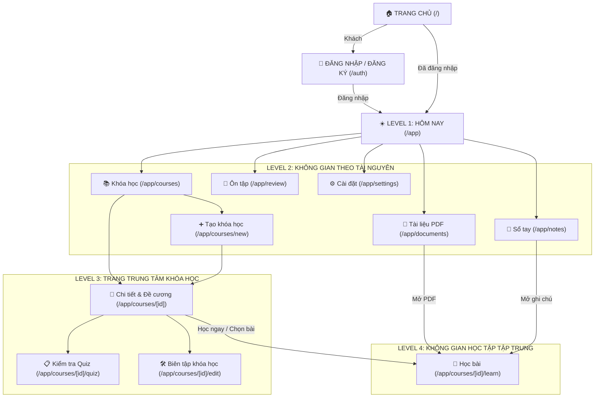

# SITEMAP & BẢN ĐỒ KIẾN TRÚC CÂY ĐỔ XUỐNG (TOP-DOWN SITEMAP TREE)
## Studxy — Hệ thống Web Tạo Khóa học & Học tập Tương tác

> **Hệ thống:** Studxy (SWMS)  
> **Cấu trúc:** Cây phân cấp đổ xuống từ Trang chủ $\to$ Bảng điều khiển $\to$ Danh sách khóa học $\to$ Không gian học tập / Studio biên tập  
> **Ngày cập nhật:** 2026-11-13  

---

## 1. SƠ ĐỒ CÂY ĐỔ XUỐNG DẠNG ĐỒ HỌA (FLOWCHART TREE — 4 TẦNG MỚI)



---

## 2. BẢN ĐỒ PHÂN CẤP 4 TẦNG (MULTI-LEVEL ROUTE TREE)

```text
Level 0: Cổng vào & Cài đặt hệ thống
├── /                          Trang chủ (Landing)
├── /auth                      Đăng nhập / Đăng ký / Chọn tài khoản nhanh
└── /app/settings              Giao diện (Sáng/Tối, Font chữ, Cỡ chữ), AI Provider, Tài khoản

Level 1: Hôm nay (/app)
└── /app                       Tâm điểm học hằng ngày
     ├── 1. Thẻ "Tiếp tục lộ trình" (bài học kế tiếp của khóa đang học)
     ├── 2. Thẻ "Ôn tập hôm nay" (số thẻ đến hạn & thời gian ước tính)
     ├── 3. Khóa học gần đây (tối đa 4 khóa học đã khử trùng lặp) -> /app/courses/[id]
     └── 4. Lối tắt 4 khu vực: Khóa học, Tài liệu, Sổ tay, Ôn tập

Level 2: Không gian làm việc theo loại tài nguyên (Sidebar 5 mục chính)
├── /app/courses               Danh mục Khóa học (Tìm kiếm, Lọc lĩnh vực & trạng thái, Ẩn bản sao trùng lặp)
│    └── /app/courses/new      Tạo khóa học mới (Tải tài liệu, AI Wizard 3 bước, Nhập SWM ZIP)
├── /app/documents             Thư viện Tài liệu PDF (Danh sách tài liệu, Tải PDF lên, Mở trình đọc)
├── /app/notes                 Kho Sổ tay Ghi chú (Danh sách sổ tay, Mở đúng bối cảnh bài học)
└── /app/review                Phòng Ôn tập Thẻ ghi nhớ (Tách rời không gian đọc)

Level 3: Chi tiết Khóa học (Course Hub)
└── /app/courses/[id]          Tổng quan, thống kê, tiến độ, bài học kế tiếp, Đề cương chương/bài (tìm & lọc)
     ├── /app/courses/[id]/quiz   Bài kiểm tra trắc nghiệm & tự luận
     └── /app/courses/[id]/edit   Trình biên tập khóa học (Cây chương/bài, Markdown Live Preview, Video URL, Xuất bản, Xuất SWM ZIP)

Level 4: Không gian Học tập Tập trung (Immersive Learning Workspace)
└── /app/courses/[id]/learn    Ẩn thanh điều hướng toàn cục; chỉ giữ:
     ├── Thanh trên tối giản: Bật/tắt lộ trình (Ctrl+\), Breadcrumb về /app/courses/[id], % tiến độ, Cỡ chữ/Font (Aa), Mục lục bài, Ngăn Sổ tay/Thẻ, Nút Quiz
     ├── Cột trái: Lộ trình Khóa học (CourseRoadmapSidebar)
     ├── Khung chính: Trình phát Video / Bài đọc Markdown sạch / Trình đọc PDF + Thanh chọn văn bản (Highlight, Tạo thẻ, Lưu vào sổ tay, AI giải thích)
     ├── Thanh dưới: Bài trước / Đánh dấu hoàn thành & Học bài tiếp
     └── Cột phải (theo ngữ cảnh): Mục lục "Trong bài này" hoặc Ngăn 3 tab (Sổ tay / Highlight / Thẻ ghi nhớ)
```

```
