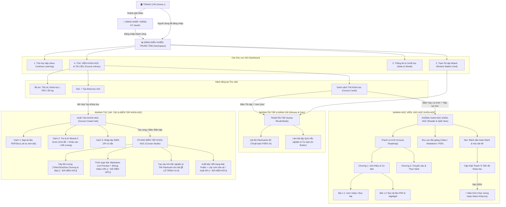

# SITEMAP & BẢN ĐỒ KIẾN TRÚC CÂY ĐỔ XUỐNG (TOP-DOWN SITEMAP TREE)
## Studxy — Hệ thống Web Tạo Khóa học & Học tập Tương tác

> **Hệ thống:** Studxy (SWMS)  
> **Cấu trúc:** Cây phân cấp đổ xuống từ Trang chủ $\to$ Bảng điều khiển $\to$ Danh sách khóa học $\to$ Không gian học tập / Studio biên tập  
> **Ngày cập nhật:** 2026-11-13  

---

## 1. SƠ ĐỒ CÂY ĐỔ XUỐNG DẠNG ĐỒ HỌA (FLOWCHART TREE)



---

## 2. BẢN ĐỒ CÂY ĐỔ XUỐNG DẠNG VĂN BẢN (TEXT INDENTATION TREE)

```text
🏠 Trang chủ (Home /)
│
├── 🔐 Xác thực & Đăng nhập (/auth)
│    ├── Đăng nhập (Email & Mật khẩu)
│    ├── Đăng ký tài khoản mới
│    └── Chọn tài khoản Demo nhanh (Sơn Trần / Minh Anh)
│
└── 📊 Bảng điều khiển Trung tâm (Dashboard /workspace)
     │
     ├── 1. Thẻ Học tiếp (Hero Continue Learning) ──────> Nhấp 1-click vào ngay bài học đang dở
     │
     ├── 2. Trạm Ôn tập Nhanh (Review Station Card) ────> Báo số thẻ đến hạn hôm nay + Nút "Ôn tập ngay"
     │
     ├── 3. Thống kê & Chuỗi học (Stats & Streak) ─────> Chuỗi ngày học, chỉ số trí nhớ FSRS, hạn mức AI
     │
     └── 4. Thư viện Khóa học & Tài liệu (Course & Library Grid)
          │
          ├── [Bộ lọc]: Tất cả | Khóa học | Tài liệu PDF | Sổ tay
          │
          ├── 🎓 DANH SÁCH CÁC KHÓA HỌC (Course Cards)
          │    │
          │    ├── Khóa học A: Lập trình Web C# .NET 10 (Tiến độ: 45%)
          │    │    ├── 🔘 Nút: "Tiếp tục học" ──────┐
          │    │    ├── 🔘 Nút: "Ôn tập Flashcards" ─┼───> (Xem chi tiết nhánh học bên dưới)
          │    │    ├── 🔘 Nút: "Làm bài Quiz" ──────┤
          │    │    └── 🔘 Nút: "Mở trong Studio" ───┘
          │    │
          │    └── Khóa học B: Giáo trình Pháp luật đại cương (Tiến độ: 100% - Đã hoàn thành)
          │
          └── ➕ NÚT "+ TẠO KHÓA HỌC MỚI" (Dành cho Giảng viên / Học viên tự soạn)
               │
               ▼ Mở Hub Tạo Khóa học (Course Create Hub)
               ├── Cách 1: Nạp tài liệu (PDF, DOCX, TXT, MD) -> AI bóc tách sinh khóa học
               ├── Cách 2: Trợ lý AI Wizard 3 bước:
               │    ├── Bước 1: Nhập đề tài muốn học/dạy
               │    ├── Bước 2: AI khảo sát mục tiêu & trình độ
               │    └── Bước 3: Xem trước đề cương (Syllabus Preview) -> Bấm Tạo
               └── Cách 3: Nhập gói SWM ZIP chuẩn bị sẵn

----------------------------------------------------------------------------------------------------

📚 CHI TIẾT NHÁNH 1: HỌC VIÊN VÀO HỌC KHÓA HỌC (Learning Flow)
└── Bấm "Tiếp tục học" trên thẻ khóa học
     │
     ▼ Mở Không gian Học tập & Trình đọc (Reader & Split Workspace)
     ├── CỘT TRÁI: Lộ trình Khóa học (Course Roadmap Sidebar)
     │    ├── Thanh % Tổng tiến độ khóa học (Progress Bar)
     │    ├── Chương 1: Kiến thức Cốt lõi
     │    │    ├── ✅ Bài 1.1: Tổng quan (Đã học xong - Tích xanh)
     │    │    ├── ▶️ Bài 1.2: Cấu trúc dữ liệu (Đang học - Đang mở)
     │    │    └── ⚪ Bài 1.3: Bài tập thực hành (Chưa học)
     │    └── Chương 2: Nâng cao & Ứng dụng
     │
     ├── KHUNG CHÍNH: Nội dung Bài giảng Đa phương thức
     │    ├── Trình phát Video (YouTube / Vimeo / MP4 nếu có)
     │    ├── Bài đọc Markdown chi tiết (Có bảng, code highlight, công thức toán)
     │    └── Trình đọc PDF song song (nếu bài học gắn với trang tài liệu gốc)
     │
     ├── KHUNG GHI CHÚ: Sổ tay cá nhân (Mở song song để ghi chép trích dẫn)
     │
     └── CHÂN BÀI HỌC: Thanh điều hướng & Hoàn thành
          ├── ⬅️ Nút "Bài trước"
          ├── ➡️ Nút "Đánh dấu Hoàn thành & Tiếp tục" ──> Ghi nhận tiến độ vào Database
          │                                            ──> Tự động chuyển sang Bài 1.3
          └── 🎉 Khi xong bài cuối cùng (100%) ─────────> Bật Modal Chúc mừng Hoàn thành!

----------------------------------------------------------------------------------------------------

🧠 CHI TIẾT NHÁNH 2: ÔN TẬP & KIỂM TRA (Review & Practice Flow)
└── Bấm "Ôn tập" hoặc "Làm Quiz" từ Khóa học
     │
     ▼ Mở Trạm Ôn tập Chủ động (Active Recall Mode)
     ├── Tab 1: Ôn tập Thẻ Flashcards (FSRS v5 Engine)
     │    ├── Mặt trước câu hỏi (Front)
     │    ├── Bấm lật thẻ 3D ──> Hiện mặt sau đáp án (Back)
     │    ├── 4 Nút đánh giá ghi nhớ: [1: Quên] - [2: Khó] - [3: Tốt] - [4: Dễ]
     │    └── Nút Hoàn tác (Undo / Phím Z) nếu bấm nhầm
     │
     └── Tab 2: Làm bài Kiểm tra Trắc nghiệm (Practice Quiz)
          ├── Danh sách câu hỏi trắc nghiệm của khóa học
          ├── Chọn đáp án A, B, C, D
          └── Bấm "Nộp bài" ──> AI chấm điểm, phân tích lỗi sai và đưa ra lời khuyên

----------------------------------------------------------------------------------------------------

🛠️ CHI TIẾT NHÁNH 3: TÁC GIẢ SOẠN & BIÊN TẬP KHÓA HỌC (Course Studio Flow)
└── Bấm "Mở trong Studio" hoặc sau khi tạo khóa học mới
     │
     ▼ Mở Studio Biên tập Khóa học (Course Studio)
     ├── THANH CÔNG CỤ TRÊN:
     │    ├── Tên khóa học & Mô tả
     │    ├── Công tắc: [Bản nháp ⟷ Công khai] (Draft / Public)
     │    ├── 🔗 Nút "Sao chép liên kết chia sẻ" (Gửi cho học viên vào học)
     │    └── 💾 Nút "Xuất gói SWM ZIP" (Tải trọn bộ về máy để lưu trữ)
     │
     ├── CỘT TRÁI: Trình thiết kế Cây Đề cương (Curriculum Tree Builder) [✅ ĐÃ HIỆN HỮU & KIỂM CHỨNG]
     │    ├── Nút "+ Thêm Chương mới" [✅]
     │    ├── Nút "+ Thêm Bài giảng mới" [✅]
     │    └── Thao tác trên từng mục: Đổi tên [✅] | Xóa chương/bài [✅] | Kéo thả sắp xếp [⏳ LỘ TRÌNH V2.4]
     │
     └── CỘT PHẢI: Trình soạn thảo Nội dung Bài đang chọn [✅ ĐÃ HIỆN HỮU & KIỂM CHỨNG]
          ├── Nhập tiêu đề bài giảng & Thời lượng học (phút) [✅]
          ├── Ô dán link Video bài giảng (Tự động hiển thị khung xem trước Video) [✅]
          ├── Trình soạn thảo văn bản Markdown (Soạn bên trái - Xem trước trực tiếp bên phải) [✅]
          ├── Chọn trang tài liệu PDF tham chiếu [⏳ LỘ TRÌNH V2.4]
          └── Thêm câu hỏi trắc nghiệm Mini Quiz cho riêng bài học đó [⏳ LỘ TRÌNH V2.4]
```
