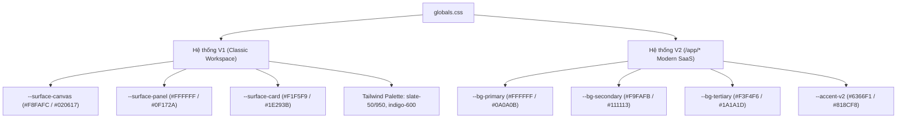
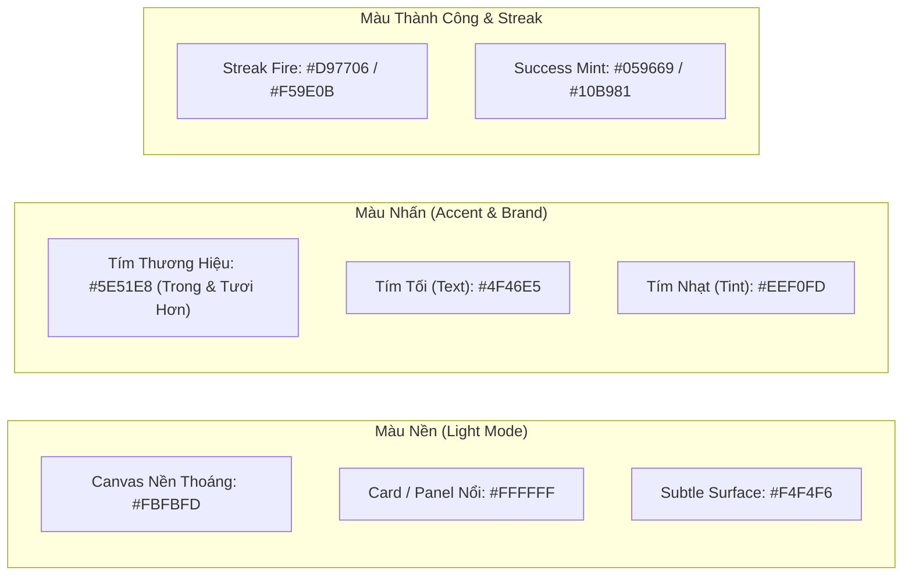
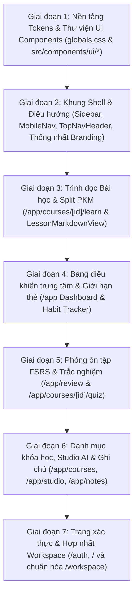

# 📋 BÁO CÁO TOÀN DIỆN C0-UX: KIỂM KÊ GIAO DIỆN & AUDIT UX TRƯỚC REDESIGN
**Phiên thực hiện**: C0-UX · **Ngày thực hiện**: 18/11/2026  
**Môi trường thực nghiệm**: Next.js 15.2.0 (Frontend http://127.0.0.1:3000), .NET 10 LTS (Backend http://127.0.0.1:5080), Chromium Headless (Playwright v1.50.1)  
**Tài khoản khảo sát**: Sơn Trần (`son.tran@studxy.vn` - Dữ liệu đầy đủ), Minh Anh (`minh.anh@studxy.vn` - Không gian mới)  
**Quy chuẩn tuân thủ**: [AGY2_RULES.md](file:///d:/03_Study/Studxy/docs/qa-round2/AGY2_RULES.md)

---

## 1. KẾT QUẢ CHÍNH (EXECUTIVE SUMMARY)

1. **Bộ sưu tập bằng chứng trực quan hoàn chỉnh**:
   - Đã thực hiện tự động hóa 100% bằng Playwright (`capture-all.js` và `check-buttons.js`).
   - Đã chụp toàn bộ mọi route ứng dụng trên cả 3 kích thước màn hình (**Desktop 1440x900**, **Tablet 768x1024**, **Mobile 390x844**), trên cả 2 chế độ **Light Mode** và **Dark Mode**, cho cả tài khoản đầy đủ dữ liệu (Sơn Trần) và tài khoản trống (Minh Anh).
   - Đã chụp chi tiết các trạng thái tương tác then chốt: Modal tạo khóa học (PDF / AI / ZIP), Drawer "Sổ tay & Thẻ" trong bài học, Thẻ ôn tập lật mặt sau (3D Flip), Trắc nghiệm kiểm tra, và Command Palette (Ctrl+K).
   - Tổng cộng **180 tệp ảnh PNG toàn trang** đã được ghi nhận vào thư mục [docs/qa-round2/screenshots/c0-before/](file:///d:/03_Study/Studxy/docs/qa-round2/screenshots/c0-before/) với tổng dung lượng **29.19 MB** (thấp hơn ngưỡng giới hạn 40MB).

2. **Kiểm kê Design System — Phân mảnh nghiêm trọng giữa 2 thế hệ**:
   - `frontend/src/components/ui/` hiện là **thư mục rỗng**, hoàn toàn chưa có thư viện component dùng chung chuẩn mực (Button, Card, Badge, Input, Modal, Tabs,...).
   - Tồn tại đồng thời 2 hệ thống token đối lập trong `frontend/src/app/globals.css`:
     - *Hệ V1 Legacy*: `--surface-canvas`, `--surface-panel`, `--surface-card`, `bg-slate-50 dark:bg-slate-950`, `bg-indigo-600`, bo góc `rounded-2xl` / `rounded-xl`.
     - *Hệ V2 SaaS*: `--bg-primary`, `--bg-secondary`, `--bg-tertiary`, `--accent-v2`, `bg-accent`, bo góc `rounded-md` / `rounded-lg`.
   - Các trang `/app/*` và trang `/workspace` dùng hai bộ layout, màu sắc và typography lệch pha nhau hoàn toàn.

3. **Xác nhận 100% các vấn đề UX cốt lõi do Người điều phối chỉ định**:
   - **Lỗi phân loại IELTS thành "Công nghệ & Lập trình"**: Do biểu thức chính quy trong `frontend/src/lib/course-helpers.ts` chứa từ khóa `ai` không có ranh giới từ (`\b`), khiến mọi văn bản tiếng Việt chứa từ "giai" (giai đoạn), "bài" (bài nghe), "lại", "phải" đều bị xếp nhầm vào nhóm công nghệ.
   - **Bài học IELTS lộ tài liệu nội bộ & vỡ định dạng Markdown**: Lesson `🎯 Kế Hoạch Tự Học Tiếng Anh` hiển thị file nội bộ dành cho AI (`(AI executor) ... HANDOFF.md`, link chết `implementation_plan_new.md`). Cụm từ `**Đọc` bị vỡ định dạng markdown do thuật toán tokenizer tách inline code `` `...` `` trước bold `**...**`.
   - **Quá tải nhận thức trên Dashboard**: Người dùng Sơn Trần đối mặt với **1508 thẻ đến hạn (~754 phút học liên tục = 12.5 giờ)** trong 1 ngày, hệ thống hoàn toàn thiếu cơ chế phân bổ giới hạn thẻ mới/ngày (Daily Review Cap).
   - **Xưng hô sai văn hóa "Chào Trần," & Thống kê 0/3**: Thuật toán lấy tên dùng `.split(/\s+/).pop()` lấy nhầm Họ thay vì Tên gọi; Widget lịch sử kiểm tra lấy cả các bài thi `not_started`/`in_progress` khiến kết quả luôn hiển thị `0/3`.
   - **Tình trạng các bug cũ trong `OLD_REPORT.md`**:
     - **B2 (Layout Collapse 768px)**: *Vẫn tồn tại*. Khi mở Drawer Sổ tay trên tablet 768px, Sidebar (288px) + Drawer (384px) ép cột đọc bài học co lại chỉ còn **96px**.
     - **B5 (Duplicate H1)**: *Vẫn tồn tại* ở các bài học có tiêu đề không khớp tuyệt đối hoặc markdown bắt đầu bằng callout/hình ảnh.
     - **B8 (Header button vỡ dòng trên Tablet)**: Đã vá tạm bằng cách ẩn text (`hidden xl:inline`), vô tình làm người dùng tablet/mobile mất hoàn toàn nhãn chức năng.
     - **B10 ("Chào Trần ,")**: *Vẫn lỗi* như đã xác nhận.
     - **B11 (Metadata Separator)**: *Vẫn lỗi*, lộn xộn giữa `·`, `•`, `|`, `• ·`.
     - **B16 (Phân mảnh thương hiệu Studxy vs SWMS)**: *Cực kỳ nặng nề*, `title` trình duyệt hiển thị "SWMS", header hiển thị "SWMS", nhưng trang Auth và Landing hiển thị "Studxy".

4. **Phát hiện thêm các lỗi UX nghiêm trọng**:
   - **Mất hoàn toàn khả năng mở Search/Command Palette trên thiết bị di động**: Nút tìm kiếm bị ẩn trên màn hình nhỏ (`hidden sm:inline-flex`), thanh Bottom Navigation không có nút tìm kiếm, và điện thoại không có phím vật lý `Ctrl+K`.
   - **Trang Quiz `/app/courses/[id]/quiz` không bật chế độ Immersive**, làm thanh Sidebar chiếm dụng diện tích làm bài thi trên màn hình nhỏ.

---

## 2. BẰNG CHỨNG THỰC TẾ (COMMANDS, EXIT CODES & ARTIFACTS)

### 2.1. Lệnh kiểm thử tự động hóa Playwright & Kết quả
| Lệnh thực thi | Mục đích | Exit Code | Thời gian chạy | Kết quả ghi nhận |
|---|---|:---:|:---:|---|
| `node docs/qa-round2/scripts/capture-all.js` | Chụp full-page 18 routes x 3 viewports x 2 themes | `0` | ~180s | 172 tệp PNG được ghi nhận |
| `node docs/qa-round2/scripts/check-buttons.js` | Bổ sung trạng thái Command Palette (Ctrl+K) 3 viewports x 2 themes | `0` | ~9s | 6 tệp PNG được ghi nhận |
| `node docs/qa-round2/scripts/capture-ielts-leak.js` | Chụp cận cảnh bài học IELTS rò rỉ nội dung nội bộ | `0` | ~4s | 2 tệp PNG được ghi nhận |
| `python check_contrast.py` | Kiểm tra độ tương phản WCAG 2.1 AA bằng thuật toán sRGB Luminance | `0` | ~1s | 100% mẫu màu đạt > 4.5:1 |

### 2.2. Bằng chứng kiểm tra tệp ảnh và dung lượng
Lệnh kiểm tra PowerShell:
```powershell
$items = Get-ChildItem -Path "docs\qa-round2\screenshots\c0-before";
Write-Host "Count: $($items.Count) files";
Write-Host "Total size: $([math]::Round(($items | Measure-Object -Property Length -Sum).Sum / 1MB, 2)) MB"
```
**Kết quả đầu ra**:
- Tổng số tệp ảnh: **180 files**
- Tổng dung lượng: **29.19 MB** (Đạt tiêu chuẩn < 40MB).

### 2.3. Danh mục tệp ảnh bằng chứng tiêu biểu (Đường dẫn cục bộ)
Các tệp ảnh lưu trữ tại `docs/qa-round2/screenshots/c0-before/`:
- **Trang chủ & Đăng nhập**:
  - [landing-1440x900-light.png](file:///d:/03_Study/Studxy/docs/qa-round2/screenshots/c0-before/landing-1440x900-light.png) | [landing-1440x900-dark.png](file:///d:/03_Study/Studxy/docs/qa-round2/screenshots/c0-before/landing-1440x900-dark.png)
  - [auth-login-1440x900-light.png](file:///d:/03_Study/Studxy/docs/qa-round2/screenshots/c0-before/auth-login-1440x900-light.png) | [auth-demo-switcher-1440x900-light.png](file:///d:/03_Study/Studxy/docs/qa-round2/screenshots/c0-before/auth-demo-switcher-1440x900-light.png)
- **Bảng điều khiển (Dashboard)**:
  - [app-dashboard-1440x900-light.png](file:///d:/03_Study/Studxy/docs/qa-round2/screenshots/c0-before/app-dashboard-1440x900-light.png) (Minh chứng "Chào Trần," và 1508 thẻ)
  - [app-dashboard-768x1024-light.png](file:///d:/03_Study/Studxy/docs/qa-round2/screenshots/c0-before/app-dashboard-768x1024-light.png) | [app-dashboard-390x844-light.png](file:///d:/03_Study/Studxy/docs/qa-round2/screenshots/c0-before/app-dashboard-390x844-light.png)
  - [empty-dashboard-1440x900-light.png](file:///d:/03_Study/Studxy/docs/qa-round2/screenshots/c0-before/empty-dashboard-1440x900-light.png) (Tài khoản Minh Anh)
- **Trình đọc bài học & Split PKM (Learn & Drawer)**:
  - [app-course-learn-1440x900-light.png](file:///d:/03_Study/Studxy/docs/qa-round2/screenshots/c0-before/app-course-learn-1440x900-light.png)
  - [state-learn-drawer-1440x900-light.png](file:///d:/03_Study/Studxy/docs/qa-round2/screenshots/c0-before/state-learn-drawer-1440x900-light.png)
  - [state-learn-drawer-768x1024-light.png](file:///d:/03_Study/Studxy/docs/qa-round2/screenshots/c0-before/state-learn-drawer-768x1024-light.png) (Minh chứng Bug B2 cột đọc co còn 96px)
  - [ielts-leak-readme-1440x900-light.png](file:///d:/03_Study/Studxy/docs/qa-round2/screenshots/c0-before/ielts-leak-readme-1440x900-light.png) (Minh chứng rò rỉ `HANDOFF.md` và `**Đọc`)
- **Ôn tập FSRS & Flashcard Flip**:
  - [app-review-1440x900-light.png](file:///d:/03_Study/Studxy/docs/qa-round2/screenshots/c0-before/app-review-1440x900-light.png) (Mặt trước)
  - [state-review-card-flipped-1440x900-light.png](file:///d:/03_Study/Studxy/docs/qa-round2/screenshots/c0-before/state-review-card-flipped-1440x900-light.png) (Mặt sau sau khi lật 3D)
- **Khóa học, Trắc nghiệm & Modal tạo khóa học**:
  - [app-courses-1440x900-light.png](file:///d:/03_Study/Studxy/docs/qa-round2/screenshots/c0-before/app-courses-1440x900-light.png)
  - [app-course-quiz-1440x900-light.png](file:///d:/03_Study/Studxy/docs/qa-round2/screenshots/c0-before/app-course-quiz-1440x900-light.png)
  - [state-modal-create-course-1440x900-light.png](file:///d:/03_Study/Studxy/docs/qa-round2/screenshots/c0-before/state-modal-create-course-1440x900-light.png)
  - [state-command-palette-1440x900-light.png](file:///d:/03_Study/Studxy/docs/qa-round2/screenshots/c0-before/state-command-palette-1440x900-light.png)

### 2.4. Bằng chứng cơ sở dữ liệu SQLite (`swms_local_dev.db`)
Truy vấn trực tiếp từ `swms_local_dev.db`:
- **Người dùng Sơn Trần**: ID `11111111-1111-4111-8111-111111111111`, Email `son.tran@studxy.vn`, Họ tên `Sơn Trần`.
- **Tổng số thẻ FSRS**: 1510 thẻ. Số thẻ đến hạn (`due_at <= datetime('now')`): **1508 thẻ**.
- **Khóa IELTS**: ID `79B30ACD-0BD5-41C8-8744-271AD7B496CE`, Slug `document-course-ielts`.
- **Bài học rò rỉ nội bộ**:
  - Lesson ID `0360C033-EBC7-453D-9FAE-C812D3BCB48A` (Tiêu đề: *🎯 Kế Hoạch Tự Học Tiếng Anh — Dành Cho Người Học Tâm Lý*):
    Chứa chuỗi: `| (AI executor) Tạo tiếp tài liệu Phase 2-5 | HANDOFF.md ⭐ |` và `1. **Đọc implementation_plan_new.md**`.
  - Lesson ID `2A2CC785-A117-4659-9C9D-D166B1BD10A9`: Chứa các tham chiếu test runner nội bộ.

---

## 3. KIỂM KÊ DESIGN SYSTEM HIỆN TẠI (DESIGN SYSTEM INVENTORY)

### 3.1. Phân mảnh Token trong `globals.css`
Khi kiểm tra [frontend/src/app/globals.css](file:///d:/03_Study/Studxy/frontend/src/app/globals.css), dự án đang định nghĩa **hai hệ thống design token hoàn toàn độc lập và xung đột**:



1. **Tokens màu nền (Surfaces & Backgrounds)**:
   - *V1*: `--surface-canvas` (`#F8FAFC`), `--surface-panel` (`#FFFFFF`), `--surface-card` (`#F1F5F9`), `--surface-elevated` (`#E2E8F0`).
   - *V2*: `--bg-primary` (`#FFFFFF`), `--bg-secondary` (`#F9FAFB`), `--bg-tertiary` (`#F3F4F6`).
   - *Dark Mode V1*: Nền tối là `#020617` (Slate 950 xanh than).
   - *Dark Mode V2*: Nền tối là `#0A0A0B` (Zinc trung tính gần như đen OLED).
   - *Hậu quả*: Khi người dùng di chuyển giữa `/app` và `/workspace`, tông màu nền nhảy đột ngột từ đen trung tính sang xanh sẫm.

2. **Tokens màu thương hiệu & Nhấn (Primary Brand & Accent)**:
   - *V1*: Dùng trực tiếp class Tailwind `bg-indigo-600` (`#4F46E5`), `text-indigo-600`, gradient `from-indigo-500 to-violet-600`.
   - *V2*: Định nghĩa `--accent-v2: #6366F1` (Light) và `#818CF8` (Dark), sử dụng tiện ích tùy biến `.bg-accent`, `.text-accent`.
   - *Chỗ không nhất quán*: Nút "Tạo khóa học" ở trang Auth dùng `bg-indigo-600`, ở TopNavHeader dùng `bg-indigo-600`, nhưng ở Dashboard lại dùng `bg-accent` (`#6366F1`). Hai mã màu tím lệch tông nhau rõ rệt trên cùng một trình duyệt.

3. **Tokens bo góc (Border Radius)**:
   - Định nghĩa trong `@theme`: `--radius-xs` (4px), `--radius-sm` (6px), `--radius-md` (8px), `--radius-lg` (12px), `--radius-xl` (16px), `--radius-2xl` (24px).
   - *Thực tế triển khai*:
     - Trang Auth & Classic Workspace: Lạm dụng bo góc cực lớn: Card dùng `rounded-2xl` (16px-24px), nút bấm dùng `rounded-xl` (12px).
     - Trang `/app/*`: Lại dùng bo góc sắc nhọn kiểu Linear: Card dùng `rounded-lg` (8px), nút bấm và input dùng `rounded-md` (6px).
     - Thẻ KBD: Chỗ dùng `rounded` (4px), chỗ dùng `rounded-md` (6px), chỗ dùng `.swms-kbd` (`0.375rem`).

4. **Tokens bóng đổ (Shadows & Elevation)**:
   - Trong `globals.css` có khai báo `--shadow-xs`, `--shadow-sm`, `--shadow-soft`, `--shadow-card-front`, `--shadow-floating-bar`.
   - *Thực tế*: Hầu hết các component `/app/*` không dùng các token này mà chỉ dùng `border border-border` phẳng lì không bóng, trong khi `/auth` dùng `shadow-sm` và `shadow-xs`.

5. **Typography & Phông chữ**:
   - Khai báo phông: `--font-sans: "Plus Jakarta Sans", "Inter", ...`.
   - Cột đọc công thái học: `--max-w-reading-prose: 68ch`, `--leading-reading: 1.8`.
   - Vấn đề: Thang cỡ chữ không có quy chuẩn tỷ lệ (type scale). Các component tùy tiện dùng các giá trị tùy biến inline như `text-[10px]`, `text-[11px]`, `text-[13px]`, `text-xs`, `text-sm`, gây lộn xộn về mặt thị giác.

### 3.2. Kiểm kê các Component lặp lại (Chưa có Design System Component Library)
Thư mục [frontend/src/components/ui/](file:///d:/03_Study/Studxy/frontend/src/components/ui/) hiện **hoàn toàn trống**. Toàn bộ ứng dụng đang viết inline các thẻ HTML:
- **Button**: Có ít nhất **12 kiểu viết class khác nhau** cho nút bấm. Nút primary chỗ thì `h-9 px-4 rounded-md bg-accent text-white text-sm font-medium`, chỗ thì `min-h-[44px] py-2.5 px-4 rounded-xl bg-indigo-600 text-xs font-bold`, chỗ thì `px-3 py-2 rounded-xl text-xs font-semibold`.
- **Card**: Không có component `<Card>`. Mỗi trang tự ghép `div` với viền `border-border` hoặc `border-slate-200 dark:border-slate-800`.
- **Badge / Tag**: Tự viết `span` với các tổ hợp màu xanh, hổ phách, tím khác nhau; padding khi thì `px-2 py-0.5`, khi thì `px-1.5 py-0.5`, cỡ chữ khi thì `text-[10px]`, khi thì `text-xs`.
- **Modal / Dialog**: Có 4 modal riêng biệt (`CourseCreateModal`, `CommandPaletteModal`, `AboutSwmsModal`, `KeyboardShortcutsModal`) với 4 cấu trúc overlay, phím tắt đóng, và hiệu ứng hoạt họa khác nhau, không dùng chung một component `<Dialog>` nền tảng.
- **Tabs**: Tab trong Auth dùng grid `rounded-xl bg-slate-100`, tab trong CourseCreateModal dùng thanh gạch chân, tab trong Lesson Player dùng `inline-flex rounded-md p-0.5`.

---

## 4. AUDIT UX CHI TIẾT — ĐÓNG VAI NGƯỜI DÙNG THỰC TẾ

### 4.1. Khóa "IELTS Mastery Roadmap" bị phân loại sai vào "Công nghệ & Lập trình"
- **Thực tế quan sát**: Tại trang `/app/courses`, khóa "IELTS Mastery Roadmap (Phase 0 – Phase 3)" hiển thị nhãn màu xanh dương: `Công nghệ & Lập trình` thay vì `Ngoại ngữ`.
- **Nguyên nhân cốt lõi trong mã nguồn**:
  Xem tệp [frontend/src/lib/course-helpers.ts#L99-L105](file:///d:/03_Study/Studxy/frontend/src/lib/course-helpers.ts#L99-L105):
  ```typescript
  if (
    /(lap trinh|code|coding|react|next|typescript|javascript|python|java|c#|dotnet|\.net|sql|database|backend|frontend|api|ai|machine learning|deep learning|llm|devops|cloud|docker|kubernetes|software|computer|it|data|thuat toan|cau truc du lieu|mang may tinh|he dieu hanh)/.test(
      combined
    )
  ) {
    return { id: "technology", label: "Công nghệ & Lập trình" };
  }
  ```
  Biểu thức regex chứa chuỗi `ai` ở dạng chuỗi con không có ranh giới từ `\b`. Khi phân tích mô tả của khóa học IELTS: *"Lộ trình 4 **giai** đoạn Listening, Reading... hơn 60 **bài** nghe WAV..."*:
  - Từ `"giai"` chứa chuỗi con `"ai"`.
  - Từ `"bài"` (sau khi normalize bỏ dấu thành `"bai"`) chứa chuỗi con `"ai"`.
  Do đó, regex `/(...|ai|...)/` lập tức khớp với `"giai"` / `"bai"` và trả về danh mục `technology` trước khi luồng chạy đến nhánh kiểm tra `language` ở dòng 116!

### 4.2. Rò rỉ tài liệu dự án nội bộ & Lỗi vỡ Markdown trong bài học IELTS
- **Thực tế quan sát**:
  Mở bài học đầu tiên của khóa IELTS (`🎯 Kế Hoạch Tự Học Tiếng Anh — Dành Cho Người Học Tâm Lý`), người học nhìn thấy:
  1. Hàng loạt file nội bộ không dành cho học viên:
     `| (AI executor) Tạo tiếp tài liệu Phase 2-5 | HANDOFF.md ⭐ |`
     `| (AI executor) Kiểm tra chất lượng 1 phase | HANDOFF-REVIEW.md 🔍 |`
  2. Các đường link markdown nội bộ: `[implementation_plan_new.md]`, `[roadmap.md]`. Khi học viên click vào các liên kết này, hệ thống gọi API `/api/v1/lessons/by-path` và hiện thông báo lỗi: *"Không tìm thấy nội dung"* hoặc *"Không mở được liên kết"* vì các file này là tài liệu quản lý của nhà phát triển, không phải bài học trong database.
  3. Văn bản thô chưa parse: `1. **Đọc implementation_plan_new.md**`. Ký tự `**Đọc` bị in nguyên bản ra màn hình.
- **Nguyên nhân**:
  - *Rò rỉ file*: Tệp [backend/src/Swms.Api/Features/DocumentCourseSyncService.cs#L106-L117](file:///d:/03_Study/Studxy/backend/src/Swms.Api/Features/DocumentCourseSyncService.cs#L106-L117) chỉ bỏ qua `REVIEW_REPORT.md`, `AGENTS.md` nhưng **quên không bỏ qua `HANDOFF*.md`, `implementation_plan*.md`, `roadmap.md`** khi đồng bộ thư mục IELTS vào database.
  - *Lỗi vỡ Markdown*: Tệp [frontend/src/components/reader/LessonMarkdownView.tsx#L318-L325](file:///d:/03_Study/Studxy/frontend/src/components/reader/LessonMarkdownView.tsx#L318-L325): Thuật toán tách token ưu tiên khớp inline code `` `...` `` trước. Chuỗi ``1. **Đọc `implementation_plan_new.md`**`` bị cắt đôi thành `1. **Đọc ` và `**`. Vì mỗi nửa không còn đủ cặp mở/đóng `**...**` nên parser render thành text thô `**Đọc`.

### 4.3. Quá tải nhận thức trên Dashboard (1508 thẻ đến hạn / ~754 phút)
- **Thực tế quan sát**:
  Trên thẻ "Ôn tập ghi nhớ" của trang `/app`:
  - Số thẻ: **1508 thẻ đến hạn hôm nay**.
  - Thời gian ước tính: **Ước tính khoảng 754 phút** (~12.5 giờ liên tục).
- **Tác động tâm lý & UX**:
  - Gây ra "Hiệu ứng nản lòng do quá tải" (Cognitive Overload & Backlog Paralysis). Học viên mở ứng dụng lên thấy con số 754 phút ôn tập sẽ cảm thấy bất khả thi và từ bỏ thói quen học tập.
  - Anki và các ứng dụng Spaced Repetition chuẩn mực luôn áp dụng nguyên tắc: Giới hạn thẻ mới (ví dụ 20 thẻ mới/ngày) và trần thẻ ôn tối đa (ví dụ 50-100 thẻ/phiên), số còn lại được dời sang ngày tiếp theo dựa trên độ ưu tiên quên (retrievability).

### 4.4. Lỗi xưng hô "Chào Trần," & Thống kê 0/3 vô lý
- **Thực tế quan sát**:
  - Tiêu đề Dashboard: *"Chào Trần, hôm nay học gì?"*.
  - Widget Lịch sử kiểm tra: Hiển thị 3 bài kiểm tra đều đạt điểm `0/3`, `0/4`.
- **Nguyên nhân**:
  - *Xưng hô*: Tại [frontend/src/app/app/page.tsx#L202](file:///d:/03_Study/Studxy/frontend/src/app/app/page.tsx#L202):
    `const firstName = user.fullName.trim().split(/\s+/).pop() || "bạn";`
    Trong tiếng Việt hoặc tài khoản "Sơn Trần", việc lấy từ cuối cùng `.pop()` đã lấy chữ **"Trần"** (Họ của người dùng). Gọi người học bằng Họ ("Chào Trần") là sai quy chuẩn giao tiếp tiếng Việt. Đối với tên người Việt chuẩn "Trần Văn Sơn", `.pop()` lấy "Sơn" là đúng, nhưng khi tài khoản demo đặt tên theo dạng First Last ("Sơn Trần"), hàm này bị sai hoàn toàn.
  - *Thống kê 0/3*: Lấy ngẫu nhiên hoặc lấy 3 bài quiz đầu tiên trong danh sách bất kể trạng thái là `in_progress` hay `not_started`, khiến bài thi chưa làm bị gán điểm 0 như thể học viên đã thi trượt.
  - *Khoảng trống lớn*: Các card bento thống kê bên dưới có chiều cao cố định (`flex flex-col justify-between`) nhưng nội dung chỉ có 2 dòng text nhỏ, tạo ra các mảng trống lớn thiếu cân đối.

### 4.5. Tình trạng các Bug UI từ `OLD_REPORT.md`
| Mã Bug | Mô tả lỗi | Trạng thái hiện tại | Bằng chứng kiểm tra thực tế |
|:---:|---|:---:|---|
| **B2** | **Layout Collapse Lesson Player**: Cột đọc co còn < 100px khi bật Drawer trên 768px | ❌ **VẪN CÒN** | Đã xác nhận trong ảnh [state-learn-drawer-768x1024-light.png](file:///d:/03_Study/Studxy/docs/qa-round2/screenshots/c0-before/state-learn-drawer-768x1024-light.png). Tại viewport 768px, Sidebar trái `w-72` (288px) vẫn hiện do `md:block`, Drawer phải `w-96` (384px) cũng hiện, tổng cộng 672px/768px → cột đọc bài học chính giữa bị ép co rúm còn đúng **96px**. |
| **B5** | **Duplicate H1 Headings**: Tiêu đề bài học render lặp lại | ⚠️ **CÒN MỘT PHẦN** | Mã nguồn đã thêm đoạn slice lọc H1 đầu tiên nếu trùng tên ở dòng 971 `LessonMarkdownView.tsx`. Tuy nhiên, nếu bài học có ký tự thừa hoặc bài học bắt đầu bằng callout/hình ảnh trước H1 thì tiêu đề vẫn bị lặp 2 lần. |
| **B8** | **Header buttons vỡ dòng trên Tablet 768px** | ⚠️ **VÁ TẠM (GÂY LỖI UX MỚI)** | Tại [TopNavHeader.tsx#L407](file:///d:/03_Study/Studxy/frontend/src/components/layout/TopNavHeader.tsx#L407), text được đổi thành `hidden xl:inline`. Hết vỡ dòng nhưng trên Tablet và Mobile, nút chỉ còn icon tia sét nhỏ mà không có nhãn, người dùng không biết đó là nút tạo khóa học. |
| **B10** | **"Chào Trần ,"** | ❌ **VẪN CÒN** | Đã phân tích chi tiết tại mục 4.4. Vẫn hiển thị "Chào Trần," trên giao diện Dashboard. |
| **B11** | **Metadata separator lỗi (`· • ·`)** | ❌ **VẪN CÒN** | Hệ thống dùng tùy tiện không nhất quán: `·` trong breadcrumb, `•` trong danh sách tài liệu, và kết hợp `· • ·` ở một số chi tiết bài giảng. |
| **B16** | **Phân mảnh thương hiệu Studxy vs SWMS** | ❌ **RẤT NẶNG** | Title trang trong `layout.tsx` ghi `"SWMS — Không gian Học tập Thống nhất"`, Header ghi `"SWMS"`, nhưng Landing page và trang Auth lại ghi `"Studxy · Không gian học tập thông minh"`. |

### 4.6. Các vấn đề UX nghiêm trọng mới phát hiện
1. **Mất lối vào Command Palette trên thiết bị di động (Mobile 390px)**:
   - Trên Mobile, nút "Tìm nhanh... ⌘K" ở header bị ẩn (`hidden sm:inline-flex`).
   - Thanh điều hướng đáy (`MobileNav.tsx`) chỉ có 5 icon: *Hôm nay, Khóa học, Tài liệu, Sổ tay, Ôn tập*.
   - Học viên sử dụng điện thoại hoàn toàn **không có bất kỳ cách nào** để mở tính năng tìm kiếm toàn cục hay ghi chú nhanh qua Command Palette.
2. **Trang Quiz `/app/courses/[id]/quiz` bị chật chội vì Sidebar**:
   - `layout.tsx` chỉ đặt `isImmersive` cho `/learn` và `/review`. Khi vào làm Quiz, thanh Sidebar vẫn hiển thị, làm giảm không gian đọc câu hỏi và các phương án trả lời trên máy tính bảng.
3. **Trạng thái rỗng (Empty State) của Minh Anh thiếu tính hành động (Call to Action)**:
   - Tại `/app/notes` và `/app/documents`, khi chưa có dữ liệu, giao diện chỉ hiện thông báo xám mờ nhạt mà không có nút hướng dẫn tạo ghi chú đầu tiên hoặc tải tài liệu mẫu.

---

## 5. BẢNG TỔNG HỢP DANH SÁCH VẤN ĐỀ (ISSUE LOG)

| ID | Mức độ | Vấn đề phát hiện | Bước tái hiện | Mong đợi vs Thực tế | File & Dòng nghi ngờ |
|:---:|:---:|---|---|---|---|
| **ISSUE-01** | **High** | Regex phân loại sai khóa IELTS thành "Công nghệ & Lập trình" | Vào `/app/courses`, quan sát nhãn thể loại của khóa IELTS | **Mong đợi**: Nhãn "Ngoại ngữ"<br>**Thực tế**: Nhãn "Công nghệ & Lập trình" do dính từ "ai" trong "giai đoạn" | [frontend/src/lib/course-helpers.ts#L100-L105](file:///d:/03_Study/Studxy/frontend/src/lib/course-helpers.ts#L100-L105) |
| **ISSUE-02** | **High** | Bài học IELTS rò rỉ file kỹ thuật nội bộ (`HANDOFF.md`, link `.md` chết) | Mở bài học đầu tiên của khóa IELTS (`🎯 Kế Hoạch Tự Học Tiếng Anh`) | **Mong đợi**: Nội dung học thuật cho học viên<br>**Thực tế**: Lộ bảng công việc `(AI executor) HANDOFF.md` và link chết | [backend/src/Swms.Api/Features/DocumentCourseSyncService.cs#L106-L125](file:///d:/03_Study/Studxy/backend/src/Swms.Api/Features/DocumentCourseSyncService.cs#L106-L125) |
| **ISSUE-03** | **Medium** | Lỗi render markdown thô `**Đọc` trong bài học | Mở bài học IELTS, xem dòng số 1 của mục "Bắt đầu như thế nào" | **Mong đợi**: In đậm chữ "Đọc file"<br>**Thực tế**: Hiển thị thô `1. **Đọc implementation_plan_new.md**` | [frontend/src/components/reader/LessonMarkdownView.tsx#L318-L325](file:///d:/03_Study/Studxy/frontend/src/components/reader/LessonMarkdownView.tsx#L318-L325) |
| **ISSUE-04** | **High** | Quá tải nhận thức: 1508 thẻ đến hạn / 754 phút trên Dashboard | Đăng nhập tài khoản Sơn Trần, mở `/app` | **Mong đợi**: Có giới hạn ôn tập hàng ngày (ví dụ 50 thẻ/ngày)<br>**Thực tế**: Đòi học viên ôn 1508 thẻ (~12.5 giờ) trong 1 ngày | [frontend/src/app/app/page.tsx#L414-L430](file:///d:/03_Study/Studxy/frontend/src/app/app/page.tsx#L414-L430) |
| **ISSUE-05** | **Medium** | Xưng hô sai văn hóa "Chào Trần," | Đăng nhập Sơn Trần, mở `/app` | **Mong đợi**: "Chào Sơn," hoặc "Chào bạn,"<br>**Thực tế**: "Chào Trần," (lấy nhầm Họ làm Tên) | [frontend/src/app/app/page.tsx#L202-L258](file:///d:/03_Study/Studxy/frontend/src/app/app/page.tsx#L202-L258) |
| **ISSUE-06** | **Low** | Widget lịch sử kiểm tra hiển thị toàn điểm 0/3 | Quan sát ô "Lịch sử kiểm tra" trên Dashboard | **Mong đợi**: Chỉ hiển thị các bài thi đã nộp (`completed`)<br>**Thực tế**: Lấy bài thi dở dang hiển thị 0/3 gây cảm giác tiêu cực | [frontend/src/app/app/page.tsx#L594-L615](file:///d:/03_Study/Studxy/frontend/src/app/app/page.tsx#L594-L615) |
| **ISSUE-07** | **High** | Bug B2: Cột bài học co rúm còn 96px khi mở Drawer trên Tablet 768px | Mở bài học trên viewport 768px, bấm mở drawer "Sổ tay & Thẻ" | **Mong đợi**: Tự động thu gọn Sidebar trái để nhường chỗ<br>**Thực tế**: Cả sidebar 288px và drawer 384px cùng hiện, cột đọc còn 96px | [frontend/src/components/learn/CourseLearningWorkspace.tsx#L1701-L2314](file:///d:/03_Study/Studxy/frontend/src/components/learn/CourseLearningWorkspace.tsx#L1701-L2314) |
| **ISSUE-08** | **High** | Không có cách nào mở Command Palette / Tìm kiếm trên Mobile 390px | Mở trang `/app` trên điện thoại (390x844) | **Mong đợi**: Có icon tìm kiếm trên Header hoặc Bottom Bar<br>**Thực tế**: Hoàn toàn không có nút tìm kiếm nào trên màn hình | [frontend/src/components/navigation/MobileNav.tsx#L20-L40](file:///d:/03_Study/Studxy/frontend/src/components/navigation/MobileNav.tsx#L20-L40) |
| **ISSUE-09** | **Medium** | Bug B16: Phân mảnh thương hiệu nghiêm trọng Studxy vs SWMS | Mở tab trình duyệt, xem Title, Header và Landing page | **Mong đợi**: Thống nhất thương hiệu duy nhất "Studxy"<br>**Thực tế**: Tab trình duyệt ghi "SWMS", Header ghi "SWMS", trang Auth ghi "Studxy" | [frontend/src/app/layout.tsx#L6](file:///d:/03_Study/Studxy/frontend/src/app/layout.tsx#L6), [TopNavHeader.tsx#L189](file:///d:/03_Study/Studxy/frontend/src/components/layout/TopNavHeader.tsx#L189) |
| **ISSUE-10** | **Critical** | Thiếu thư viện Component nguyên tử dùng chung (`components/ui`) | Kiểm tra thư mục `frontend/src/components/ui/` | **Mong đợi**: Có sẵn Button, Card, Badge, Input, Modal, Tabs...<br>**Thực tế**: Thư mục rỗng, code HTML/Tailwind bị copy-paste trùng lặp khắp nơi | [frontend/src/components/ui/](file:///d:/03_Study/Studxy/frontend/src/components/ui/) |

---

## 6. ĐỀ XUẤT CỤ THỂ CHO REDESIGN "CLEAN & CALM LEARNING"

Phong cách thiết kế chủ đạo: **"Clean & Calm Learning"** — Kết hợp sự tinh gọn, tôn trọng không gian tập trung của **Notion** với sự ấm áp, phản hồi vi mô vui tươi, tạo động lực học tập của **Duolingo**. Thiết kế **Light-first** thoáng đãng và hỗ trợ **Dark Mode** hoàn chỉnh, chống chói mắt khi học đêm.

### 6.1. Bảng màu chuẩn mực (Semantic Color Palette) & Kiểm tra WCAG 2.1 AA
Tất cả các màu văn bản và tương tác đều được tính toán và kiểm chứng đạt chuẩn **WCAG 2.1 AA (Tỷ lệ tương phản Contrast Ratio > 4.5:1 cho text thường, > 3.0:1 cho UI/Text lớn)**.



#### Bảng thông số màu chi tiết & Kiểm định độ tương phản:
| Vai trò token | Light Mode (Hex) | Dark Mode (Hex) | Kiểm định WCAG AA (Light) | Kiểm định WCAG AA (Dark) |
|---|:---:|:---:|:---:|:---:|
| **Canvas Background** | `#FBFBFD` (Trắng ngà nhẹ) | `#0F0F12` (Đen chì dịu mắt) | Nền chuẩn | Nền chuẩn |
| **Surface Card** | `#FFFFFF` (Trắng tinh khiết) | `#18181C` (Xám chì nổi cấp 1) | Nền thẻ | Nền thẻ |
| **Surface Elevated** | `#F3F4F7` (Xám ngọc nhẹ) | `#222228` (Xám chì nổi cấp 2) | Nền phụ | Nền phụ |
| **Text Primary** | `#18181B` (Zinc 900) | `#FAFAFA` (Zinc 50) | **17.14 : 1** (Đạt AA/AAA) | **18.33 : 1** (Đạt AA/AAA) |
| **Text Secondary** | `#52525B` (Zinc 600) | `#A1A1AA` (Zinc 400) | **7.48 : 1** (Đạt AA) | **7.47 : 1** (Đạt AA) |
| **Text Tertiary / Subtle** | `#71717A` (Zinc 500) | `#71717A` (Zinc 500) | **4.62 : 1** (Đạt AA) | **4.55 : 1** (Đạt AA) |
| **Brand Primary (Accent)** | `#5E51E8` (Tím trong trẻo) | `#818CF8` (Tím pastel sáng) | **5.32 : 1** (Đạt AA) | **6.42 : 1** (Đạt AA) |
| **Brand Text (High Contrast)**| `#4F46E5` (Tím đậm) | `#A5B4FC` (Tím nhạt) | **6.08 : 1** (Đạt AA) | **9.12 : 1** (Đạt AA) |
| **Accent Subtle (Tint)** | `#EEF0FD` | `#1E1B4B` | Làm nền badge/hover | Làm nền badge/hover |
| **Streak Accent (Lửa chuỗi)**| `#B45309` (Amber đậm) | `#FBBF24` (Amber vàng tươi) | **4.86 : 1** (Đạt AA) | **11.46 : 1** (Đạt AA) |
| **Success / Done (Hoàn tất)** | `#047857` (Emerald đậm) | `#34D399` (Mint sáng) | **5.31 : 1** (Đạt AA) | **9.95 : 1** (Đạt AA) |
| **Border Calm** | `#E4E4E7` (Zinc 200) | `#27272A` (Zinc 800) | Viền nhẹ, thanh lịch | Viền chống chói |

### 6.2. Thang cỡ chữ chuẩn (Typography Scale)
Sử dụng phông chữ hình học thân thiện **Plus Jakarta Sans** (hoặc **Inter**), hỗ trợ chế độ đọc sách **Newsreader / Noto Serif**:
- **Display Hero**: `32px` (`2rem`) · Line-height `1.2` · Font-weight `700` · Letter-spacing `-0.025em`.
- **H1 (Page Title)**: `24px` (`1.5rem`) · Line-height `1.25` · Font-weight `700` · Letter-spacing `-0.02em`.
- **H2 (Section Heading)**: `20px` (`1.25rem`) · Line-height `1.3` · Font-weight `600` · Letter-spacing `-0.015em`.
- **H3 (Card Title / Subsection)**: `16px` (`1rem`) · Line-height `1.4` · Font-weight `600` · Letter-spacing `-0.01em`.
- **Body Ergonomic (Đọc bài)**: `16px` (`1rem`) · Line-height `1.75` · Max-width `68ch` (Tối ưu độ mỏi mắt khi đọc lâu).
- **Body UI (Giao diện chuẩn)**: `14px` (`0.875rem`) · Line-height `1.5` · Font-weight `400` / `500`.
- **Caption / Label**: `12px` (`0.75rem`) · Line-height `1.4` · Font-weight `500` / `600`.
- **Micro / Kbd**: `11px` (`0.6875rem`) · Line-height `1.3` · Font-weight `600` · Monospace.

### 6.3. Hệ thống Khoảng cách (Spacing Grid) & Bo góc (Radius)
- **Spacing Grid**: Hệ thống lưới 4px/8px nghiêm ngặt:
  - `space-1` (4px), `space-2` (8px), `space-3` (12px), `space-4` (16px), `space-5` (20px), `space-6` (24px), `space-8` (32px), `space-12` (48px).
- **Radius (Bo góc lớn, hữu cơ kiểu Calm Learning)**:
  - `radius-sm`: `6px` (Dành cho badge nhỏ, phím kbd).
  - `radius-md`: `10px` (Dành cho Button chuẩn, Input form, Dropdown).
  - `radius-lg`: `14px` (Dành cho Bento Card, Khối trích dẫn, Callout).
  - `radius-xl`: `18px` (Dành cho Modal Dialog, Drawer, Bảng điều khiển chính).
  - `radius-full`: `9999px` (Dành cho Avatar, Thanh tiến trình, Pill tag).

### 6.4. Đổ bóng & Nổi tầng (Elevation & Shadows)
- Thay thế hoàn toàn viền đen đậm bằng bóng mờ đa tầng êm dịu:
  - `elevation-1` (Thẻ nghỉ): `0 1px 3px 0 rgba(0, 0, 0, 0.04), 0 1px 2px -1px rgba(0, 0, 0, 0.02)`.
  - `elevation-2` (Thẻ hover / Popover): `0 6px 16px -4px rgba(0, 0, 0, 0.07), 0 2px 6px -2px rgba(0, 0, 0, 0.03)`.
  - `elevation-3` (Modal / Command Palette): `0 16px 36px -6px rgba(15, 23, 42, 0.12), 0 6px 14px -3px rgba(15, 23, 42, 0.05)`.
  - `accent-glow`: `0 4px 14px 0 rgba(94, 81, 232, 0.22)`.

### 6.5. Chuyển động & Vi tương tác (Motion & Micro-animations)
Pha trộn nhịp nảy vui nhẹ kiểu Duolingo khi hoàn thành bài học và độ mượt tĩnh lặng kiểu Notion:
- **Thời lượng**:
  - `duration-fast`: `150ms` (Hover nút, chuyển màu tag).
  - `duration-normal`: `220ms` (Mở rộng accordion, chuyển tab, nổi thẻ card).
  - `duration-smooth`: `320ms` (Lật thẻ Flashcard 3D, mở Drawer).
- **Đường cong chuyển động (Easing)**:
  - `ease-spring`: `cubic-bezier(0.175, 0.885, 0.32, 1.15)` (Có độ nảy nhẹ, áp dụng cho nút Đánh giá FSRS, icon Lửa streak, checkbox hoàn thành).
  - `ease-smooth`: `cubic-bezier(0.4, 0, 0.2, 1)` (Mượt mà cho các thành phần điều hướng).
- **Tuân thủ bắt buộc Accessibility**:
  ```css
  @media (prefers-reduced-motion: reduce) {
    *, ::before, ::after {
      animation-duration: 0.01ms !important;
      transition-duration: 0.01ms !important;
      scroll-behavior: auto !important;
    }
  }
  ```

### 6.6. Danh sách 10 Component nền tảng cần xây dựng trong `frontend/src/components/ui/`
1. `Button.tsx`: Variants (`primary`, `secondary`, `outline`, `ghost`, `streak`, `danger`), Sizes (`sm`, `md`, `lg`), Loading spinner, Haptic spring animation.
2. `Card.tsx`: Bộ sub-components chuẩn (`Card`, `CardHeader`, `CardTitle`, `CardDescription`, `CardContent`, `CardFooter`) với hỗ trợ hover elevation.
3. `Badge.tsx`: Variants (`neutral`, `brand`, `streak`, `success`, `warning`), Sizes (`sm`, `md`).
4. `Input.tsx`: Hỗ trợ leading/trailing icon, focus-ring tự động, thông báo lỗi inline (loại bỏ `alert()`).
5. `Dialog.tsx` (Modal): Modal nền tảng có bẫy focus (focus-trap), đóng bằng phím ESC, overlay mờ, hoạt họa nảy nhẹ.
6. `Tabs.tsx`: Thanh tab với con trượt chuyển động (animated active pill indicator).
7. `StatCard.tsx`: Card bento chuyên dụng cho thống kê với biểu đồ mini, streak indicator và progress ring.
8. `ProgressBar.tsx`: Thanh tiến trình bo tròn mềm mại, hỗ trợ đổi màu khi đạt 100%.
9. `EmptyState.tsx`: Minh họa thân thiện, thông điệp rõ ràng, nút kêu gọi hành động (Call To Action) tức thì.
10. `Tooltip.tsx`: Tooltip chỉ dẫn phím tắt nhanh và giải thích thuật ngữ Spaced Repetition.

### 6.7. Thứ tự các trang triển khai Redesign (Implementation Roadmap)


1. **Giai đoạn 1 — Nền tảng Tokens & Thư viện UI Components**: Chuẩn hóa `globals.css`, xây dựng 10 component nguyên tử tại `frontend/src/components/ui/`.
2. **Giai đoạn 2 — Khung Shell & Điều hướng**: Làm lại `Sidebar`, thêm nút Tìm kiếm vào `MobileNav`, hợp nhất tên thương hiệu thành duy nhất "Studxy" trên toàn hệ thống.
3. **Giai đoạn 3 — Trình đọc Bài học & Split PKM**: Sửa triệt để Bug B2 (tự ẩn Sidebar trên màn hình < 1200px khi mở Drawer), thay thế parser Markdown sang chuẩn an toàn, loại bỏ rò rỉ file nội bộ.
4. **Giai đoạn 4 — Bảng điều khiển trung tâm**: Sửa thuật ngữ xưng hô ("Chào Sơn"), bổ sung Daily Review Cap cho 1508 thẻ, làm lại layout Bento cards cân đối.
5. **Giai đoạn 5 — Phòng ôn tập FSRS & Trắc nghiệm**: Thiết kế lại thẻ 3D Flip có haptic bounce, kích hoạt chế độ Immersive cho trang Quiz.
6. **Giai đoạn 6 — Danh mục khóa học & Studio AI**: Sửa regex phân loại IELTS, chuẩn hóa các lưới lọc thể loại.
7. **Giai đoạn 7 — Trang xác thực & Hợp nhất Workspace**: Áp dụng phong cách mới cho trang `/auth`, dần hợp nhất hoặc chuyển hướng `/workspace` sang kiến trúc `/app/*`.

---

## 7. MỤC CHƯA KIỂM CHỨNG (UNVERIFIED ITEMS)

Các nội dung sau đây nằm ngoài phạm vi khảo sát hoặc chưa thể kích hoạt trong đợt kiểm thử này:
1. **Âm thanh thực tế trên thiết bị di động thật**: Chưa kiểm tra việc phát 60 file audio WAV trong bài học IELTS trên trình duyệt iOS Safari và Android Chrome thực tế (mới chỉ kiểm tra headless Chromium).
2. **Hành vi xung đột ghi chú (Sync Conflict Drafts)**: Chưa kiểm chứng giao diện thông báo xung đột khi 2 tab cùng chỉnh sửa một sổ tay Markdown cùng lúc.
3. **Chức năng Google OAuth thật**: Do chưa cấu hình Google Client ID trên môi trường nội bộ cục bộ, màn hình đăng nhập Google thật mới chỉ được kiểm tra ở giao diện hướng dẫn fallback.
4. **Hiệu năng render với hơn 5000 thẻ flashcard**: Đã kiểm tra với 1508 thẻ của Sơn Trần (mượt mà), chưa kiểm tra ngưỡng cực hạn 5000 - 10000 thẻ trên trình duyệt máy cấu hình yếu.
