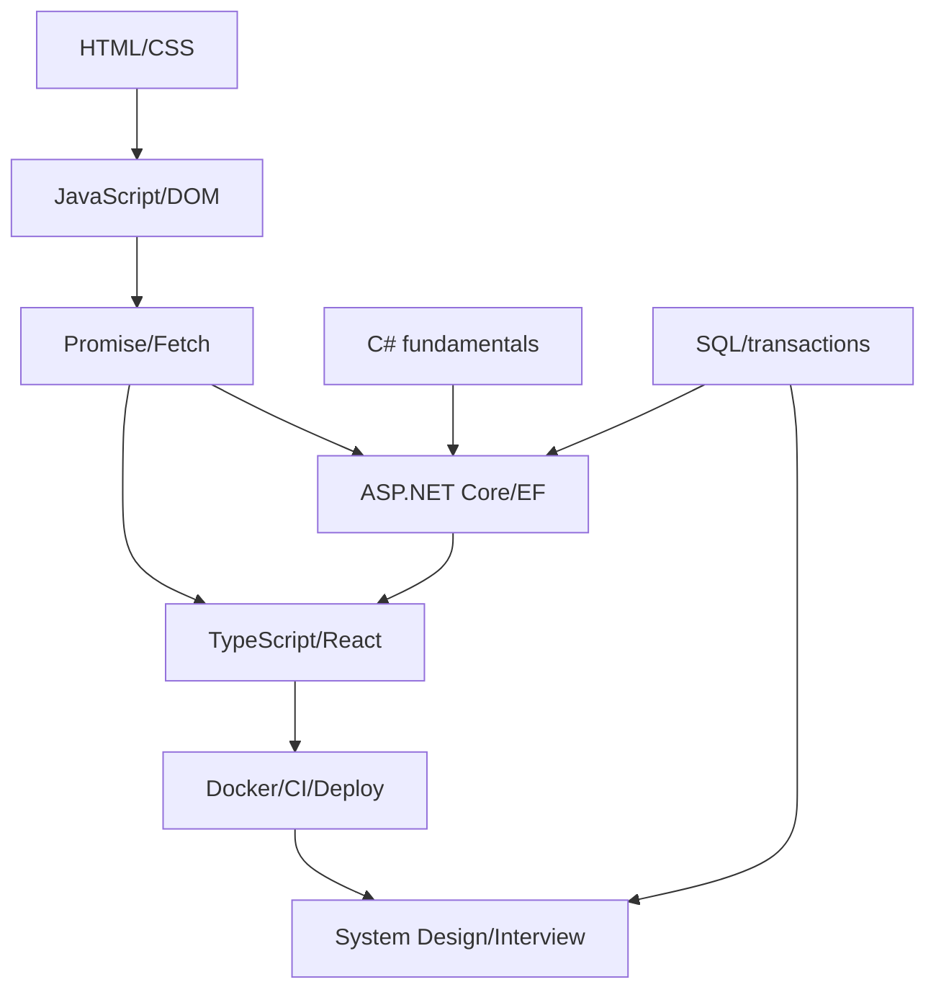

# Lộ trình năng lực
28 tuần / 84 bài; lịch linh hoạt theo gate. English, Git, test xuyên suốt.

| Tuần | Chặng | 3 bài nhỏ | Feature / gate |
|---|---|---|---|
| [W01](notes/module-1/week-01.md) | 1 | Semantic HTML và form; Box model, Flexbox, Grid; Responsive và accessibility | UI fixture hiện 3 dòng và tổng 100000 VND. |
| [W02](notes/module-1/week-02.md) | 1 | Scope và closure; Array methods và immutability; Validation, equality và dữ liệu | Fixture total 100000; Food 80000; excess Food 10000; [] total 0. |
| [W03](notes/module-1/week-03.md) | 1 | DOM và event flow; ES modules và boundary; localStorage và lỗi dữ liệu | Add/edit/delete fixture cập nhật tổng đúng và reload còn dữ liệu. |
| [W04](notes/module-1/week-04.md) | 1 | Promise và async/await; Fetch, HTTP và cancellation; Event loop và debugging network | Test fixture 3/[]/JSON sai/404/offline có state đúng và loading kết thúc. |
| [W05](notes/module-2/week-05.md) | 2 | Value, reference và equality; OOP và encapsulation; Money/date và test đầu tiên | Tự dự đoán và giải thích output2/1/2 cùng class alias/struct copy. |
| [W06](notes/module-2/week-06.md) | 2 | List, Dictionary, HashSet; Generics và constraints; Delegate, lambda và callback | Dictionary report Food80000/Travel20000, empty đúng; missing category báo lỗi rõ. |
| [W07](notes/module-2/week-07.md) | 2 | LINQ deferred và materialization; Nullable reference types; Exceptions và error contract | Deferred demo q80000/snapshot50000 và giải thích thời điểm enumerate. |
| [W08](notes/module-2/week-08.md) | 2 | Task và async I/O; CancellationToken và resource; Dependency Injection lifetimes | Cancel trước khi đọc/giữa staging báo canceled, không trả success partial. |
| [W09](notes/module-3/week-09.md) | 3 | Relational model và khóa; Normalization thực dụng; Constraints và seed reproducible | SELECT fixture Alice3 rows,total100000,Bob0. |
| [W10](notes/module-3/week-10.md) | 3 | JOIN và cardinality; GROUP BY và HAVING; Subquery, EXISTS và CTE | Report fixture Food80000/2,Travel20000/1,categoryempty0/0. |
| [W11](notes/module-3/week-11.md) | 3 | Index design; Basic execution plan và đo lường; Pagination và query round trips | Fixed dataset/tied dates phân trang không duplicate/missing; pageSize0/101 bị chặn. |
| [W12](notes/module-3/week-12.md) | 3 | ACID và transaction boundary; Isolation, race và optimistic concurrency; Idempotency và retry an toàn | Fault giữa multiwrites giữ0 partial records; success lưu toàn batch. |
| [W13](notes/module-4/week-13.md) | 4 | HTTP và REST contract; Pipeline và DI; ProblemDetails và logging | Ping và fault thể hiện status/pipeline đúng, production không trả stack. |
| [W14](notes/module-4/week-14.md) | 4 | DbContext và relationships; Migration và upgrade; Validation và concurrency | Migration trên lab giữ fixture và constraints; SQL translation đúng. |
| [W15](notes/module-4/week-15.md) | 4 | JWT trust và môi trường; Auth và resource quyền; Session lifecycle và secrets | 401missing/expired/wrongissuer/audience/signature,403policy,404crossowner. |
| [W16](notes/module-4/week-16.md) | 4 | Unit và integration; Atomic import và retry; Regression và trace diagnosis | Regression dùng relationalisolatedDB cho constraints/rowversion/rollback. |
| [W17](notes/module-5/week-17.md) | 5 | Kiểu dữ liệu tại boundary; Components, props và identity; State và derived values | Build strict TypeScript không lỗi; guard từ chối string/negative/unsafe amount. |
| [W18](notes/module-5/week-18.md) | 5 | Effects và lifecycle; Routes và URL state; Request state machine | Refresh deep link /expenses?month=2026-10 hoạt động; back/forward phục hồi filter. |
| [W19](notes/module-5/week-19.md) | 5 | Controlled forms và validation; SPA authentication; Session UX và ownership | Form chặn empty/decimal/unsafe; server400 giữ input và focus error. |
| [W20](notes/module-5/week-20.md) | 5 | Budget dashboard; State management tối thiểu; User-focused testing và accessibility | Dashboard100000/80000/20000; excess10000/14.29%,zero không Infinity. |
| [W21](notes/module-6/week-21.md) | 6 | Git và review workflow; Linux và process basics; Configuration và secrets | Fresh clone chạy theo README với lockfile/migrations và không file ngầm cá nhân. |
| [W22](notes/module-6/week-22.md) | 6 | Images và multi-stage build; Compose networking và volumes; Startup và failure recovery | Docker build và API container chạy non-root, GETping200, DBhostname db. |
| [W23](notes/module-6/week-23.md) | 6 | CI reproducible pipeline; Relational integration tests; Evidence và deployment boundary | Fresh Linux runner cold-cache build/unit/UIpass với lockfile. |
| [W24](notes/module-6/week-24.md) | 6 | Deployment runbook; Logs, metrics và health; Backup, rollback và operations | PublicHTTPSUI/API hoạt động login/provider và Alice/Bobownership; no devtoken/dev exception. |
| [W25](notes/module-7/week-25.md) | 7 | HTTP và latency budget; Rate limiter; Capacity và design communication | Samewindow quota vượt trả429; Alice/Bobpartitions độc lập và không do clientUserId. |
| [W26](notes/module-7/week-26.md) | 7 | Redis fundamentals; Cache-aside và invalidation; Failure, stampede và evidence | Alice/Bobcachekeys riêng; hit/miss assertions total đúng, không globalfinancekey. |
| [W27](notes/module-7/week-27.md) | 7 | Background job contract; Outbox và at-least-once processing; Load balancing và horizontal scaling | 202/status/downloadowner đúng; Bob không đọcAlicejob/file; UIpending/failure/success riêng. |
| [W28](notes/module-7/week-28.md) | 7 | DSA hợp lý; Practical interview answers; Portfolio và application gate | 16DSAproblems có independentattempt/edgecases/complexity, làm2bài mới 45 phút không copy. |

Chỉ chuyển chặng khi 4 gate đạt. Readiness cuối tại quality/progress.md.
