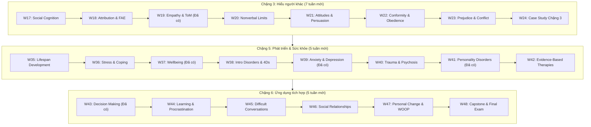

# Đặc Tả Chương Trình Chi Tiết Các Tuần Bổ Sung (W17–W24, W35–W48) — Khóa Học Tâm Lý Học 48 Tuần

**Ngày lập:** 2026-10-05  
**Tác giả:** Antigravity Remediation Team (Root Checkpoint 339)  
**Tài liệu gốc tham chiếu:** `Psychology/docs/superpowers/specs/2026-08-28-psychology-curriculum-design.md`  
**Chính sách nguồn:** `Psychology/source-policy.md` (APA, OpenStax Psychology 2e, Noba Project, peer-reviewed meta-analyses)  
**Phạm vi:** Hoàn thiện đặc tả sư phạm, ma trận chuẩn đầu ra (LO Matrix), danh mục khái niệm (Claim/Concept IDs), thiết kế 2 tầng (Cốt lõi & Đọc sâu) và hợp đồng câu hỏi trắc nghiệm cho toàn bộ 17 tuần còn thiếu để đạt mục tiêu trọn vẹn 48 tuần tự học.

---

## 1. Tổng quan phân bổ và trạng thái 48 tuần

| Chặng | Tên Chặng | Các Tuần | Trạng thái hiện tại | Tuần bổ sung trong đặc tả này |
|---|---|---|---|---|
| **Chặng 1** | Nền tảng khoa học | W01 – W08 | Đã hoàn thành 8/8 tuần | Không |
| **Chặng 2** | Hiểu bản thân | W09 – W16 | Đã hoàn thành 8/8 tuần | Không |
| **Chặng 3** | Hiểu người khác | W17 – W24 | Có W19 (1/8 tuần) | **W17, W18, W20, W21, W22, W23, W24 (7 tuần)** |
| **Chặng 4** | Tình cảm và các mối quan hệ | W25 – W34 | Đã hoàn thành 10/10 tuần | Không |
| **Chặng 5** | Phát triển và sức khỏe tâm thần | W35 – W42 | Có W37, W39, W41 (3/8 tuần) | **W35, W36, W38, W40, W42 (5 tuần)** |
| **Chặng 6** | Ứng dụng tích hợp | W43 – W48 | Có W43 (1/6 tuần) | **W44, W45, W46, W47, W48 (5 tuần)** |
| **Tổng** | **Toàn bộ khóa học** | **48 tuần** | **31/48 tuần đã có nội dung** | **17 tuần được đặc tả chi tiết** |

---

## 2. Tiêu chuẩn thiết kế bắt buộc cho từng tuần (Contract v2)

Mỗi tuần trong 17 tuần bổ sung phải tuân thủ nghiêm ngặt cấu trúc 2 tầng theo hợp đồng sư phạm:
1. **Mục tiêu học tập (Learning Objectives - LO):** 3–4 LOs phân tầng theo Bloom (Remember, Understand, Apply, Analyze).
2. **Khái niệm then chốt (Claim IDs & Concepts):** 4–6 concepts/tuần với định nghĩa khoa học chính xác, không dùng ngôn ngữ suy diễn.
3. **Phần Cốt lõi (30–45 phút):** Bản tóm lược nội dung tự đủ nghĩa, giải thích cơ chế sinh học/tâm lý học nền tảng, thuật ngữ then chốt và 2 câu hỏi kiểm tra nhanh (retrieval practice).
4. **Phần Đọc sâu (2–3 giờ):** 
   - 2.000 – 3.500 từ;
   - 2–3 nghiên cứu/thí nghiệm kinh điển kèm phân tích phương pháp luận, giới hạn mẫu (WEIRD bias) và khả năng tái lập (replication crisis);
   - Mục bắt buộc: **“Biết được gì / Chưa thể kết luận gì”** (What we know / What remains uncertain);
   - Mục phản biện Pop Psychology: chỉ rõ các hiểu lầm phổ biến trên mạng xã hội.
5. **Ranh giới an toàn (Safety Boundaries):** Tuyệt đối không dạy thao túng, không dạy suy đoán tính cách qua 1 cử chỉ, không tự chẩn đoán bệnh lý tâm thần cho bản thân hoặc người khác.
6. **Đánh giá (Assessment Suite):**
   - 8–12 câu hỏi trắc nghiệm stem-dependent (câu hỏi dựa trên dữ kiện ngữ cảnh cụ thể, 4 lựa chọn đồng đều, triệt tiêu tín hiệu lộ đáp án hình thức với trần blind cue $\le 25\%$);
   - Bảng giải thích chi tiết trỏ về mục tài liệu liên quan;
   - Bài tập tình huống giả định (Hypothetical Case Study/Reflection), không ép người học tiết lộ chấn thương cá nhân.

---

## 3. Đặc tả chi tiết từng tuần bổ sung

### CHẶNG 3: HIỂU NGƯỜI KHÁC (SOCIAL COGNITION & INTERPERSONAL DYNAMICS)

#### 🔹 Tuần 17: Social Cognition & Cách Ta Hình Thành Ấn Tượng
- **Chủ đề:** Nhận thức xã hội, ấn tượng ban đầu, hiệu ứng hào quang và giới hạn của phán đoán tích tắc.
- **Learning Objectives:**
  - *LO-W17-01 (Understand):* Giải thích cơ chế hình thành ấn tượng xã hội qua lý thuyết lược đồ (schema) và xử lý thông tin từ trên xuống (top-down processing).
  - *LO-W17-02 (Analyze):* Phân tích các nghiên cứu về "thin slices of behavior" (Ambady & Rosenthal) và chỉ rõ các điều kiện bối cảnh mà phán đoán nhanh thất bại.
  - *LO-W17-03 (Apply):* Nhận diện hiệu ứng hào quang (halo effect) và hiệu ứng thứ tự ưu tiên (primacy effect) trong giao tiếp công việc và xã hội.
- **Khái niệm chính:** `C17-01` Social schema; `C17-02` Thin slices of behavior; `C17-03` Halo effect; `C17-04` Primacy effect; `C17-05` Confirmation bias in social perception.
- **Nguồn thẩm định:** OpenStax Psychology 2e (Ch.12: Social Psychology); Ambady & Rosenthal (1992); Nisbett & Wilson (1977) về Halo Effect.
- **Phản biện Pop Psychology:** Bác bỏ luận điểm "giác quan thứ sáu luôn đọc vị chính xác con người trong 3 giây đầu".

#### 🔹 Tuần 18: Attribution & Lỗi Quy Kết Bản Chất
- **Chủ đề:** Quy kết nguyên nhân, thiên kiến quy kết cơ bản (FAE), actor-observer bias và vai trò của bối cảnh hoàn cảnh.
- **Learning Objectives:**
  - *LO-W18-01 (Understand):* Phân biệt quy kết nội tại (dispositional) và quy kết hoàn cảnh (situational) theo mô hình đồng biến của Kelley.
  - *LO-W18-02 (Analyze):* Giải thích cơ chế của Thiên kiến Quy kết Cơ bản (Fundamental Attribution Error) và ảnh hưởng của sự khác biệt văn hóa (tập thể vs cá nhân).
  - *LO-W18-03 (Apply):* Ứng dụng quy trình 2 giai đoạn của Gilbert để điều chỉnh quy kết tự động khi đánh giá hành vi của đồng nghiệp hoặc đối tác.
- **Khái niệm chính:** `C18-01` Dispositional vs Situational attribution; `C18-02` Fundamental Attribution Error (FAE); `C18-03` Actor-Observer bias; `C18-04` Self-serving bias; `C18-05` Kelley's Covariation Model.
- **Nguồn thẩm định:** Ross (1977); Gilbert & Malone (1995); Choi, Nisbett & Norenzayan (1999).

#### 🔹 Tuần 20: Giao Tiếp Bằng Lời & Giới Hạn Của Tín Hiệu Cơ Thể
- **Chủ đề:** Giao tiếp ngôn ngữ và phi ngôn ngữ, ranh giới khoa học của ngôn ngữ cơ thể và giải mã các huyền thoại phát hiện nói dối.
- **Learning Objectives:**
  - *LO-W20-01 (Understand):* Phân tích vai trò của bối cảnh (context), chuẩn mực văn hóa và baseline cá nhân trong giải mã tín hiệu phi ngôn ngữ.
  - *LO-W20-02 (Evaluate):* Đánh giá bằng chứng thực nghiệm về "vi biểu cảm" (microexpressions) và chỉ rõ tại sao tỷ lệ phát hiện nói dối qua cử chỉ của con người chỉ xấp xỉ mức ngẫu nhiên (54%).
  - *LO-W20-03 (Apply):* Thiết lập kỹ năng quan sát đa kênh (lời nói, ngữ điệu, cử chỉ, hành vi thực tế) mà không vội vàng kết luận tâm lý đối phương.
- **Khái niệm chính:** `C20-01` Nonverbal communication channels; `C20-02` Baseline behavior; `C20-03` Microexpressions & Ekman controversy; `C20-04` Deception detection limits; `C20-05` Multi-modal consistency.
- **Nguồn thẩm định:** Bond & DePaulo (2006) meta-analysis về phát hiện nói dối; Barrett et al. (2019) Emotional Facial Actions consensus report.
- **Phản biện Pop Psychology:** Vạch trần các cuốn sách "Đọc vị bất kỳ ai qua ánh mắt / khoanh tay".

#### 🔹 Tuần 21: Thái Độ, Thuyết Phục & Ảnh Hưởng Xã Hội
- **Chủ đề:** Cấu trúc thái độ, bất hòa nhận thức, mô hình khả năng suy ngẫm (ELM) và các kỹ thuật thuyết phục trong đời sống.
- **Learning Objectives:**
  - *LO-W21-01 (Understand):* Giải thích cơ chế giảm bất hòa nhận thức (Cognitive Dissonance) qua thí nghiệm kinh điển Festinger & Carlsmith (1959).
  - *LO-W21-02 (Analyze):* Phân biệt tuyến xử lý trung tâm (central route) và tuyến ngoại vi (peripheral route) trong mô hình Elaboration Likelihood Model (Petty & Cacioppo).
  - *LO-W21-03 (Apply):* Nhận diện các nguyên lý ảnh hưởng xã hội (sự đáp ứng tương hỗ, bằng chứng xã hội, khan hiếm) và xây dựng kháng cự tâm lý trước thao túng tiếp thị.
- **Khái niệm chính:** `C21-01` Cognitive Dissonance; `C21-02` Elaboration Likelihood Model (ELM); `C21-03` Central vs Peripheral processing; `C21-04` Social proof; `C21-05` Psychological reactance.
- **Nguồn thẩm định:** Festinger (1957); Petty & Cacioppo (1986); Cialdini (2001).

#### 🔹 Tuần 22: Áp Lực Nhóm, Tuân Phục & Quyền Lực
- **Chủ đề:** Tâm lý học đám đông, thí nghiệm Asch về conformity, thí nghiệm Milgram về obedience và cơ chế phi cá nhân hóa.
- **Learning Objectives:**
  - *LO-W22-01 (Understand):* Phân biệt ảnh hưởng xã hội thông tin (informational social influence) và ảnh hưởng xã hội chuẩn mực (normative social influence).
  - *LO-W22-02 (Analyze):* Giải thích điều kiện biên của thí nghiệm Milgram (vai trò của khoảng cách, sự hiện diện của người phản biện, tính hợp pháp của quyền lực).
  - *LO-W22-03 (Evaluate):* Đánh giá các yếu tố dẫn đến tư duy tập thể (Groupthink) và đề xuất biện pháp thúc đẩy bất đồng quan điểm mang tính xây dựng.
- **Khái niệm chính:** `C22-01` Normative vs Informational conformity; `C22-02` Asch paradigm; `C22-03` Milgram obedience paradigm; `C22-04` Deindividuation; `C22-05` Groupthink.
- **Nguồn thẩm định:** Asch (1956); Milgram (1974); Janis (1982); Haslam & Reicher (2012).

#### 🔹 Tuần 23: Định Kiến, Kỳ Thị, Hành Vi Giúp Đỡ & Xung Đột
- **Chủ đề:** Nhận thức liên nhóm (ingroup/outgroup), định kiến ngầm, hiệu ứng người ngoài cuộc (bystander effect) và giải quyết xung đột.
- **Learning Objectives:**
  - *LO-W23-01 (Understand):* Phân biệt định kiến (prejudice - cảm xúc), rập khuôn (stereotype - nhận thức) và phân biệt đối xử (discrimination - hành vi).
  - *LO-W23-02 (Analyze):* Phân tích cơ chế khuếch tán trách nhiệm (diffusion of responsibility) trong hiệu ứng người ngoài cuộc (Darley & Latané).
  - *LO-W23-03 (Apply):* Ứng dụng thuyết tiếp xúc liên nhóm (Contact Hypothesis của Allport) và mục tiêu chung cấp cao (superordinate goals) để hóa giải bất đồng nhóm.
- **Khái niệm chính:** `C23-01` In-group favoritism vs Out-group derogation; `C23-02` Implicit bias & IAT limitations; `C23-03` Bystander effect & Diffusion of responsibility; `C23-04` Realistic Conflict Theory (Robbers Cave); `C23-05` Contact hypothesis.
- **Nguồn thẩm định:** Darley & Latané (1968); Sherif et al. (1961); Pettigrew & Tropp (2006) meta-analysis.

#### 🔹 Tuần 24: Case Study Tổng Hợp Chặng 3 — Hiểu Hành Vi Bằng Nhiều Giả Thuyết Cạnh Tranh
- **Chủ đề:** Tổng hợp Chặng 3; phương pháp phân tích hành vi phức tạp trong đời sống thực tế bằng cách đối chiếu đa giả thuyết khoa học.
- **Learning Objectives:**
  - *LO-W24-01 (Synthesize):* Tích hợp nhận thức xã hội, quy kết bối cảnh, ảnh hưởng nhóm và rào cản giao tiếp vào 1 khung phân tích tình huống hoàn chỉnh.
  - *LO-W24-02 (Evaluate):* So sánh các giả thuyết cạnh tranh (giải thích theo tính cách cá nhân vs áp lực tình huống vs sai lệch nhận thức) mà không vội vàng phán xét.
  - *LO-W24-03 (Apply):* Hoàn thành hồ sơ tình huống Chặng 3 với giải pháp can thiệp khách quan, an toàn và có cơ sở khoa học.
- **Khái niệm chính:** `C24-01` Competing hypotheses analysis; `C24-02` Parsimony in social explanations; `C24-03` Multi-level social modeling; `C24-04` Stage 3 Synthesis.
- **Đánh giá:** Bài kiểm tra tổng hợp Chặng 3 (15 câu trắc nghiệm bao quát W17–W24) + 1 bản phân tích ca tình huống đa góc nhìn.

---

### CHẶNG 5: PHÁT TRIỂN & SỨC KHỎE TÂM THẦN (DEVELOPMENTAL & CLINICAL SCIENCE)

#### 🔹 Tuần 35: Phát Triển Suốt Đời — Trẻ Em, Vị Thành Niên, Trưởng Thành & Tuổi Già
- **Chủ đề:** Tâm lý học phát triển suốt đời (Lifespan developmental psychology), các cột mốc nhận thức, khủng hoảng tâm lý xã hội và sự thích ứng khi già đi.
- **Learning Objectives:**
  - *LO-W35-01 (Understand):* So sánh các giai đoạn phát triển nhận thức của Piaget và các giai đoạn phát triển tâm lý xã hội của Erikson.
  - *LO-W35-02 (Analyze):* Giải thích sự phát triển của thùy trán (prefrontal cortex) ở tuổi vị thành niên và mối liên hệ với hành vi tìm kiếm rủi ro.
  - *LO-W35-03 (Apply):* Nhận diện các yếu tố duy trì tính mềm dẻo não bộ (neuroplasticity) và sự phát triển trí tuệ kết tinh (crystallized intelligence) trong giai đoạn lão hóa.
- **Khái niệm chính:** `C35-01` Lifespan perspective; `C35-02` Piaget cognitive stages & modern revisions; `C35-03` Erikson psychosocial crises; `C35-04` Adolescent brain maturation; `C35-05` Fluid vs Crystallized intelligence.
- **Nguồn thẩm định:** OpenStax Psychology 2e (Ch.9: Lifespan Development); Steinberg (2008) về não bộ tuổi vị thành niên; Baltes (1987).

#### 🔹 Tuần 36: Stress, Coping, Thể Chất & Khả Năng Phục Hồi (Resilience)
- **Chủ đề:** Sinh lý học của stress, trục HPA, các chiến lược ứng phó (coping mechanisms), tải trọng dị ứng tích tụ (allostatic load) và phục hồi tâm lý.
- **Learning Objectives:**
  - *LO-W36-01 (Understand):* Mô tả phản ứng sinh lý thần kinh trước stress (trục giao cảm-tủy thượng thận và trục HPA) theo hội chứng thích ứng chung của Selye.
  - *LO-W36-02 (Analyze):* Phân biệt chiến lược ứng phó tập trung vào vấn đề (problem-focused) và ứng phó tập trung vào cảm xúc (emotion-focused) theo mô hình Lazarus & Folkman.
  - *LO-W36-03 (Apply):* Xây dựng kế hoạch quản lý stress cá nhân dựa trên bằng chứng (vệ sinh giấc ngủ, rèn luyện thể chất, nhận thức lại kích thích).
- **Khái niệm chính:** `C36-01` General Adaptation Syndrome (GAS); `C36-02` Hypothalamic-Pituitary-Adrenal (HPA) axis; `C36-03` Allostatic load; `C36-04` Problem vs Emotion-focused coping; `C36-05` Resilience & post-traumatic growth limits.
- **Nguồn thẩm định:** Selye (1956); Lazarus & Folkman (1984); McEwen (1998) về Allostatic load.

#### 🔹 Tuần 38: Nhập Môn Rối Loạn Tâm Lý — Distress, Dysfunction, Tiêu Chuẩn & Chống Kỳ Thị
- **Chủ đề:** Khái niệm sức khỏe tâm thần và rối loạn tâm lý; mô hình 4D; khung DSM-5 / ICD-11; mô hình sinh học-tâm lý-xã hội và ranh giới không tự chẩn đoán.
- **Learning Objectives:**
  - *LO-W38-01 (Understand):* Giải thích tiêu chí 4D (Deviance, Distress, Dysfunction, Danger) và tầm quan trọng của bối cảnh văn hóa trong định nghĩa bất thường.
  - *LO-W38-02 (Analyze):* Phân tích mô hình Diathesis-Stress (tố chất kết hợp kích thích) và mô hình Sinh học - Tâm lý - Xã hội (Biopsychosocial model).
  - *LO-W38-03 (Evaluate):* Nhận thức rõ ràng các nguy cơ của việc tự chẩn đoán qua mạng xã hội (medical student syndrome, lạm dụng thuật ngữ "trauma/gaslight").
- **Khái niệm chính:** `C38-01` Defining psychological disorder; `C38-02` 4Ds criteria; `C38-03` DSM-5 / ICD-11 diagnostic frameworks; `C38-04` Biopsychosocial model; `C38-05` Diathesis-Stress model; `C38-06` Destigmatization & Non-self-diagnosis boundary.
- **Nguồn thẩm định:** APA DSM-5-TR Introduction; Engel (1977); Wakefield (1992) Harmful Dysfunction analysis.

#### 🔹 Tuần 40: Chấn Thương Tâm Lý, Rối Loạn Lưỡng Cực & Loạn Thần Nhập Môn
- **Chủ đề:** Khái niệm chấn thương tâm lý (Trauma & PTSD), Rối loạn Lưỡng cực (Bipolar I & II), Rối loạn Phổ Phân liệt (Schizophrenia spectrum) ở góc độ khoa học thần kinh nhập môn.
- **Learning Objectives:**
  - *LO-W40-01 (Understand):* Phân biệt phản ứng stress cấp tính (Acute Stress Disorder) và Rối loạn Stress Sau Sang chấn (PTSD), cùng vai trò của hạch hạnh nhân (amygdala) và hải mã (hippocampus).
  - *LO-W40-02 (Analyze):* Phân biệt chu kỳ Hưng cảm (Mania) và Trầm cảm trong Bipolar I vs Bipolar II; bác bỏ hiểu lầm coi tính khí thất thường trong ngày là lưỡng cực.
  - *LO-W40-03 (Understand):* Nhận biết các triệu chứng dương tính (ảo giác, hoang tưởng) và triệu chứng âm tính (vô cảm, rút lui xã hội) của bệnh tâm thần phân liệt theo tiếp cận khoa học, nhân văn và phi kỳ thị.
- **Khái niệm chính:** `C40-01` Trauma spectrum & PTSD; `C40-02` Neurobiology of fear memory; `C40-03` Bipolar disorder dynamics; `C40-04` Schizophrenia positive vs negative symptoms; `C40-05` Humane destigmatized framing.
- **Nguồn thẩm định:** NIMH Educational Resources; APA DSM-5-TR; Van der Kolk (2014); Howes & Kapur (2009) Dopamine hypothesis.

#### 🔹 Tuần 42: Các Liệu Pháp Tâm Lý Dựa Trên Bằng Chứng & Khi Nào Cần Tìm Chuyên Gia
- **Chủ đề:** Khoa học trị liệu tâm lý; Liệu pháp Hành vi Nhận thức (CBT), Chấp nhận & Cam kết (ACT), Biện chứng Hành vi (DBT); yếu tố chung trong trị liệu (common factors) và hướng dẫn tìm kiếm hỗ trợ chuyên môn an toàn.
- **Learning Objectives:**
  - *LO-W42-01 (Understand):* Giải thích nguyên lý cốt lõi của CBT (tam giác Nhận thức - Cảm xúc - Hành vi của Aaron Beck) và tái cấu trúc nhận thức (cognitive restructuring).
  - *LO-W42-02 (Analyze):* Phân tích vai trò của liên minh trị liệu (therapeutic alliance) và các yếu tố chung đóng góp vào hiệu quả can thiệp theo bằng chứng thực nghiệm.
  - *LO-W42-03 (Apply):* Phân biệt vai trò của Bác sĩ tâm thần, Chuyên gia tâm lý lâm sàng, Chuyên viên tham vấn và nắm rõ quy trình tìm kiếm sự trợ giúp khẩn cấp.
- **Khái niệm chính:** `C42-01` Evidence-Based Practice in Psychology (EBPP); `C42-02` Cognitive Behavioral Therapy (CBT); `C42-03` Third-wave therapies (ACT, DBT); `C42-04` Therapeutic Alliance; `C42-05` Professional boundaries & Referral guidelines.
- **Nguồn thẩm định:** APA Presidential Task Force on Evidence-Based Practice (2006); Beck (2011); Wampold (2015) The Great Psychotherapy Debate.

---

### CHẶNG 6: ỨNG DỤNG TÍCH HỢP (INTEGRATED APPLIED PSYCHOLOGY & CAPSTONE)

#### 🔹 Tuần 44: Tâm Lý Học Học Tập, Hiệu Suất Công Việc & Trì Hoãn
- **Chủ đề:** Ứng dụng khoa học nhận thức vào học tập hiệu quả; cơ chế trì hoãn (procrastination) như một vấn đề điều hòa cảm xúc; trạng thái dòng chảy (flow) và phòng ngừa kiệt sức (burnout).
- **Learning Objectives:**
  - *LO-W44-01 (Understand):* Giải thích tại sao trì hoãn là sự thất bại trong điều hòa cảm xúc ngắn hạn (affect regulation) chứ không đơn thuần là quản lý thời gian kém.
  - *LO-W44-02 (Apply):* Ứng dụng các nguyên lý học tập dựa trên bằng chứng: thực hành truy xuất (retrieval practice), lặp lại ngắt quãng (spaced repetition) và đan xen kiến thức (interleaving).
  - *LO-W44-03 (Analyze):* Phân biệt giữa say mê công việc lành mạnh và tình trạng kiệt sức (burnout) theo các chiều đo kiệt quệ thể xác, hoài nghi và giảm hiệu quả cá nhân.
- **Khái niệm chính:** `C44-01` Procrastination as emotional regulation; `C44-02` Evidence-based learning techniques (Dunlosky et al.); `C44-03` Flow state conditions; `C44-04` Maslach Burnout Inventory dimensions; `C44-05` Temporal Motivation Theory (Steel).
- **Nguồn thẩm định:** Sirois & Pychyl (2013); Dunlosky et al. (2013) Monograph về kỹ thuật học tập; Maslach & Leiter (2016).

#### 🔹 Tuần 45: Thực Hành Giao Tiếp Khó & Quản Trị Bất Đồng
- **Chủ đề:** Tâm lý học đối thoại trong tình huống căng thẳng; giao tiếp trắc ẩn (Nonviolent Communication); lắng nghe phản hồi và điều hòa cảm xúc khi bị công kích.
- **Learning Objectives:**
  - *LO-W45-01 (Understand):* Phân tích các rào cản nhận thức kích hoạt cơ chế tự vệ (defensiveness) và phản ứng "chiến hay biến" trong giao tiếp đối thoại.
  - *LO-W45-02 (Apply):* Thực hành cấu trúc 4 bước quan sát khách quan, nhận diện cảm xúc, xác định nhu cầu cốt lõi và đưa ra đề nghị cụ thể (khung OFNR).
  - *LO-W45-03 (Evaluate):* Đánh giá và phân biệt giữa ranh giới cá nhân lành mạnh (healthy boundaries) và sự né tránh xung đột tiêu cực (conflict avoidance).
- **Khái niệm chính:** `C45-01` Threat appraisal in interpersonal conflict; `C45-02` Nonviolent communication (OFNR framework); `C45-03` De-escalation strategies; `C45-04` Defensiveness vs Assertiveness; `C45-05` Perspective-taking in disputes.
- **Nguồn thẩm định:** Stone, Patton & Heen (Difficult Conversations, Harvard Negotiation Project); Rosenberg (2003); Gottman (2015).

#### 🔹 Tuần 46: Xây Dựng & Duy Trì Quan Hệ Xã Hội Bền Vững
- **Chủ đề:** Tâm lý học về tình bạn, mạng lưới hỗ trợ xã hội (social support networks), sự cô đơn trong xã hội hiện đại và bảo trì mối quan hệ dài hạn.
- **Learning Objectives:**
  - *LO-W46-01 (Understand):* Phân tích tác động sinh lý học của sự cô đơn mãn tính và giá trị bảo vệ sức khỏe của vốn xã hội (social capital).
  - *LO-W46-02 (Apply):* Ứng dụng mô hình đầu tư quan hệ (Investment Model của Rusbult) để nhận diện các yếu tố dự báo sự gắn kết và lòng trung thành trong quan hệ.
  - *LO-W46-03 (Analyze):* Phân biệt các kiểu hỗ trợ xã hội (cảm xúc, công cụ, thông tin) và điều kiện để sự hỗ trợ không gây cảm giác gánh nặng cho người nhận.
- **Khái niệm chính:** `C46-01` Loneliness epidemiology (Cacioppo); `C46-02` Structural vs Functional social support; `C46-03` Rusbult Investment Model; `C46-04` Relational maintenance behaviors; `C46-05` Dunbar's numbers and network tiers.
- **Nguồn thẩm định:** Cacioppo & Patrick (2008); Rusbult (1983); Cohen (2004) Social relationships and health.

#### 🔹 Tuần 47: Lập Kế Hoạch Phát Triển Cá Nhân Có Cơ Sở Khoa Học
- **Chủ đề:** Khoa học về thay đổi hành vi dài hạn; mô hình WOOP (Wish, Outcome, Obstacle, Plan); ý định thực thi (Implementation Intentions) và vòng lặp phản hồi.
- **Learning Objectives:**
  - *LO-W47-01 (Understand):* Giải thích tại sao tư duy tích cực đơn thuần (positive visualization) có thể làm giảm động lực thực tế so với đối chiếu tinh thần (mental contrasting).
  - *LO-W47-02 (Apply):* Thiết lập kế hoạch thay đổi hành vi cá nhân bằng cấu trúc "Nếu [Tình huống] thì [Hành vi]" (If-Then planning của Peter Gollwitzer).
  - *LO-W47-03 (Evaluate):* Xây dựng hệ thống tự theo dõi (self-monitoring) thích ứng, cho phép điều chỉnh mục tiêu khi gặp thất bại mà không rơi vào hiệu ứng "đằng nào cũng hỏng" (what-the-hell effect).
- **Khái niệm chính:** `C47-01` Mental Contrasting; `C47-02` Implementation Intentions (If-Then plans); `C47-03` WOOP framework (Oettingen); `C47-04` Self-regulation loops; `C47-05` Flexible vs Rigid goal setting.
- **Nguồn thẩm định:** Oettingen (2014); Gollwitzer & Sheeran (2006) meta-analysis; Polivy & Herman (2002) False hope syndrome.

#### 🔹 Tuần 48: Capstone Review, Đồ Án Tự Hiểu Bản Thân & Đạo Đức Ứng Dụng
- **Chủ đề:** Kỳ thi tổng kết toàn khóa (Final Comprehensive Exam); đồ án danh mục tự hiểu bản thân và tha nhân; đạo đức ứng dụng tâm lý học trong đời sống thường nhật.
- **Learning Objectives:**
  - *LO-W48-01 (Synthesize):* Kết nối toàn diện các nguyên lý từ 6 chặng (khoa học thần kinh, nhận thức, cảm xúc, quan hệ, phát triển, ứng dụng) để giải quyết tình huống phức hợp.
  - *LO-W48-02 (Evaluate):* Thẩm định đạo đức và ranh giới cá nhân khi sử dụng kiến thức tâm lý: tôn trọng quyền tự chủ, không thao túng, khiêm tốn nhận thức trước sự phức tạp của tâm trí con người.
  - *LO-W48-03 (Apply):* Hoàn thiện Hồ sơ Năng lực Tâm lý học 48 Tuần (Learner Capstone Portfolio) phản ánh hành trình tự học và kế hoạch thực hành lâu dài.
- **Khái niệm chính:** `C48-01` Capstone Integrative Synthesis; `C48-02` Ethical principles in applied psychology; `C48-03` Intellectual humility; `C48-04` 48-Week Lifelong Learning Roadmap.
- **Đánh giá:**
  - Bài kiểm tra toàn diện 48 tuần (Final Exam: 25 câu hỏi tích hợp nhiều chặng, đảm bảo chuẩn blind cue $\le 25\%$);
  - Đồ án tổng kết cá nhân (Capstone Reflection & Evidence Portfolio).

---

## 4. Kế hoạch lộ trình triển khai chi tiết cho 17 tuần bổ sung

---

## 5. Ranh giới xác nhận & Kiểm soát phát hành

1. **Bảo toàn dữ liệu cũ:** Tài liệu này được tạo mới dưới dạng đặc tả kỹ thuật sư phạm bổ sung; không chỉnh sửa, không ghi đè và không xóa bất kỳ file bài học, quiz hay manifest hiện có của Psychology.
2. **Trạng thái sẵn sàng:** Toàn bộ khóa học Tâm lý học duy trì `ready_for_upload: false` và `ready_for_self_study: false`.
3. **Bước tiếp theo:** Sau khi bản đặc tả này được ghi nhận, các tuần bài học chi tiết sẽ được biên soạn theo từng chặng cùng các bộ kiểm thử trắc nghiệm tuân thủ quy tắc blind cue $\le 25\%$.
