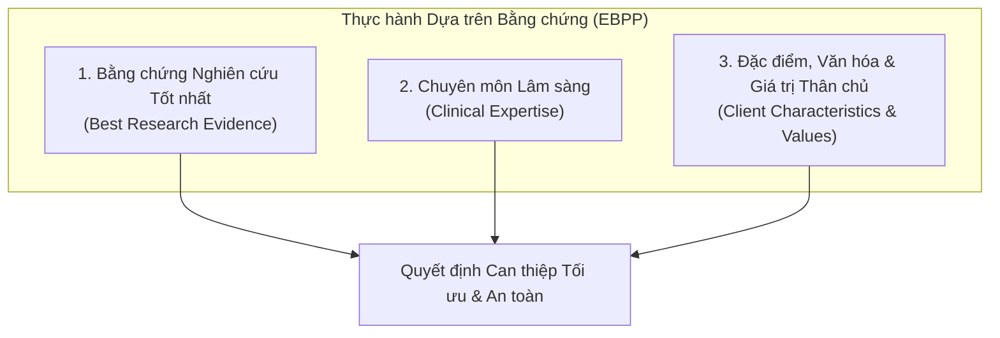
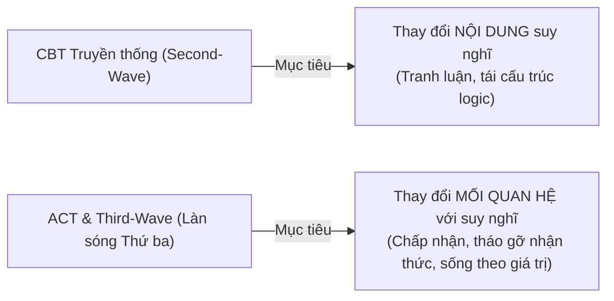

# Tuần 42 — Các Liệu pháp Tâm lý Dựa trên Bằng chứng & Điều hướng Hệ thống Sức khỏe Tâm thần

> [!CAUTION]
> **Tuyên bố miễn trách nhiệm lâm sàng:** Nội dung bài học này mang tính giáo dục học thuật và hướng dẫn điều hướng an toàn, không cấu thành dịch vụ trị liệu y tế hay lời khuyên tâm thần trực tiếp. Nếu bạn hoặc ai đó đang trải qua ý nghĩ tự sát, khủng hoảng tâm lý nghiêm trọng hoặc bạo lực gia đình, xin vui lòng liên hệ ngay dịch vụ y tế cấp cứu (115 tại Việt Nam), đến phòng khám chuyên khoa gần nhất, hoặc gọi các đường dây nóng hỗ trợ tâm lý khẩn cấp (như Đường dây nóng Ngày Mai: 096 306 1414).

---

**Chặng:** 5 — Phát triển Tâm lý và Sức khỏe Tâm thần  
**Tuần:** 42 / 48  
**Thời gian học mục tiêu:** 2–3 giờ (bài đọc sâu) + 30–45 phút học nhanh  
**Mức độ:** Trung cấp – Nâng cao  

---

## 1. Ý nghĩa & Bối cảnh Thực tế (Why It Matters)

Khi kết thúc Chặng 5 về Bệnh lý học và Sức khỏe Tâm thần, câu hỏi thực tế quan trọng nhất mà bất kỳ người học tâm lý học nào cũng phải đối mặt là: **Khi một người rơi vào đau khổ tâm lý, khoa học có thể giúp họ bằng cách nào? Làm thế nào để phân biệt một liệu pháp tâm lý chân chính dựa trên bằng chứng với những trò lừa đảo "chữa lành" giả khoa học (Pseudoscience)?**

Thị trường chăm sóc sức khỏe tinh thần hiện đại tràn ngập các dịch vụ tự xưng là "chữa lành", "thôi miên tiền kiếp", "giải mã năng lượng", "luân xa khai sáng" hay các khóa học khai vấn (coaching) không được kiểm chứng khoa học. Nhiều người đã chi trả những khoản tiền khổng lồ chỉ để đổi lấy sự suy giảm bệnh tình trầm trọng hơn, bị thao túng tâm lý hoặc đánh mất cơ hội vàng được can thiệp y khoa và trị liệu đúng lúc.

Bài học tuần này cung cấp bản đồ định hướng toàn diện về **Thực hành Dựa trên Bằng chứng trong Tâm lý học (Evidence-Based Practice in Psychology — EBPP)**. Chúng ta sẽ khám phá cơ chế vận hành của các trường phái can thiệp khoa học hàng đầu thế giới: từ Liệu pháp Hành vi Nhận thức (CBT) kinh điển của Aaron Beck đến các Liệu pháp Làn sóng Thứ ba (ACT, DBT) của Steven Hayes và Marsha Linehan; thấu hiểu sức mạnh của Liên minh Trị liệu (Therapeutic Alliance); và trang bị bộ kỹ năng điều hướng thực tế để phân biệt ranh giới chuyên môn giữa Bác sĩ Tâm thần, Chuyên gia Tâm lý Lâm sàng và Chuyên viên Tham vấn, đồng thời nhận diện các tín hiệu "cờ đỏ" nguy hiểm để bảo vệ bản thân và người thân.

---

## 2. Mục tiêu Học tập Đo lường được (Measurable Learning Objectives)

Sau khi hoàn thành bài học này, bạn sẽ có khả năng:

- **`[LO-W42-01]` [Hiểu / Nguyên lý]:** Giải thích định nghĩa Thực hành Dựa trên Bằng chứng trong Tâm lý học (EBPP theo APA, 2006) với mô hình ba trụ cột tích hợp; phân biệt rõ can thiệp khoa học với các liệu pháp giả khoa học (Pseudoscience).
- **`[LO-W42-02]` [Phân tích / So sánh]:** So sánh cơ chế can thiệp giữa Liệu pháp Hành vi Nhận thức truyền thống (CBT — Beck, 2011) và Các Liệu pháp Làn sóng Thứ ba (ACT & DBT — Hayes et al., 2006); phân biệt kỹ thuật Tái cấu trúc nhận thức (Cognitive Restructuring) với Tháo gỡ nhận thức (Cognitive Defusion).
- **`[LO-W42-03]` [Đánh giá / Bằng chứng]:** Đánh giá vai trò khoa học của Các Yếu tố Chung (Common Factors) và Liên minh Trị liệu (Therapeutic Alliance — Wampold & Imel, 2015; Norcross & Lambert, 2018) đối với kết quả can thiệp tâm lý.
- **`[LO-W42-04]` [Áp dụng / Điều hướng An toàn]:** Phân biệt ranh giới chức năng và thẩm quyền giữa Bác sĩ Tâm thần (Psychiatrist), Chuyên gia Tâm lý Lâm sàng (Clinical Psychologist) và Chuyên viên Tham vấn (Counselor); nhận diện các tín hiệu cảnh báo vi phạm đạo đức và áp dụng quy trình tìm kiếm hỗ trợ an toàn.

---

## 3. Học nhanh khi mệt (Fast-Track Core — 30–45 phút)

> [!TIP]
> Dành cho người học bận rộn muốn nắm vững bộ lọc an toàn và các nguyên lý can thiệp trước khi nghiên cứu sâu.

### Ba nguyên tắc cốt tử về can thiệp tâm lý học

1. **Ba Trụ Cột của EBPP:** Một trị liệu tâm lý có giá trị khoa học không chỉ dựa vào niềm tin của người làm trị liệu. Theo Hiệp hội Tâm lý học Hoa Kỳ (APA, 2006), EBPP đòi hỏi sự kết hợp hài hòa giữa: (1) Bằng chứng nghiên cứu thực nghiệm tốt nhất, (2) Chuyên môn lâm sàng của nhà trị liệu, và (3) Đặc điểm, bối cảnh văn hóa và giá trị sống của thân chủ.
2. **CBT vs. Làn sóng Thứ ba (ACT/DBT):** 
   - *CBT truyền thống:* Nhận thức định hình cảm xúc và hành vi; can thiệp bằng cách tìm kiếm bằng chứng thực tế và thay đổi **nội dung** suy nghĩ sai lệch (tái cấu trúc nhận thức).
   - *Làn sóng thứ ba (ACT):* Thay vì cố gắng xua đuổi hay tranh luận với suy nghĩ tiêu cực, thân chủ học cách thay đổi **mối quan hệ** với suy nghĩ thông qua chánh niệm, tháo gỡ nhận thức (defusion) và cam kết hành động theo giá trị sống.
3. **Bộ Ba Chuyên Khoa Y Tế Tâm Thần:**
   - *Bác sĩ Tâm thần (Psychiatrist):* Bác sĩ y khoa, chẩn đoán bệnh lý tâm thần và có quyền kê đơn thuốc.
   - *Chuyên gia Tâm lý Lâm sàng (Clinical Psychologist):* Bằng thạc sĩ/tiến sĩ tâm lý học lâm sàng, thực hiện đánh giá trắc nghiệm tâm lý và tiến hành trị liệu tâm lý chuyên sâu (psychotherapy).
   - *Chuyên viên Tham vấn (Counselor):* Hỗ trợ thân chủ giải quyết các khủng hoảng đời sống, định hướng nghề nghiệp và mối quan hệ; chuyển gửi khi gặp rối loạn tâm thần nặng.

---

## 4. Bài đọc sâu (Deep Dive — 2.000–3.500 từ)

### 4.1 Thực hành Dựa trên Bằng chứng trong Tâm lý học (EBPP) `[C42-01]`

Trong lịch sử tâm lý trị liệu, từng có giai đoạn các nhà thực hành áp dụng phương pháp can thiệp chỉ dựa trên trực giác cá nhân, uy tín của người thầy, hoặc các lý thuyết suy diễn phi thực nghiệm. Để bảo vệ an toàn cho thân chủ và xây dựng uy tín nghề nghiệp, Hiệp hội Tâm lý học Hoa Kỳ (APA, 2006) đã ban hành tuyên ngôn chính thức định nghĩa **Thực hành Dựa trên Bằng chứng trong Tâm lý học (Evidence-Based Practice in Psychology — EBPP)** `[C42-01]`.

EBPP được định nghĩa là **"sự tích hợp giữa bằng chứng nghiên cứu tốt nhất hiện có với chuyên môn lâm sàng trong bối cảnh các đặc điểm, văn hóa và sở thích của thân chủ"**. Mô hình này được biểu thị qua ba trụ cột tương hỗ:

- **Trụ cột 1 — Bằng chứng Nghiên cứu Thực nghiệm Tốt nhất (Best Research Evidence):** Dữ liệu thu được từ các thiết kế nghiên cứu khoa học có độ tin cậy cao, đặc biệt là các Thử nghiệm Lâm sàng Đối chứng Ngẫu nhiên (RCT - Randomized Controlled Trials) và các Phân tích Gộp (Meta-analyses), kiểm tra tính hiệu quả (efficacy) và tính hữu dụng thực địa (effectiveness).
- **Trụ cột 2 — Chuyên môn và Sự Nhạy bén Lâm sàng (Clinical Expertise):** Năng lực của nhà trị liệu trong việc đánh giá chính xác, xây dựng liên minh hợp tác, điều chỉnh kỹ thuật linh hoạt theo từng ca bệnh cụ thể và nhận biết khi nào phương pháp đang áp dụng không mang lại tiến triển.
- **Trụ cột 3 — Đặc điểm Cá nhân, Văn hóa và Giá trị của Thân chủ (Client Characteristics, Culture & Preferences):** Liệu pháp can thiệp phải tôn trọng thế giới quan, bản sắc tôn giáo, giá trị đạo đức và sự đồng thuận có hiểu biết của thân chủ; một kỹ thuật dù có bằng chứng tốt đến đâu cũng vô nghĩa nếu đi ngược lại giá trị sống của người tiếp nhận.

**Cảnh giác Giả khoa học (Pseudoscience):** Scott Lilienfeld và các cộng sự (2014) cảnh báo về các liệu pháp giả khoa học thường dùng thuật ngữ giật gân, viện dẫn giai thoại cá nhân (anecdotal evidence) thay vì dữ liệu thống kê, và không thể bị bác bỏ (unfalsifiable). EBPP là tấm khiên vững chắc nhất bảo vệ thân chủ khỏi các can thiệp độc hại này. 🟢 **[Mạnh]**

### 4.2 Liệu pháp Hành vi Nhận thức (CBT — Aaron Beck & Judith Beck) `[C42-02]`

Được phát triển bởi Bác sĩ Tâm thần Aaron T. Beck vào những năm 1960 và được hoàn thiện bởi Judith S. Beck (2011), **Liệu pháp Hành vi Nhận thức (Cognitive Behavior Therapy — CBT)** là một trong những trường phái tâm lý trị liệu được nghiên cứu sâu rộng và có khối lượng bằng chứng thực nghiệm đồ sộ nhất hiện nay (Hofmann et al., 2012) `[C42-02]`.

#### Mô hình Nhận thức Cốt lõi (The Cognitive Model)
CBT vận hành trên nguyên lý nền tảng: **Không phải bản thân sự kiện bên ngoài quyết định cảm xúc và hành vi của con người, mà chính cách chúng ta diễn giải và gán ý nghĩa cho sự kiện đó mới định hình phản ứng của chúng ta.**

Cấu trúc nhận thức bao gồm ba tầng bậc:
1. **Suy nghĩ Tự động (Automatic Thoughts):** Những dòng suy nghĩ hoặc hình ảnh xuất hiện chớp nhoáng, tự phát trong tâm trí khi một sự kiện xảy ra; chúng thường mang tính phán xét và thiên lệch khi thân chủ đang bị lo âu hay trầm cảm.
2. **Niềm tin Trung gian (Intermediate Beliefs):** Các quy tắc ngầm, giả định và thái độ sống (ví dụ: *"Nếu tôi không làm hoàn hảo mọi thứ, tôi là kẻ thất bại"*).
3. **Niềm tin Cốt lõi (Core Beliefs / Schemas):** Những giả định sâu xa nhất, cứng nhắc nhất về bản thân, thế giới và tương lai hình thành từ thời thơ ấu (ví dụ: *"Tôi bất tài"*, *"Thế giới đầy hiểm nguy"*).

#### Kỹ thuật Can thiệp Trọng tâm của CBT
- **Ghi chép Suy nghĩ (Thought Records):** Hướng dẫn thân chủ nhận diện tình huống kích hoạt, cảm xúc đi kèm và bắt giữ các suy nghĩ tự động tiêu cực.
- **Tái cấu trúc Nhận thức (Cognitive Restructuring):** Sử dụng kỹ thuật Hỏi gợi ý kiểu Socrates (Socratic Questioning) để kiểm tra bằng chứng ủng hộ và bằng chứng phản bác suy nghĩ đó; phát triển suy nghĩ thay thế cân bằng và thực tế hơn.
- **Thử nghiệm Hành vi (Behavioral Experiments):** Thân chủ chủ động tiến hành các hành động ngoài đời thực để kiểm chứng xem niềm tin tiêu cực có thực sự diễn ra hay không.
- **Kích hoạt Hành vi (Behavioral Activation):** Lên lịch các hoạt động tạo cảm giác làm chủ (mastery) và niềm vui (pleasure) để phá vỡ vòng luẩn quẩn rút lui và thụ động của trầm cảm.

### 4.3 Các Liệu pháp Làn sóng Thứ ba: ACT & DBT `[C42-03]`

Trong khi CBT truyền thống (làn sóng thứ hai) tập trung vào việc tranh luận, kiểm tra bằng chứng và thay đổi *nội dung* của suy nghĩ, thì **Các Liệu pháp Làn sóng Thứ ba (Third-Wave Therapies)** — tiêu biểu là Liệu pháp Chấp nhận và Cam kết (Acceptance and Commitment Therapy — ACT của Steven C. Hayes et al., 2006) và DBT của Marsha Linehan — mang lại một bước chuyển dịch mô hình căn bản `[C42-03]`:

#### Liệu pháp Chấp nhận và Cam kết (ACT) & Tính Linh hoạt Tâm lý
ACT định nghĩa mục tiêu trị liệu không phải là "loại bỏ sạch cơn đau đớn cảm xúc", mà là phát triển **Tính linh hoạt Tâm lý (Psychological Flexibility)** — khả năng hiện diện trọn vẹn trong khoảnh khắc hiện tại, cởi mở đón nhận trải nghiệm nội tâm (kể cả cảm xúc tiêu cực) và hành động nhất quán theo các giá trị sống có ý nghĩa.

Mô hình Lục giác Linh hoạt (Hexaflex) của ACT vận hành qua 6 tiến trình cốt lõi:
1. **Chấp nhận (Acceptance):** Chủ động đón nhận những cảm xúc khó chịu mà không cố gắng đè nén, né tránh hay kiểm soát chúng một cách tuyệt vọng.
2. **Tháo gỡ Nhận thức (Cognitive Defusion):** Nhìn nhận suy nghĩ chỉ là những ngôn từ, âm thanh và sự kiện tâm trí thoáng qua, thay vì đồng nhất hóa bản thân với suy nghĩ hay coi suy nghĩ là "sự thật tuyệt đối" (Thought-action fusion). Ví dụ: chuyển từ *"Tôi là kẻ thất bại"* sang *"Tôi đang nhận thấy một suy nghĩ rằng mình là kẻ thất bại"*.
3. **Tiếp xúc với Hiện tại (Contact with the Present Moment):** Rèn luyện chánh niệm (Mindfulness), neo giữ sự chú ý vào thực tại ở đây và bây giờ.
4. **Bản ngã như Ngữ cảnh (Self-as-Context):** Trải nghiệm bản thân là "bầu trời quan sát", nơi các đám mây cảm xúc và suy nghĩ trôi qua mà không làm thay đổi bản chất bao la của bầu trời.
5. **Giá trị Sống (Values):** Xác định rõ điều gì thực sự có ý nghĩa và quan trọng sâu sắc nhất đối với cá nhân trong cuộc đời (ví dụ: sự tử tế, lòng dũng cảm, học hỏi).
6. **Hành động Cam kết (Committed Action):** Thiết lập mục tiêu cụ thể và kiên trì hành động hướng tới giá trị sống đã chọn, bất kể sự hiện diện của những lo âu hay sợ hãi.

### 4.4 Các Yếu tố Chung và Liên minh Trị liệu (Common Factors & Therapeutic Alliance) `[C42-04]`

Một trong những tranh luận học thuật sâu sắc nhất trong tâm lý học lâm sàng là: **Yếu tố nào thực sự quyết định sự thành công của một ca trị liệu tâm lý? Kỹ thuật đặc thù của từng trường phái hay mối quan hệ con người giữa nhà trị liệu và thân chủ?**

Nhà nghiên cứu Bruce Wampold (2015) và John Norcross (Norcross & Lambert, 2018) đã thực hiện hàng loạt phân tích gộp đồ sộ để kiểm tra Giả thuyết Phán quyết Chim Dodo (Dodo Bird Verdict — ý niệm cho rằng các trường phái trị liệu chính thống đều mang lại kết quả thuyên giảm tương đương nhau) `[C42-04]`. 

Kết quả thực nghiệm chứng minh rằng:
- Sự khác biệt về mặt kỹ thuật giữa các trường phái trị liệu chính thống (như CBT, Tâm động học, Nhân văn, ACT) chỉ giải thích một tỷ lệ rất nhỏ (khoảng 1–5%) sự biến thiên kết quả điều trị.
- Ngược lại, **Các Yếu tố Chung (Common Factors)** — đặc biệt là **Liên minh Trị liệu (Therapeutic Alliance)** — đóng góp tới hơn 30–40% vào sự thành công của can thiệp.

**Liên minh Trị liệu (Therapeutic Alliance)** được Edward Bordin định nghĩa gồm ba thành tố gắn kết mật thiết:
1. **Mối liên kết tình cảm (Bond):** Sự tin cậy lẫn nhau, thái độ thấu cảm chân thành và sự tôn trọng không điều kiện giữa thân chủ và nhà trị liệu.
2. **Đồng thuận về Mục tiêu (Goals):** Cả hai bên cùng thống nhất rõ ràng về những gì cần đạt được trong quá trình can thiệp.
3. **Đồng thuận về Nhiệm vụ (Tasks):** Cả hai bên cùng nhất trí về các bước thực hiện, bài tập hoặc phương pháp sẽ tiến hành trong các buổi làm việc.

> [!IMPORTANT]
> Kỹ thuật trị liệu là cần thiết để tạo ra cấu trúc định hướng, nhưng chính mối quan hệ hợp tác nhân văn, ấm áp và an toàn mới là cái nôi nuôi dưỡng sự biến đổi tâm lý kỳ diệu của con người.

### 4.5 Điều hướng Hệ thống Sức khỏe Tâm thần: Vai trò & Ranh giới An toàn `[C42-05]`

Để trở thành một người tiêu dùng thông thái hoặc người học có trách nhiệm, chúng ta cần phân biệt rạch ròi ba vai trò chuyên môn y tế - tâm lý chính theo chuẩn mực quốc tế (APA, 2017; Corey et al., 2019) `[C42-05]`:

| Tiêu chí | Bác sĩ Tâm thần (Psychiatrist) | Chuyên gia Tâm lý Lâm sàng (Clinical Psychologist) | Chuyên viên Tham vấn (Counselor) |
|:---|:---|:---|:---|
| **Bằng cấp Đào tạo** | Bác sĩ Y khoa (MD/DO) + Bác sĩ Nội trú Chuyên khoa Tâm thần. | Thạc sĩ (MS/MA) hoặc Tiến sĩ (PhD/PsyD) về Tâm lý học Lâm sàng. | Thạc sĩ Tham vấn Tâm lý (MA/MS Counseling, LPC, LMFT). |
| **Thẩm quyền Y tế** | Chẩn đoán y khoa, thực hiện xét nghiệm cận lâm sàng và **KÊ ĐƠN THUỐC**. | Thực hiện trắc nghiệm tâm lý chuẩn hóa; **TIẾN HÀNH TRỊ LIỆU TÂM LÝ** chuyên sâu. | Thực hiện tham vấn cá nhân, gia đình; hỗ trợ giải quyết khó khăn đời sống. |
| **Đối tượng Trọng tâm** | Rối loạn tâm thần nặng, loạn thần, hưng cảm, trầm cảm kháng trị cần hóa dược. | Rối loạn lo âu, trầm cảm, chấn thương PTSD, rối loạn nhân cách, ám ảnh cưỡng chế. | Căng thẳng hôn nhân, định hướng nghề nghiệp, xung đột gia đình, mất mát tang chế. |
| **Quyền kê đơn thuốc** | **CÓ** (Bác sĩ y khoa hợp pháp). | **KHÔNG** (Trừ một số bang/quốc gia có chứng chỉ đào tạo y dược bổ sung rất hạn chế). | **KHÔNG**. |

#### Tín hiệu "Cờ Đỏ" (Red Flags) Cảnh báo Vi phạm Đạo đức Nghề nghiệp
Khi tìm kiếm dịch vụ tâm lý, người học cần lập tức dừng lại và cảnh giác cao độ nếu gặp các dấu hiệu sau:
1. **Cam kết chữa khỏi 100% trong thời gian thần tốc:** Khoa học tâm lý không bao giờ đảm bảo khỏi bệnh thần tốc; những lời quảng cáo "chữa lành dứt điểm trầm cảm sau 3 ngày" đều là lừa đảo.
2. **Xâm phạm ranh giới cá nhân (Dual Relationships):** Nhà trị liệu gợi ý quan hệ tình cảm, rủ đi chơi riêng, vay mượn tiền bạc hoặc kinh doanh chung với thân chủ.
3. **Phán xét đạo đức và áp đặt quan điểm:** Đổ lỗi cho nạn nhân (ví dụ: *"Bạn bị trầm cảm vì bạn thiếu lòng biết ơn / nghiệp chướng quá khứ"*).
4. **Giả danh bác sĩ kê đơn thuốc trái phép:** Người không có bằng bác sĩ y khoa nhưng tự ý kê đơn thuốc tâm thần hoặc thực phẩm chức năng không rõ nguồn gốc.
5. **Cố tình cô lập thân chủ:** Yêu cầu thân chủ cắt đứt liên lạc hoàn toàn với gia đình và bạn bè để chỉ phụ thuộc vào một mình nhà trị liệu.

---

## 5. Nghiên cứu & Mô hình Tiêu biểu (Key Studies & Theoretical Models)

### 5.1 APA Task Force (2006) — Tuyên ngôn Chính thức về EBPP `[C42-01]`
Báo cáo của Nhóm Đặc nhiệm Tổng thống APA về Thực hành Dựa trên Bằng chứng đã thiết lập định nghĩa nền tảng cho tâm lý học thế kỷ 21. Báo cáo khẳng định EBPP không phải là một danh sách các công thức đóng gói cứng nhắc (manuals), mà là một quy trình ra quyết định lâm sàng năng động, tôn trọng cá tính và quyền tự quyết của thân chủ.

### 5.2 Hofmann et al. (2012) — Phân tích Gộp Toàn diện về Hiệu quả của CBT `[C42-02]`
Nghiên cứu công bố trên *Cognitive Therapy and Research* đã tổng hợp 269 phân tích gộp (meta-analyses) về CBT trên hàng chục ngàn bệnh nhân. Kết quả khẳng định CBT có hiệu quả điều trị vượt trội hoặc tương đương thuốc đối với hầu hết các rối loạn lo âu, trầm cảm, rối loạn hoảng sợ và rối loạn ăn uống, với tỷ lệ tái phát thấp hơn đáng kể sau khi kết thúc trị liệu.

### 5.3 Hayes, Luoma, Bond, Masuda, & Lillis (2006) — Mô hình ACT & Psychological Flexibility `[C42-03]`
Công trình cột mốc trên tạp chí *Behaviour Research and Therapy* giới thiệu mô hình Lục giác Linh hoạt (Hexaflex). Nghiên cứu thực nghiệm chứng minh rằng việc cố gắng đè nén suy nghĩ tiêu cực thường tạo ra "hiệu ứng nghịch lý" (paradoxical rebound effect) làm tăng cường độ đau khổ, trong khi sự tháo gỡ nhận thức và chấp nhận mang lại sự cải thiện tâm lý bền vững.

### 5.4 Wampold & Imel (2015); Norcross & Lambert (2018) — Sức mạnh của Liên minh Trị liệu `[C42-04]`
Cuốn sách *The Great Psychotherapy Debate* của Wampold và các nghiên cứu của Norcross chứng minh vai trò quyết định của Liên minh Trị liệu (Therapeutic Alliance). Dữ liệu chỉ ra rằng thân chủ cảm nhận được sự thấu cảm, an toàn và đồng thuận mục tiêu với nhà trị liệu là nhân tố dự báo kết quả can thiệp mạnh mẽ nhất trên toàn bộ các trường phái tâm lý học.

---

## 6. Biết được gì / Chưa thể kết luận gì (What We Know vs. What Remains Uncertain)

### Những điều khoa học đã chứng minh vững chắc 🟢
- Tâm lý trị liệu (đặc biệt là CBT, ACT, DBT) có hiệu quả thực tế rõ rệt trong việc cải thiện sức khỏe tâm thần và làm biến đổi tích cực cấu trúc hoạt động não bộ (neuroplasticity).
- Liên minh trị liệu bền vững là nền tảng cốt tử cho mọi thành công can thiệp; không một kỹ thuật nào có thể bù đắp cho sự thiếu hụt thấu cảm và tin cậy giữa con người với con người.
- Kết hợp giữa trị liệu tâm lý và điều trị hóa dược tâm thần (khi cần thiết) mang lại hiệu quả tối ưu cho các giai đoạn trầm cảm nặng, rối loạn lưỡng cực và tâm thần phân liệt.

### Những điều khoa học chưa thể kết luận dứt khoát 🟡
- Vẫn chưa thể xác định chính xác 100% liệu một thân chủ cụ thể với hồ sơ gen và tiểu sử riêng biệt sẽ đáp ứng tốt nhất với trường phái trị liệu nào ngay từ đầu (vấn đề cá nhân hóa can thiệp - precision psychotherapy).
- Hiệu quả dài hạn của các ứng dụng can thiệp tâm lý trực tuyến (digital mental health / AI chatbot therapy) so với trị liệu trực tiếp giữa người với người vẫn đang trong quá trình thu thập dữ liệu kiểm chứng.

---

## 7. Hiểu lầm phổ biến & Phản biện Pop Psychology (Common Myths & Pop Psych Debunked)

### Hiểu lầm 1: "Chỉ cần tư duy tích cực và thôi miên năng lượng là có thể chữa khỏi mọi bệnh tâm thần"
- **Sự thật khoa học:** Đây là biểu hiện của "sự tích cực độc hại" (toxic positivity) và giả khoa học. Việc ép buộc suy nghĩ tích cực khi não bộ đang thiếu hụt chất dẫn truyền thần kinh hoặc chấn thương tâm lý sâu sắc chỉ làm thân chủ thêm tội lỗi và tuyệt vọng. Trị liệu thực chứng đòi hỏi sự dũng cảm đối diện, tháo gỡ niềm tin và thay đổi hành vi thực tế.

### Hiểu lầm 2: "Đi gặp bác sĩ tâm thần hoặc nhà tâm lý học là bằng chứng của sự yếu đuối và điên rồ"
- **Sự thật khoa học:** Tìm kiếm sự trợ giúp chuyên môn là biểu hiện của lòng dũng cảm và trí tuệ nhận thức. Tương tự như việc gãy xương cần bác sĩ bó bột, một hệ thần kinh bị tổn thương hoặc kiệt quệ cảm xúc hoàn toàn xứng đáng được hỗ trợ bởi các chuyên gia y tế và tâm lý học có đào tạo bài bản.

### Hiểu lầm 3: "Uống thuốc tâm thần sẽ làm hỏng não và gây nghiện suốt đời"
- **Sự thật khoa học:** Các thuốc tâm thần hiện đại (như SSRI/SNRI, chất ổn định khí sắc) được nghiên cứu kỹ lưỡng để điều hòa sinh hóa não bộ và không gây nghiện như ma túy. Khi được theo dõi bởi bác sĩ tâm thần có chuyên môn, thuốc là cứu cánh sinh mạng giúp ổn định các cơn khủng hoảng để thân chủ có thể tiếp nhận trị liệu tâm lý.

---

## 8. Ôn tập Ngắn Giữa tuần (Mid-Week Mini-Reviews)

1. **Ba trụ cột EBPP:** Hãy tự vẽ lại và giải thích ba thành tố cấu thành Thực hành Dựa trên Bằng chứng trong Tâm lý học theo APA (2006).
2. **So sánh cơ chế:** Phân biệt sự khác nhau giữa kỹ thuật *Tái cấu trúc nhận thức* trong CBT và *Tháo gỡ nhận thức (Defusion)* trong ACT qua một ví dụ cụ thể.
3. **Phân định vai trò:** Một người bạn của bạn đang có triệu chứng mất ngủ kéo dài, nghe thấy tiếng nói vô hình trong đầu và nghi ngờ hàng xóm hãm hại. Bạn nên khuyên người bạn đó đến gặp chuyên gia nào đầu tiên: Bác sĩ Tâm thần hay Chuyên viên Tham vấn? Giải thích lý do.

---

## 9. Bài tập Tình huống Ứng dụng & Reflection Tự nguyện (Case Study & Voluntary Journal)

### Tình huống điều hướng thực tế
Hải (28 tuổi) bị căng thẳng kéo dài trong công việc dẫn đến mất ngủ, tim đập nhanh và cảm giác tuyệt vọng. Một người quen giới thiệu Hải đến một "bậc thầy tâm linh chữa lành". Bậc thầy này yêu cầu Hải nộp 20 triệu đồng cho khóa học 3 ngày, khẳng định rằng bệnh của Hải là do "nghiệp duyên kiếp trước", cấm Hải đi khám bác sĩ tây y, và yêu cầu Hải phải chia sẻ toàn bộ mật khẩu mạng xã hội để "thanh tẩy năng lượng".

**Câu hỏi phân tích:**
1. Hãy liệt kê ít nhất 3 "cờ đỏ" (red flags) vi phạm nghiêm trọng đạo đức và tiêu chuẩn an toàn trong tình huống của Hải.
2. Dưới góc độ EBPP, quy trình tìm kiếm hỗ trợ đúng đắn và an toàn nhất cho Hải nên diễn ra như thế nào?
3. Nếu bạn là người thân của Hải, bạn sẽ cung cấp những thông tin khoa học nào để giúp Hải bảo vệ bản thân?

---

## 10. Bảng Thuật ngữ Tuần (Weekly Glossary — 8–15 thuật ngữ)

| Thuật ngữ Tiếng Anh | Thuật ngữ Tiếng Việt | Định nghĩa Khoa học vắn tắt |
|:---|:---|:---|
| **EBPP** | Thực hành Dựa trên Bằng chứng | Sự tích hợp giữa bằng chứng nghiên cứu tốt nhất, chuyên môn lâm sàng và đặc điểm thân chủ. |
| **Cognitive Behavior Therapy (CBT)** | Liệu pháp Hành vi Nhận thức | Liệu pháp can thiệp thông qua việc tái cấu trúc suy nghĩ sai lệch và kích hoạt hành vi thích ứng. |
| **Automatic Thoughts** | Suy nghĩ Tự động | Những suy nghĩ tự phát, chớp nhoáng xuất hiện khi gặp sự kiện kích hoạt, định hình cảm xúc. |
| **Cognitive Restructuring** | Tái cấu trúc Nhận thức | Kỹ thuật kiểm tra bằng chứng thực tế và thay đổi các suy nghĩ tiêu cực thiếu cân bằng. |
| **Acceptance and Commitment Therapy (ACT)** | Liệu pháp Chấp nhận & Cam kết | Liệu pháp làn sóng thứ ba phát triển tính linh hoạt tâm lý thông qua chấp nhận và sống theo giá trị. |
| **Cognitive Defusion** | Tháo gỡ Nhận thức | Kỹ thuật nhìn nhận suy nghĩ chỉ là ngôn từ/sự kiện tâm trí thoáng qua, tách rời khỏi danh tính. |
| **Psychological Flexibility** | Tính Linh hoạt Tâm lý | Năng lực hiện diện trong hiện tại, cởi mở với cảm xúc và cam kết hành động theo giá trị sống. |
| **Common Factors** | Các Yếu tố Chung | Các thành tố hiệu quả chung của mọi liệu pháp tâm lý (liên minh, sự thấu cảm, kỳ vọng tích cực). |
| **Therapeutic Alliance** | Liên minh Trị liệu | Mối quan hệ hợp tác tin cậy, thấu cảm và đồng thuận về mục tiêu/nhiệm vụ giữa thân chủ và nhà trị liệu. |
| **Psychiatrist** | Bác sĩ Tâm thần | Bác sĩ y khoa chuyên chẩn đoán, điều trị bệnh tâm thần và có thẩm quyền kê đơn thuốc. |
| **Clinical Psychologist** | Chuyên gia Tâm lý Lâm sàng | Chuyên gia đánh giá trắc nghiệm tâm lý và thực hiện các liệu pháp tâm lý chuyên sâu. |
| **Pseudoscience** | Giả khoa học | Các niềm tin hoặc thực hành tự nhận là khoa học nhưng không có bằng chứng thực nghiệm kiểm chứng. |

---

## 11. Danh mục Tài liệu Tham khảo (Verified References — APA 7th)

1. American Psychological Association. (2017). *Ethical principles of psychologists and code of conduct* (with 2016 amendments). https://www.apa.org/ethics/code
2. APA Presidential Task Force on Evidence-Based Practice. (2006). Evidence-based practice in psychology. *American Psychologist*, 61(4), 271–285. https://doi.org/10.1037/0003-066X.61.4.271
3. Beck, J. S. (2011). *Cognitive behavior therapy: Basics and beyond* (2nd ed.). Guilford Press.
4. Corey, G., Corey, M. S., & Corey, C. (2019). *Issues and ethics in the helping professions* (10th ed.). Cengage Learning.
5. Hayes, S. C., Luoma, J. B., Bond, F. W., Masuda, A., & Lillis, J. (2006). Acceptance and commitment therapy: Model, processes and outcomes. *Behaviour Research and Therapy*, 44(1), 1–25. https://doi.org/10.1016/j.brat.2005.06.006
6. Hofmann, S. G., Asnaani, A., Vonk, I. J., Sawyer, A. T., & Fang, A. (2012). The efficacy of cognitive behavioral therapy: A review of meta-analyses. *Cognitive Therapy and Research*, 36(5), 427–440. https://doi.org/10.1007/s10608-012-9476-1
7. Lilienfeld, S. O., Lynn, S. J., & Lohr, J. M. (Eds.). (2014). *Science and pseudoscience in clinical psychology* (2nd ed.). Guilford Press.
8. Norcross, J. C., & Lambert, M. J. (2018). Psychotherapy relationships that work III. *Psychotherapy*, 55(4), 303–315. https://doi.org/10.1037/pst0000193
9. Wampold, B. E., & Imel, Z. E. (2015). *The great psychotherapy debate: The evidence for what makes psychotherapy work* (2nd ed.). Routledge. https://doi.org/10.4324/9780203582015

---

## 12. Đánh giá Cuối tuần & Bước tiếp theo (Weekly Quiz & Next Steps)

- **Bài kiểm tra trắc nghiệm:** Hoàn thành bài trắc nghiệm 12 câu tại `assessments/quizzes/week-42-quiz.md` và kiểm tra đối chiếu lời giải tại `assessments/answer-keys/week-42-answers.md`.
- **Thẻ ôn tập Flashcards:** Luyện tập 8 thẻ flashcards tại `flashcards/week-42.yaml` để củng cố thuật ngữ và nguyên tắc an toàn nghề nghiệp.
- **Tổng kết Chặng 5:** Chúc mừng bạn đã hoàn thành xuất sắc Chặng 5 (Phát triển Tâm lý & Sức khỏe Tâm thần - W35 đến W42)! Bạn đã nắm vững các quy luật phát triển trọn đời, cơ chế ứng phó stress, hạnh phúc học, các rối loạn tâm thần kinh điển và các liệu pháp khoa học. Hãy sẵn sàng bước vào Chặng 6 — *Tâm lý học Ứng dụng & Hành vi Xã hội* (W43–W48).
